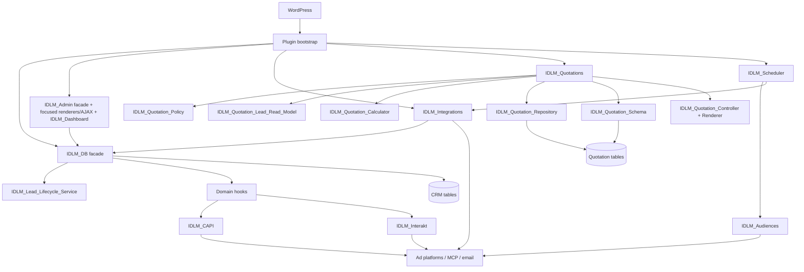
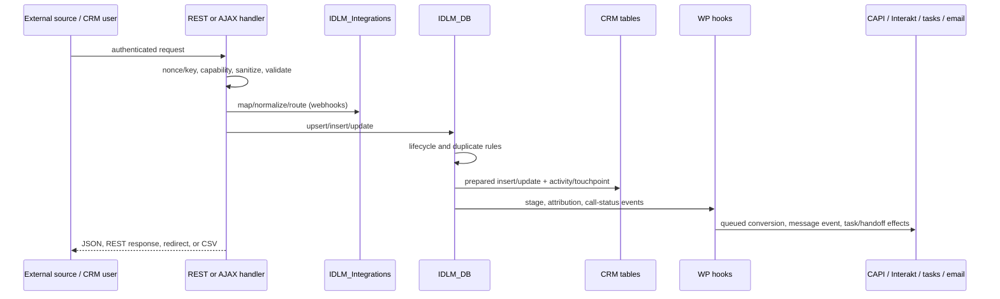

# Architecture

## Overview

Interior Design Lead Manager is a WordPress-native, custom-table CRM. It uses a procedural bootstrap and static service classes, direct `$wpdb` persistence, WordPress options for configuration, authenticated admin-AJAX for the interactive UI, and REST endpoints for external systems. There is no container, autoloader, ORM, or build system; a minimal guarded template layer handles extracted reusable views.



## Bootstrap and initialization

`interior-design-lead-manager.php` defines release/schema constants, requires every class in a fixed order, and registers activation/deactivation. Activation creates the core and quotation tables, stores schema state, schedules jobs, and installs CRM roles/capabilities. On `plugins_loaded`, role capabilities are reconciled and—except on `wp-login.php`—telemetry, schema checks, integrations, CAPI, Interakt, scheduler, admin UI, and quotations initialize.

The fixed include order is a hidden dependency: classes call each other statically without constructor injection. Most calls are safe after boot, but activation explicitly depends on the required files already being loaded.

## Major boundaries

- **Domain/data:** `IDLM_DB` is the compatibility facade for schema, task, and audit APIs; `IDLM_Lead_Lifecycle_Service` owns lead insert/upsert/update transitions. `IDLM_Lead_Deletion_Service` owns transactional cleanup and orphan audit/repair. The database has no declared foreign keys; integrity is application-managed.
- **Presentation/controllers:** `IDLM_Admin` is the thin compatibility facade for registrations, menus, and public callbacks. `IDLM_Admin_Assets` owns shared asset registration/context enqueueing; `IDLM_Admin_Shortcodes` owns frontend shortcode/workspace orchestration; `IDLM_Admin_Account_Controller` owns account presentation/update coordination; `IDLM_Admin_Users_Controller` owns administrator-only CRM user creation, managed-role changes, access suspension, password-reset initiation, and administrator safeguards. `IDLM_Admin_Presenter` and `IDLM_Admin_Lead_Notifications` own display formatting and WhatsApp/reminder presentation support. Focused page renderers own context/query coordination. `IDLM_Admin_Ajax` remains the authenticated AJAX compatibility coordinator, while `IDLM_Admin_Lead_Reads` owns the extracted lead-detail read and drawer response behind both established delegate layers. `IDLM_Cursor_Pagination` signs user/filter-bound keyset positions used by the default manager lead queue while legacy page/offset requests remain compatible. `IDLM_Dashboard_Read_Model` scopes and caches the aggregate queries built by `IDLM_Dashboard`; `IDLM_Read_Model_Cache` provides generation invalidation, object-cache/transient storage, and rebuild locking. `IDLM_Lead_Access_Policy` centralizes representative roles plus ownership/visibility decisions.
- **Settings/views:** `IDLM_Admin_Settings_Controller` owns authenticated CRM/integration settings POST persistence, and `IDLM_Admin_Settings_Renderer` owns settings context/environment reads plus ten guarded section templates behind the established `IDLM_Admin` callback. `IDLM_Settings` provides grouped non-secret routing reads with mirrored legacy options. `IDLM_View` includes guarded root or nested plugin templates with a single context array; templates remain responsible for context-specific escaping.
- **Quotations:** `IDLM_Quotations` remains the compatibility facade. `IDLM_Quotation_Controller` owns request/transaction handlers; `IDLM_Quotation_Renderer` owns escaped views and semantic server-rendered print output; policy, lead read model, calculator, schema, and repository classes own their established boundaries.
- **Integration:** `IDLM_Integrations` accepts inbound leads, captures browser attribution, exports authenticated Google feeds, exposes MCP, routes assignments, and sends routing/handoff email. `IDLM_CAPI`, `IDLM_Audiences`, and `IDLM_Interakt` perform platform-specific outbound calls.
- **Scheduling/diagnostics:** `IDLM_Scheduler` selects Action Scheduler when available and otherwise WP-Cron. `IDLM_Telemetry` installs PHP error/exception handlers and persists diagnostic events. `IDLM_Operational_Health` provides aggregate schema/database/scheduler/retention/credential/storage/cache/queue/fault checks with initial warning/critical thresholds. `IDLM_Horizontal_Readiness` provides an aggregate-only administrator preflight for shared database/media/configuration declarations, persistent cache, Action Scheduler, controlled cron, and node-local export assumptions.

## Lead data flow



`IDLM_DB::update_lead()` is the central transition boundary. It reconciles quality/stage, qualification/disqualification metadata, handoff state, timing metrics, tasks, activity entries, and downstream hooks. Any direct update to `wp_idlm_leads` must be reviewed for bypassed behavior.

## Admin and frontend architecture

The frontend `[idlm_workspace]` is the single CRM interface. The same compatibility callbacks power `[idlm_dashboard]`, `[idlm_leads_list]`, `[idlm_kanban]`, and the composite workspace; `IDLM_Admin_Shortcodes` coordinates these callbacks, and page methods delegate to focused renderers and guarded `templates/admin/` views. `[idlm_quotations]` delegates to the quotation module. WordPress Admin retains only an administrator utility page with plugin/version and shortcode setup information; legacy CRM admin URLs redirect to the capability-matched workspace section when a published workspace page exists. Shortcodes require logged-in CRM/quote capabilities; admin-only sections remain gated by `manage_options`. `IDLM_Admin_Assets` preserves the shared handles and context-specific module sets used by both shortcodes and quotations.

`assets/js/admin-app.js` is the shared AJAX client and modal/task implementation; it keeps page-entry cursors for sequential lead-list navigation and retains offset-compatible page requests where the server does not issue a cursor. Dashboard, Kanban, quotation, and workspace scripts add module behavior. `wp_localize_script()` exposes only the AJAX URL, shared admin nonce, and call-status vocabulary. CSS follows the same shared-plus-module model.

## REST, AJAX, and integration architecture

All AJAX actions are authenticated (`wp_ajax_` only) and use WordPress login cookies plus a nonce. Handlers then apply broad CRM, manager, administrator, quotation, and object-level checks. See [INTERFACES.md](INTERFACES.md).

The lead webhook, Google feed, and MCP routes use route-specific permission callbacks with encrypted/environment-backed scoped credentials, header-only constant-time checks, and per-IP rate limits; handlers retain defense-in-depth authentication checks. A high-priority `rest_authentication_errors` filter still bypasses site-wide REST authentication errors for those integration paths so external credentials can be evaluated independently of cookie authentication. Interakt and Meta callbacks use verification-token or HMAC checks appropriate to their external contracts.

Outbound integrations use `wp_remote_post()` for Meta, Google Measurement Protocol, LinkedIn, and Interakt. Google audience sync itself is feed-based/stubbed rather than an upload API; LinkedIn and Meta audience sync post hashed lead identifiers. Notifications use `wp_mail()`.

## Test architecture

`tests/run.php` is the fast dependency-free behavioral suite and uses the WordPress/$wpdb doubles in `tests/bootstrap.php`. `tests/integration/run.php` boots real WordPress core against a newly created `idlm_test_*` MySQL database, while isolated workers exercise redirecting quotation saves and concurrent number reservations. GitHub Actions runs both suites across PHP 7.4/8.1/8.4 and WordPress 6.6/latest.

`tests/performance/` contains deterministic PII-free dataset generation, aggregate environment/query-plan capture, and the Phase 8 authenticated read-only HTTP runner. Load execution is an opt-in non-production operation; it reuses existing WordPress cookies/nonces and action contracts and emits aggregate evidence only. The required resilience matrix and remaining evidence are tracked in [LOAD-RESILIENCE-QUALIFICATION.md](LOAD-RESILIENCE-QUALIFICATION.md).

`tests/release/` contains the Phase 9 release-artifact boundary. It inventories files through `.distignore`, aligns version authorities, rejects development/private material and high-confidence credential signatures, verifies a single plugin-directory ZIP, and emits exact-revision, CI-attestation, and SHA-256 evidence. Dirty local output is rehearsal-only; the CI candidate job waits for the complete test matrix. See [PRODUCTION-RELEASE.md](PRODUCTION-RELEASE.md).

The admin facade refactor reached its verified release boundary in version 1.98.1: all 75 compatibility methods remain callable, `includes/class-admin.php` is 432 lines, and the automated plus live route/viewport/interaction evidence is recorded in [ADMIN-REFACTOR-VERIFICATION.md](ADMIN-REFACTOR-VERIFICATION.md).

## Scheduling

Daily audience sync and telemetry pruning run around 02:00; sensitive-data retention runs daily. Hourly assignment fallback also rolls forward pre-sales tasks. Action Scheduler hooks (`idlm_daily_audience_sync`, `idlm_hourly_assignment_fallback`) are used when its API exists; otherwise `_cron` WP-Cron hooks are scheduled. CAPI and Interakt events use asynchronous single actions/events. Assignment fallback uses a database advisory lock, and round-robin counters use atomic `idlm_routing_state` rows.

Horizontal deployment requirements, declarations, current runtime-write inventory, and qualification order are recorded in [HORIZONTAL-DEPLOYMENT.md](HORIZONTAL-DEPLOYMENT.md). The readiness report does not provision infrastructure and must be followed by the Phase 8 two-node resilience suite.

## Recommended future structure

Production hardening, measured query/cache work, bounded background processing, hotspot extraction, and multi-node requirements are sequenced in [PRODUCTION-SCALABILITY-PLAN.md](PRODUCTION-SCALABILITY-PLAN.md). That plan is the implementation authority for scalability work; the structure below remains a gradual direction rather than permission for a wholesale rewrite.

The present structure is WordPress-compatible but class boundaries no longer match responsibilities. A gradual, compatibility-preserving target is:

```text
src/
  Admin/          menu and page controllers
  Frontend/       shortcode controllers
  Domain/         lead, qualification, routing, quotation services
  Database/       schema, repositories, migrations
  Rest/           route registration and request controllers
  Integrations/   Meta, Google, LinkedIn, Interakt, MCP
  Support/        capabilities, formatting, telemetry
templates/        escaped PHP views
assets/           source/static client assets
docs/
tests/
```

Introduce this one seam at a time behind existing class methods, hooks, route names, and shortcodes. Do not perform a wholesale namespace/autoload migration without a compatibility plan.
