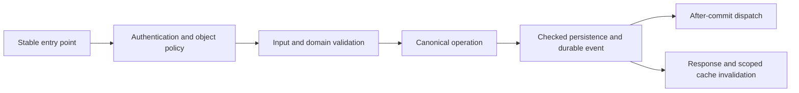

# Audit remediation and production readiness plan

Author / Builder: **Shashi**. Prepared: **2026-10-06**.
Status: **44 findings IMPLEMENTED; none CLOSED; site acceptance and deployment pending.**
Latest checkpoint: [CI-qualified production build 1.102.88](CI-QUALIFIED-BUILD-1.102.88.md). M6 COMPLETE; selected single-server M7 qualification and exact M8 build/promotion evidence verified. Eight remote matrix cells and the official package gate PASS. REL-001 IMPLEMENTED; 44 IMPLEMENTED / zero IN PROGRESS / zero CLOSED. Actual-host acceptance and deployment remain pending.
Baseline: audited working tree **1.102.42**, base revision `ff148ba62ec710a622d9b1af7e8f511b7e0b7385`.

## Outcome and planning authority

Make the plugin safe to operate, straightforward to extend, and demonstrably reliable while preserving authorized working flows. Close all 44 findings in the [audit register](audit-2026-10-06/FINDINGS.md), complete the applicable [verification gaps](audit-2026-10-06/SCENARIOS.md), and qualify one exact release artifact.

This is the audit remediation sequence. The existing [production/scalability plan](PRODUCTION-SCALABILITY-PLAN.md) remains the authority for measured performance and infrastructure work; its earlier progress records do not close the newer audit findings. The October 6 audit remains an immutable baseline. Record new outcomes separately rather than rewriting its historical FAIL observations.

Companions: [test matrix](AUDIT-REMEDIATION-TEST-MATRIX.md) and [44-item implementation backlog](audit-remediation-backlog.csv). The original backlog started OPEN; CORE-001/011, QUO-001/002/003 and INT-001/002 now have local implementation evidence, without CLOSED status. A plan, passing syntax, mocked assertion, or successful ordinary workflow does not close a release gate.

## Preserve the workflow by making its contracts explicit

Before changing each boundary, characterize its successful authorized behavior: inputs, output shape, state, tasks, history, timestamps, hooks, and customer documents. Retain public callback names, hooks, AJAX actions, REST routes, shortcodes, capabilities, options, schema names, JS globals, asset handles, and UI selectors. Keep the frontend workspace and supported administrator utilities consistent.

Security fixes intentionally remove unauthorized reads/writes and unsafe defaults. Durability fixes intentionally replace false success with a clear retryable failure. Treat those as documented corrections, with role-impact previews and migration instructions, rather than attempting to preserve defective behavior. Preserve existing legitimate configured preferences unless a reviewed security correction requires migration.

Use additive schema changes and restartable backfills. Retain historical commercial state and known snapshots. Test both fresh installation and upgrade. A previous plugin ZIP alone cannot reverse a schema/data migration; recovery must include the database and private-file state appropriate to that migration.

## Decisions and proposed defaults

These are proposals, not assumed approval for changes to existing production settings. Complete the dependent decision before implementation; independent characterization and regression work can proceed.

| Decision | Proposed default | Implementation prerequisite |
|---|---|---|
| Release channel | User selected private managed ZIP on 2026-10-18 | Confirm distribution/update/support ownership for final release; directory publication remains a separate gate |
| CRM visibility and mutation | Current-owner representative access; explicitly granted manager access; separate view and edit decisions | Document a role/capability/object matrix, historical pre-sales visibility, mixed-role precedence, and migration impact |
| Historical quotations | Preserve finalized/accepted legacy revisions; snapshot currency, contractual terms, milestones, item classifications and relevant template version | Decide editable draft behavior and whether branding may remain live; archive unreconstructable legacy values with provenance |
| MCP custom queries | Prefer typed, parameterized read tools with explicit field grants; no authentication columns | Inventory existing client query usage; choose a compatible restricted grammar or versioned replacement before removing a supported interface |
| Private files | Protected storage plus authenticated live-object retrieval; deny static access | Select a deployment-compatible storage mechanism and verify direct HTTP denial on the supported server configurations |
| Support floor | User selected WordPress 6.6 / PHP 7.4 under REL-005 | Qualify the selected floor and all PHP 7.4/8.1/8.4 × WP 6.6/latest cells for the exact candidate; local named checks do not close the matrix |
| Recovery and deletion | Full validated CRM restore; explicit retention/erasure policy; data preservation on ordinary deactivation | Define media/user exclusions, numbering continuity, review resolution, uninstall behavior and supported multisite scope |
| Scale and availability | Use the existing provisional small/expected/maximum dataset profiles | Replace provisional targets with expected production volume, topology, acceptable queue delay and recovery objectives |

## Architecture approach

The graph query **“Lead lifecycle quotation authorization persistence side effects”**, bounded to approximately 1,600 tokens, connected CORE-004 and QUO-002/003 to the documented lifecycle and quotation flows. The audit graph's scoped source hashes still matched at planning time; vendor code and older non-audit documentation were outside that refresh. Graph relationships guide navigation, not correctness proof.

Current source confirms `IDLM_DB` delegates insert/upsert/update to `IDLM_Lead_Lifecycle_Service`, `IDLM_Lead_Access_Policy` owns access/scope, quotation policy/controller/repository have distinct seams, and the bootstrap explicitly loads classes. Preserve these seams while repairing the guarantees beneath them. In particular, the lifecycle currently extends `IDLM_DB`; account for inherited helper calls when extracting persistence responsibilities.

Use this request path consistently:

Modularize by responsibility first, retaining procedural bootstrap and static `IDLM_*` classes. Add focused files under `includes/` behind existing facades. Defer physical migration to `src/`, namespacing, Composer, a framework, ORM, and frontend build tooling until a separate measurable need warrants them. A file move does not repair authorization, transaction, or queue behavior.

Target ownership:

| Boundary | Implementation owner | Compatibility surface |
|---|---|---|
| Authentication, view/edit scope and file access | Existing access/quotation policies and focused private-file service | Existing guards and authenticated endpoints |
| Lead transitions and required dependent writes | Lifecycle service plus focused persistence/task helpers | `IDLM_DB::insert_lead/upsert_inbound_lead/update_lead` |
| Quote aggregate, numbering and snapshots | Existing policy/controller/repository/calculator/schema/exporter | `IDLM_Quotations` and existing quotation handlers |
| AJAX parsing and responses | Focused lead/task/import/export/routing handlers | `IDLM_Admin` and `IDLM_Admin_Ajax` delegates |
| Provider authentication, mapping and delivery | Provider modules and shared claim/retry mechanics where justified | Existing REST and scheduled hooks |
| Install/upgrade/restore/delete/retention | Schema installers, backup, deletion and retention owners | Existing lifecycle and administrator tools |
| Read models and presentation | Existing scoped read models, renderers, guarded views and shared assets | Existing workspace routes, selectors and localization |

Any new helper must have one owner and a demonstrated caller. Document trusted internal methods separately from HTTP authorization. Add new storage only when required: durable delivery claims/outbox for crash recovery have a concrete integrity purpose; speculative caches/tables do not.

## Milestones and dependency order

Milestone labels M0–M8 belong to this plan, independently of the older scalability plan's phase numbering. Deliver small reviewable changes; keep mechanical extraction separate from behavioral fixes and schema migrations. Tests accompany the responsible fix rather than being postponed to the end.

Independent small fixes may land earlier once their regression exists: ordinary quotation quantity validation, fresh-export diagnostics, CSV protection, responsive labels, licenses and deterministic ZIP metadata need not wait for unrelated persistence work. Their milestone still owns complete verification. Security and recovery prerequisites remain mandatory for dependent changes.

### M0 — Establish the baseline and regression harness

1. Preserve/hash the existing dirty and untracked source, including the quotation exporter/vendor tree. Reconcile which changes form the candidate; never reset or discard them to obtain a clean checkout.
2. Rerun the existing fast/native suites in their appropriate isolated environments and reproduce audit probes. Capture their actual named results; the audit reports 174 fast cases, 17 distinct native cases, and 29 failing targeted assertions, not current universal coverage.
3. Inventory the 16 operation families, twelve audit flow contracts, public entry points, tables and cleanup obligations. Build independent expectations so tests do not copy an incomplete production manifest.
4. Promote useful audit probes into reusable tests beside production tests; remove reliance on one-session fixtures, audit-document paths and source-string-only checks for behavioral guarantees.
5. Establish a reusable disposable HTTP/browser fixture, fake clock, fail-point injection, deterministic synthetic data, outbound HTTP/mail interception, and multi-process barrier workers.

Exit: baseline failures are attributable, fixtures never use the configured site database, authorized happy paths are characterized, and each finding has a named acceptance test/owner. Existing unrelated regressions remain visible rather than being silently accepted.

### M1 — Close access and confidential-data boundaries

Findings: **INT-001/002, QUO-001/002/003, CORE-001/002/003/011**.

- Enforce effective capabilities and suspension/revocation on every transport. Separate read-all scope from mutation authority; apply live lead ownership to tasks, quote lists, detail, autosaves, exports, search, pagination and cached reads.
- Bind quote, lead, revision, autosave, request key and uploaded-file identities to the authorized operation. New-quote creation cannot select an unrelated persisted revision. Revalidate under the relevant write lock to handle concurrent reassignment.
- Replace permissive MCP SQL evaluation with the decided bounded query interface. Never expose password hashes, activation keys, sensitive user metadata, or unrelated WordPress tables. Assert rejection before database execution.
- Move confidential documents behind protected retrieval. Migrate legacy references in resumable verified batches; confirm protected copy/checksum before removing or blocking the old copy. Test old URLs directly, browser cache/header behavior, current-owner downloads, deletion, backups and missing-file recovery.
- Neutralize spreadsheet formula prefixes in lead export cells while preserving ordinary data. Test actual parsed downloads, not merely `fputcsv()` quoting.

Exit: actual HTTP and direct-file tests show no cross-user disclosure/mutation after ownership/capability changes. Allowed workflows still succeed; legacy-file migration has a preservation/revocation rehearsal.

### M2 — Make persistence, migrations and recovery trustworthy

Findings: **INT-003, CORE-004/005/007, QUO-004/005/007/010**.

- Define required synchronous writes for each canonical mutation. Coordinate lead state, immutable reporting events, tasks, touchpoints, activity and durable dispatch claims in an appropriate aggregate transaction; check every required write and the commit result. Avoid nested transaction assumptions when quotation code already owns a transaction.
- Emit external work and success responses only after durable completion. Persist retryable event intent where a crash between commit and enqueue could lose delivery. Preserve existing event names/payload contracts; document timing changes.
- Verify physical tables/columns/indexes and required transactional engines before advancing schema/backfill markers. DDL can commit independently: use locked, restartable steps and verified markers rather than claiming a transaction rolls back `dbDelta()`.
- Stop reinstall/catalogue changes from overwriting known historical item snapshots. Preserve accepted/shared/rejected/cancelled state, exact pointers/timestamps and historical totals using the decided reversible mapping.
- Preflight restore versions, complete table manifests, explicit empty tables, column/value types, IDs and relationships before deleting anything. Export a consistent snapshot. Fence queued/running workers and version their work across restore/reset; handle files separately from database rollback.

Exit: native injected failures leave no partial required state, false success or pre-commit external action; retry creates one valid result. Historical upgrade and restore fixtures preserve complete aggregates and demonstrate restart/recovery. Unsupported engines are safely migrated in rehearsal or writes are blocked with an actionable error.

### M3 — Repair routing, task and review lifecycle

Findings: **CORE-006/008/009/010/012/013**; continue CORE-011's ownership regression.

- Make partial six-task plans repairable without duplicates; define reopening, cancellation, overdue progression and reassignment behavior for every relevant state.
- Exclude disabled/ineligible users from manual assignment, automated pools and fallback. Reserve/recheck capacity per successful assignment, including concurrent intake and unassigned batches.
- Provide an authorized identity-review resolution workflow: select canonical lead/create separate lead/reject, audit the decision, prevent repeat processing, and include review PII in deletion/reset/retention.
- Bound retention, heavy reads and cleanup by batch size/time with checkpoints, observable failures and overlap prevention. Preserve minimal independent replay evidence where payload detail expires.
- Reconcile state registries and focused docs with the tested rules; explicitly describe permitted reversals and coupled effects.

Exit: routing races do not exceed capacity or assign disabled users; partial task plans converge once; reset/deletion includes independently inventoried data; interrupted jobs resume without skipping or repeating destructive work.

### M4 — Unify provider dispatch, cancellation and replay behavior

Findings: **INT-004/005/006/007/008/009/010**.

- Queue opaque event/claim IDs rather than secrets and copied contact payloads. At dispatch load current credentials, enabled state, allowed identity/state, exclusion rules and cancellation generation.
- Share eligibility/claim/retry handling between normal workers and manual retries. Keep stable event identity and appropriate event/config snapshots separate from current credentials. Persist attempt outcomes, bounded backoff and recoverable terminal/manual-review states.
- Process all Meta batch entries/changes/messages, acknowledge only after required durable handling, normalize identity consistently and deduplicate provider message IDs under concurrent replay.
- Apply the same active-rule resolver to manual/scheduled audience jobs and pull feeds. Preserve failed manual work and respect exclusions.
- Separate minimal durable delivery claims from retention-controlled PII/log bodies. Encrypt remaining platform secrets via the existing protected store, migrate safely, and remove secrets from URLs, queue args and diagnostics where provider contracts allow header authentication.
- Exercise both Action Scheduler and WP-Cron, enqueue failure, worker overlap and crash windows. Where provider idempotency is absent, record uncertain outcomes for reconciliation; do not promise exactly-once external delivery.

Exit: disable/rotate/cancel/replay behavior is consistent across all dispatch paths. Synthetic provider contract tests pass; advertised provider acceptance has sandbox evidence or remains an explicit release gate. Real external sends require separate authorization.

### M5 — Stabilize commercial calculations, exports and UI

Findings: **QUO-006/008/009, UI-001/002/003/004**.

- Use finite, representable numeric bounds, agreed precision/rounding, row limits and normalized quantity before line totals. Cover dimensions, tiny areas, exponent/overflow, discounts/tax and browser/server/stored-total parity.
- Align browser quantity min/step with the server domain; ordinary 1 and 2 must save unchanged. Keep invalid entries recoverable without losing form/autosave state.
- Render exact persisted revision currency/terms/milestones and snapshot classifications. Reprinting after settings/catalogue changes must preserve the decided historical contract across print/PDF/CSV/XLSX.
- Normalize A4/Letter once across settings, preview and renderer; verify real PDF page sizes, multipage output and resource limits. Fix fresh-settings defaults and PHP diagnostics that can corrupt downloads.
- Stack mobile task fields, associate accessible labels, and verify keyboard/focus/error behavior in supported workspace/admin contexts. Exercise lazy drawer tabs and stale response ordering in the existing dirty UI changes.

Exit: ordinary and boundary quotes save through the real browser, totals match stored/exported values, historical documents remain faithful, outputs parse without diagnostics, and mobile/accessible task entry works.

### M6 — Extract remaining hotspots without changing contracts

Maintenance work; depends on characterization and the repaired boundary it touches.

Extract focused handlers from `class-admin-ajax.php`, integration auth/intake/routing/feed/notification responsibilities from `class-integrations.php`, and remaining schema/task/activity helpers from `class-db.php` where coupling is demonstrated. Separate provider delivery from CAPI orchestration and aggregate queries from dashboard presentation. Split `admin-app.js` and the Leads view only where feature ownership becomes clearer, using existing asset registration and localized contracts.

For each extraction: inventory callers/registrations; move one responsibility; leave the old method as a stable delegate; test boot/activation order, authorized behavior, error shape and selectors; remove duplicate implementation after verification. Avoid simultaneous file moves, policy changes and schema changes. Add a feature-extension checklist covering permissions, domain validation, persistence, cleanup/backup, queues, UI and tests. Refresh focused project maps and knowledge graph after substantive changes.

Exit: each operation has a clear transport/policy/domain/persistence owner, facades retain callability, and new feature work can reuse the same boundaries. File size alone is not the success metric.

### M7 — Qualify scale, lifecycle and operational recovery

Complete CORE-012 and the applicable existing scalability phases rather than duplicating their tooling.

Measure list/filter/pagination, drawer/activity, dashboard, quotation list/exports, intake/import, queue lag and retention at small/expected/maximum profiles. Collect p95/p99, query plans/count/time, memory, response sizes and lock/deadlock/retry signals. Optimize only measured bottlenecks; keep caches permission-aware and invalidated after committed changes.

Test fresh install, each supported historical upgrade, interrupted upgrade/restart, deactivate/reactivate with queued work, missing extensions, chosen uninstall policy, timezone/DST reporting, deletion/erasure and restore recovery. Test persistent-cache/no-cache and Action Scheduler/WP-Cron variants. Support multisite or explicitly reject unsupported network activation. Qualify two-node shared storage/cache/worker behavior only if horizontal deployment is advertised; declare the supported topology honestly.

Exit: signed-off workload/resource targets pass, no integrity/access violations occur under concurrency, and operators have actionable health signals plus practiced credential rotation, backlog recovery, restore and rollback runbooks.

### M8 — Produce and rehearse the exact release

Findings: **REL-001/002/003/004/005/006/007**.

- Complete dependency/source/license notices, including the exact Inter font origin; verify advisories/provenance at release time. Triage each Plugin Check diagnostic by source/contract, fixing real defects and recording narrow justified findings rather than mass suppression.
- Make attribution an explicit opt-in with a reviewed upgrade policy. Publish accurate provider/data/purpose/retention/configuration/privacy disclosures, runtime prerequisites, support/security-reporting and managed update/rollback instructions.
- Normalize every ZIP entry's metadata, including the root directory; remove development/local artifacts; build twice with fixed inputs and require matching bytes/checksums.
- Reconcile and commit the complete candidate with version/changelog alignment and Shashi attribution at the release boundary. Do not deploy the current dirty rehearsal ZIP. Complete the supported CI matrix on that revision and retain matching evidence.
- Install the exact ZIP in fresh disposable WordPress; rerun required native/HTTP/browser/upgrade/restore/output/Plugin Check qualification against installed bytes. If a harness is temporarily copied into the fixture, remove it and verify installed inventory before final identity checks.
- Promote through the existing verifier only after release gates pass. Prepare the reviewed artifact and deployment/rollback checklist; production deployment remains a separately authorized final action using the saved production connection.

Exit: one clean source revision, aligned version, reproducible ZIP/SHA, dependency inventory/notices, matching successful CI, passing final-artifact evidence and rehearsed recovery. Private distribution does not waive access, integrity, privacy or license requirements.

## Working and closure rules

For each backlog item record: owner, approved policy where needed, reproduction, implementation revision, regression scenario IDs, command/environment, expected versus actual result, artifact identity and remaining limitations. Progress OPEN → IN PROGRESS → IMPLEMENTED → VERIFIED → CLOSED. A source review or double may support IMPLEMENTED; native/HTTP/browser evidence is required wherever the finding depends on those boundaries.

First run the smallest failing regression, then affected module checks and changed-file PHP lint. Run the full suite for shared/core changes, multi-module milestones and release qualification. A test failure must be investigated rather than changing expected behavior to match the defect. Promote known audit failures into the normal suite as their fixes land; retain remaining baseline failures in a separate explicit report.

Do not bundle broad refactoring into urgent fixes. Do not add dependencies when current WordPress/test facilities suffice. Keep unrelated working-tree changes intact. Document migration/recovery limitations and remaining NOT RUN/BLOCKED evidence explicitly. Review business-impacting policy changes before rollout; no deployment or destructive configured-site work is part of this planning change.

## Definition of done

- All 44 findings have verified closure, not merely a plan or disabled test; every applicable audit gap has asserted evidence. Any justified non-applicability identifies the explicit supported scope and rationale.
- Successful authorized flows pass on fresh installs and upgrades, in each supported transport/UI context. Access tightening and failure responses are documented and tested deliberate corrections.
- Native failures/races preserve durable aggregates, current access and historical commercial state. Recovery includes the database, files and queued work as appropriate.
- Supported runtime/topology/performance claims match measured evidence. Secrets/PII do not leak through static files, exports, caches, logs, jobs or MCP.
- Feature ownership, extension rules, focused documentation and regression harness are maintainable without parallel duplicate implementations.
- The exact reviewed release passes the final artifact gates and has a practiced promotion/rollback procedure. Exhaustive testing is not claimed; named scenarios, environments and remaining limits are auditable.

## First implementation slice

Begin with M0's preservation and characterization, then a narrowly scoped M1 change binding new quotation saves to the correct lead/revision and separating quotation mutation authority from read scope. Add actual HTTP owner/non-owner/reassignment/revision-substitution tests plus authorized save/autosave/export regressions. Follow immediately with MCP table/field scope and live lead/task/quote access fixes. Private-file protection starts early because deployment/storage compatibility and legacy-file migration require longer rehearsal.

This slice has a clear acceptance boundary, addresses demonstrated high-impact defects, and establishes the fixture/policy seams needed for the larger persistence and migration work.

## First implemented slice — 2026-10-06

M0 baseline/characterization required for QUO-001/003 is complete locally. Candidate 1.102.43 separates quote mutation authority and binds revision/request identities. See [implementation, role impact, executed checks and limits](AUDIT-REMEDIATION-QUOTATION-SLICE.md). Global M0 and remaining milestones are not declared complete.

## Executed second slice — 2026-10-06

The user approved removing legacy editorial CRM grants and moving legacy global visibility to assigned-only while preserving explicit role scopes and dedicated CRM/manager grants. CORE-001, QUO-002 and CORE-011 are IMPLEMENTED locally in 1.102.44; see [migration impact, actual tests and remaining limits](AUDIT-REMEDIATION-READ-SLICE.md). They are not CLOSED, and remaining M0/M1/release qualification is not complete.

### Third slice progress — 2026-10-06

Repository/client characterization selected the restricted compatible SELECT interface. INT-001/002 are IMPLEMENTED locally in 1.102.45, with independent PII grants and actual HTTP/stdio/native evidence. See [the third slice report](AUDIT-REMEDIATION-MCP-SLICE.md); no CLOSED, supported-matrix, exact-artifact or deployment claim. Next bounded M1 work is CORE-003 export protection; CORE-002 needs the storage/deployment prerequisite.

### Fourth slice implementation — lead CSV protection

CORE-003 is IMPLEMENTED locally in `1.102.46`: shared text normalization, stable numeric/header/filter/auth contracts and actual parsed disposable HTTP downloads. See [the fourth slice report](AUDIT-REMEDIATION-CSV-SLICE.md). No CLOSED, global M0, supported-matrix or release claim. Next CORE-002 requires production storage/web-server details and a legacy-file preservation/revocation rehearsal.

### Fifth slice implementation — private lead files inside WordPress

CORE-002 is IMPLEMENTED locally in `1.102.47`: database-only new uploads, live authenticated downloads, verified resumable legacy main/variant migration, pointer/expiry/deletion erasure and explicit partial-backup policy. The user’s WordPress-contained constraint is satisfied without requiring web-server deny rules for new bytes. See [the fifth slice report](AUDIT-REMEDIATION-PRIVATE-FILE-SLICE.md). Production legacy/cache migration, full M0/M1 qualification, support matrix and exact artifact remain open. Next bounded M2 work: INT-003 restore preflight/manifest integrity.

## Sixth slice implementation — 2026-10-06

INT-003 is IMPLEMENTED locally in `1.102.48`: complete same-site backup validation/staging, consistent exports, transactional settings/generation recovery, sequence highwater and cooperative worker fencing. [Sixth slice evidence and policy](AUDIT-REMEDIATION-RESTORE-SLICE.md). No CLOSED, full M0, support-matrix, exact-artifact or deployment claim. Next bounded M2 work: CORE-007 physical-schema/restart-safe migration checks.

## Seventh slice implementation — 2026-10-06

CORE-007 is IMPLEMENTED locally in `1.102.49`: verified physical core/routing schemas, InnoDB refusal, session-locked checked markers, restartable backfills and explicit activation/runtime failure. Core schema is `1.3.6`; routing `1.0.1`. [Seventh slice evidence and operator policy](AUDIT-REMEDIATION-SCHEMA-SLICE.md). Whole T17/T20, support matrix, global M0 and exact artifact remain incomplete. Next bounded M2 work: CORE-004/005 coupled persistence and after-commit delivery; quotation migration/history findings remain separate.

## Eighth slice — CORE-004/005 lead persistence (2026-10-07)

Shashi: locally IMPLEMENTED in candidate **1.102.50**, core schema **1.3.7**, with routing **1.0.1** and quotation **2.5.0** unchanged. Required canonical lead/activity/event/task/touchpoint/intent writes and commit are checked under one owner; routed capture is acknowledged after required completion. External hook/cache intent is durable and dispatched after commit with bounded, fenced replay. Foreign transactions are refused, core wpdb reconnect replay is disabled while owned, and private-file migration shares the owner.

Final evidence: **258 fast / 104 native / 278 actual HTTP/stdio cases PASS**, focused inbound/task and optional Action Scheduler contracts PASS, and 24 changed PHP lint checks PASS. CORE-004/005 remain **IMPLEMENTED, not CLOSED** pending supported-runtime and exact artifact qualification. Historical partial task plans and provider delivery guarantees remain separate. [Scope/evidence/limits](AUDIT-REMEDIATION-LIFECYCLE-SLICE.md). Next bounded milestone work: CORE-006 task-plan repair, followed by the remaining M3 routing/review lifecycle findings.

## CORE-006 local implementation — 2026-10-07

Shashi: candidate **1.102.51**, core **1.3.8**, routing **1.0.1** and quotation **2.5.0** unchanged. Stable nullable task cycles and a unique lead/cycle key support checked legacy adoption and missing-slot repair; active evidence/reopening/scheduling/owner reconciliation share the lifecycle transaction. Scheduled repair uses overlap fencing and a 100-lead checkpoint, including empty plans. Complete prior backups normalize before strict preflight.

**263 fast / 117 native / 281 HTTP-stdio PASS**, with 5 / 13 / 3 focused new cases and 17 PHP lint checks. CORE-006: **IMPLEMENTED, not CLOSED** pending runtime/artifact qualification. Ambiguous legacy history is preserved for review. [Policy, evidence and limits](AUDIT-REMEDIATION-TASK-PLAN-SLICE.md). Next: CORE-009 eligible assignment, then CORE-010 capacity.

## CORE-009 local implementation — 2026-10-07

Shashi: candidate **1.102.52**, schemas unchanged. Shared role/effective-capability/disabled policy filters all runtime assignment pools and rechecks locked live account/meta/role values before changed ownership. Historical owners remain available for ordinary edits and filters. **266 fast / 127 native / 287 HTTP-stdio PASS**, including stale grants committed by an independent connection, target read/engine failures and admin/shortcode mutation choices. CORE-009: **IMPLEMENTED, not CLOSED**; CORE-010 capacity remains OPEN. [Evidence and qualification limits](AUDIT-REMEDIATION-ASSIGNMENT-ELIGIBILITY-SLICE.md).

## CORE-010 local implementation — 2026-10-07

Shashi: candidate **1.102.53**, schemas unchanged. Shared positive-workload admission locks a representative account and reads current settings/count inside canonical/automatic transactions. Recovery pools refresh per candidate; zero remains unlimited, historical unchanged/closed work consumes no new slot, and reopening requires room. **270 fast / 139 native / 292 HTTP-stdio PASS**, including 201-lead backlogs, stale snapshots/settings, rollback/crash and four concurrent writer pairs. CORE-010: **IMPLEMENTED, not CLOSED** pending runtime/artifact and volume/lock-contention qualification. [Evidence and limits](AUDIT-REMEDIATION-CAPACITY-SLICE.md). Next bounded M3 work: CORE-008 review lifecycle/erasure.

## CORE-008 implemented slice — 2026-10-07

Shashi: candidate **1.102.54**, core **1.3.9**. Manager-only review inspection and checked canonical/separate/reject decisions; terminal external replay, complete lead/reset review erasure, bounded review retention and prior backup normalization. **275 fast / 158 native / 303 HTTP-stdio PASS**, plus desktop/mobile browser verification. IMPLEMENTED, not CLOSED. [Policy/evidence/limits](AUDIT-REMEDIATION-IDENTITY-REVIEW-SLICE.md). Next: CORE-012; runtime, volume and artifact gates remain open.

## CORE-012 bounded retention and read work — 2026-10-07

Shashi: candidate **1.102.55**, schemas unchanged. Checked 100-row retention batches rotate across targets with transactional progress, recovery/session fencing, continuations and health faults. Task cards page 50 after SQL grouping; WhatsApp uses SQL count/EXISTS; CSV stages 100-row reads with explicit row/file/time limits before headers. **279 fast / 171 native / 308 HTTP-stdio PASS**, desktop/mobile pagination and a local 5,000-lead read-plan sample. IMPLEMENTED, not CLOSED; M7 production workload/runtime/artifact gates remain open. [Policy, evidence and limitations](AUDIT-REMEDIATION-BOUNDED-WORK-SLICE.md). Next: CORE-013.

## CORE-013 — State vocabulary and lifecycle policy (2026-10-07)

Shashi: candidate **1.102.56**, schemas unchanged. Shared manual-task and early-close subsets now drive forms and handlers; qualification coupling is distinguished from supplied-quality validation. [Current policy](STATE-POLICY.md) records current writers, reversal effects and historical repair differences. **284 fast / 5 focused native / 14 task-plan native checks PASS** (18 distinct native cases; fresh schema runs twice). CORE-013 is IMPLEMENTED, not CLOSED; runtime/artifact qualification remains open. **25 OPEN / 19 IMPLEMENTED**. [Evidence and limits](AUDIT-REMEDIATION-STATE-POLICY-SLICE.md). Next: QUO-004, outstanding M2 quotation migration integrity.

## QUO-004 — Checked quotation migration completion (2026-10-07)

Shashi: candidate **1.102.57**, quotation schema **2.5.1**, core/routing unchanged. Physical verification precedes checked data phases; final schema completion and durable pending/ready status prevent false acknowledgements. Boot/activation propagate failures and retry incomplete work, reading committed markers directly. Complete 2.5.0 backup compatibility retained. **291 fast / 202 native / 312 HTTP-stdio PASS**. Two final targeted native checks also pass (203 distinct native cases across final runs). IMPLEMENTED, not CLOSED; QUO-005/010 historical semantics and M7/M8 qualification remain open. **24 OPEN / 20 IMPLEMENTED**. [Policy and evidence](AUDIT-REMEDIATION-QUOTATION-MIGRATION-SLICE.md). Next: QUO-005.

## QUO-005 — Historical item classification preservation (2026-10-07)

Shashi: candidate **1.102.58**, quotation schema **2.5.2**. Remove catalogue-to-history classification rewrites for every installer path. Add conservative `classification_source` provenance, derive new submitted/default values, preserve revision copies and normalize complete prior quotation/core backup inventories. **294 fast / 212 native / 315 HTTP-stdio PASS**; 3 / 9 / 3 new named cases cover old/missing snapshots, all item/monetary fields, denied DDL, crash/retry, independent installers and old/new/malformed recovery. IMPLEMENTED, not CLOSED; runtime/artifact and historical-state qualification remain open. **23 OPEN / 21 IMPLEMENTED**. [Policy and evidence](AUDIT-REMEDIATION-QUOTATION-CLASSIFICATION-SLICE.md). Next: QUO-010.

## QUO-010 — Preserve historical commercial quotation states (2026-10-07)

Shashi: candidate **1.102.59**, quotation schema **2.5.3**, lifecycle receipt **1.1.0**, columns unchanged. Replace destructive normalization with relationship verification, preserve exact commercial state/pointers/dates/content/totals, protect finalized and commercially evidenced history across mutations/editor UI, and import known legacy Shared flags without guessed dates. Complete 2.5.2 backups remain supported. **296 fast / 219 native / 326 HTTP-stdio PASS**; 2 / 7 / 11 new cases include failure/retry, independent installers, stale finalization requests and actual recovery. IMPLEMENTED, not CLOSED; erased historical values and runtime/artifact qualification remain explicit limits. **22 OPEN / 22 IMPLEMENTED**. [Policy and evidence](AUDIT-REMEDIATION-QUOTATION-HISTORY-SLICE.md). Next: QUO-007.

## QUO-007 — Runtime quotation engine checks (2026-10-07)

Shashi: candidate **1.102.60**, schemas unchanged. QUO-007 checks and pins current InnoDB table metadata before quotation save, working-copy mutations, catalogue import and number reservation. Transaction-local READ COMMITTED retains live grant visibility after engine checks/lock waits; unsupported engines require operator repair, with no automatic conversion. **299 fast / 224 native / 349 HTTP-stdio PASS**; 3 / 5 / 23 new cases include every dependency, physical defaults/drift, missing/failed reads, independent metadata locking, actual rollback/retry and current authority. IMPLEMENTED, not CLOSED; runtime/artifact, cache/drop-in and production lock qualification remain open. **21 OPEN / 23 IMPLEMENTED**. [Policy and evidence](AUDIT-REMEDIATION-QUOTATION-ENGINE-SLICE.md). Next: QUO-008.

## 2026-10-07 — QUO-008 numeric validation and rounding

Shashi: candidate **1.102.61**, schemas unchanged. QUO-008 rejects nonfinite/exponent/negative/over-range input, bounds rows/sections and prices normalized quantities with integer cents. Browser/server/SQL/save/export checks cover tiny areas, rounded line sums, adjustments/GST and projection boundaries. **305 fast / 227 native / 371 HTTP-stdio PASS**, 28 JS golden vectors and representative admin/mobile browser checks. **20 OPEN / 24 IMPLEMENTED**; IMPLEMENTED, not CLOSED. Exact artifact/runtime and complete production form/transport qualification remain open. [Policy and evidence](AUDIT-REMEDIATION-QUOTATION-NUMERIC-SLICE.md). Next: QUO-006.

## 2026-10-07 — QUO-006 historical document terms and currency

Shashi: candidate **1.102.62**, quotation schema **2.5.4**; core/routing/lifecycle unchanged. Capture contractual cover/closing/footer and allocated payments per new revision, retain original quotation currency across edits/autosave, and render saved values in historical views/print/PDF/CSV/XLSX. Legacy terms remain explicitly unknown; additive upgrade and exact older backups preserve history. **310 fast / 231 native / 377 HTTP-stdio PASS**, actual browser R02/R01 and mobile checks, real A4 PDF/CSV/XLSX evidence. **19 OPEN / 25 IMPLEMENTED**; IMPLEMENTED, not CLOSED. Runtime/artifact and full PDF/transport qualification remain open. [Policy and evidence](AUDIT-REMEDIATION-QUOTATION-DOCUMENT-SLICE.md). Next: QUO-009.

## 2026-10-08 — QUO-009 paper size and UI-004 download defaults

Shashi: candidate **1.102.63**, schemas unchanged. Shared paper normalization aligns setup/print/PDF, preserves existing A3/Legal support and safe A4 defaults; PDF CSS no longer forces A4. Explicit quotation CSV escaping removes PHP 8.4 download diagnostics. **312 fast / 11 focused actual HTTP PASS**, with all 377 pre-existing HTTP/stdio cases passing in the accumulated run, actual browser desktop/mobile selection and nine-page A4/Letter dimension/text/visual evidence. QUO-009 and coupled UI-004 are **IMPLEMENTED, not CLOSED**; runtime/artifact and exhaustive PDF resource/transport qualification remain open. **17 OPEN / 27 IMPLEMENTED**. [Policy and evidence](AUDIT-REMEDIATION-QUOTATION-PAPER-SLICE.md). Next: UI-001.

## 2026-10-08 — UI-001 ordinary quotation quantities

Shashi: working-tree **1.102.63**, schemas unchanged. Current quantity controls already use min/step **0.01**; qualify that existing repair without another production edit or version bump. **312 fast / 28 JavaScript vectors / 3 focused native HTTP PASS**, plus actual desktop/mobile creation, edit, added/duplicated/section controls, tiny dimensions, autosave recovery and repeated saves. Independent SQL retains all 14 browser-saved rows across three revisions. **UI-001 IMPLEMENTED, not CLOSED; 16 OPEN / 28 IMPLEMENTED**. Runtime/artifact and broader browser qualification remain open. [Evidence and limits](AUDIT-REMEDIATION-QUOTATION-QUANTITY-SLICE.md). Next: UI-002.

## 2026-10-08 — UI-002 mobile task layout

Shashi: local style iteration on **1.102.63**, schemas unchanged. Move inline task grids into shared CSS; stack panels and priority/type at the existing 820 px breakpoint, align full-width 44 px controls and wrap longer labels. Actual **320/390/768 px and desktop** browser checks pass for administrator/representative flows, with three task saves independently checked in SQL, scrolling and long-label captured-markup stress. **312 fast PASS; UI-002 IMPLEMENTED, not CLOSED; 15 OPEN / 29 IMPLEMENTED**. [Evidence and qualification](AUDIT-REMEDIATION-TASK-LAYOUT-SLICE.md). Next: UI-003.

## 2026-10-09 — UI-003 task labels and keyboard recovery

Shashi: candidate **1.102.64**, schemas unchanged. Associate all four task labels; expose the open drawer, support Enter submission and linked recoverable title errors, and restore focus after save/ordinary dismissal. **312 fast / 1 focused native HTTP PASS**, plus 13 desktop/mobile browser observations and two saves independently checked in SQL. **UI-003 IMPLEMENTED, not CLOSED; 14 OPEN / 30 IMPLEMENTED**. Spoken screen-reader, full drawer/nested-dialog and runtime/artifact qualification remain open. [Evidence and limits](AUDIT-REMEDIATION-TASK-ACCESSIBILITY-SLICE.md). Next: INT-004.

## 2026-10-09 — INT-004 ordinary Interakt dispatch

Shashi: candidate **1.102.65**, schemas unchanged. Opaque durable ordinary jobs use AS/WP-Cron; current primary settings, credentials, lead/owner and intended rule gate delivery. Enable epochs revoke earlier work, legacy copied-key callbacks are refused, and interrupted attempts remain uncertain without automatic resend. **318 fast / 240 full native PASS**, followed by **11 final focused native PASS** (241 distinct native cases across runs), plus AS adapter contracts. **INT-004 IMPLEMENTED, not CLOSED; 13 OPEN / 31 IMPLEMENTED**. Live provider/AS, retention, legacy secret purge and runtime/artifact qualification remain open. [Policy and evidence](AUDIT-REMEDIATION-INTERAKT-DISPATCH-SLICE.md). Next: INT-005.

## 2026-10-09 — INT-005 CAPI manual retry

Shashi: candidate **1.102.66**, schemas unchanged. Exact defaults/custom event identity, shared current eligibility, fresh credentials and exact attempt reporting replace guessed forced replay. New logs preserve destination/time/commercial identity; durable per-root receipts cap manual attempts at three and retain uncertainty without automatic resend. **324 fast / 251 full native / 398 full actual HTTP PASS** (including 6 focused CAPI cases), with desktop/mobile reporting and independent SQL evidence. **INT-005 IMPLEMENTED, not CLOSED; 12 OPEN / 32 IMPLEMENTED**. Live provider/runtime/artifact, ordinary durable CAPI delivery, receipt retention and platform-secret migration remain open. [Policy and evidence](AUDIT-REMEDIATION-CAPI-RETRY-SLICE.md). Next: INT-006.

## 2026-10-09 — INT-006 WhatsApp inbound batches and replay

Shashi: candidate **1.102.67**, schemas unchanged. Process all signed Meta entries/changes/messages, use Meta/Interakt provider-ID receipts, match one canonical full phone and commit activity/receipt before acknowledgement. Explicit partial failures retry only missing work; minimal tombstones survive pruning and same-site restore/reset. **330 fast / 260 full native / 404 full actual HTTP PASS**, including **10 focused native / 6 focused HTTP** and independent-worker interruption/replay tests. **INT-006 IMPLEMENTED, not CLOSED; 11 OPEN / 33 IMPLEMENTED**. Live provider timing/variants, receipt retention/erasure and runtime/artifact qualification remain open. [Policy and evidence](AUDIT-REMEDIATION-WHATSAPP-INBOUND-SLICE.md). Next: INT-007.

## 2026-10-09 — INT-007 disabled Google audience pull feed

Shashi: candidate **1.102.68**, schemas unchanged. Shared enabled-rule resolution stops disabled/removed Google audience pulls before contact reads or CSV output; first enabled duplicate wins, explicit rules override legacy settings and confidential feed responses disallow cache storage. **335 fast / 4 focused native / 7 focused actual HTTP PASS**. **INT-007 IMPLEMENTED, not CLOSED; 10 OPEN / 34 IMPLEMENTED**. Provider-side behavior, persistent-cache/runtime/artifact qualification remain open. [Policy and evidence](AUDIT-REMEDIATION-GOOGLE-AUDIENCE-SLICE.md). Next: INT-008.

## 2026-10-09 — INT-008 CAPI retention and delivery evidence

Shashi: candidate **1.102.69**, schemas unchanged. Configured CAPI retention was already corrected by CORE-012; INT-008 adds minimal durable claim/acceptance/uncertainty receipts, atomic log acknowledgements and bounded transactional legacy-success preservation before pruning. **340 fast / 275 full native / 14 final focused native / 414 full actual HTTP PASS** (276 distinct native cases across runs). **INT-008 IMPLEMENTED, not CLOSED; 9 OPEN / 35 IMPLEMENTED**. Historical lost evidence, provider reconciliation, runtime/artifact and recovery/volume qualification remain open. [Policy and evidence](AUDIT-REMEDIATION-CAPI-RETENTION-SLICE.md). Next: INT-009.

## 2026-10-09 — INT-009 audience manual work and exclusions

Shashi: candidate **1.102.70**, schemas unchanged. Durable per-lead/rule outcomes retain failed manual work, share current exclusions, bound pages/retries, fence unknown delivery and serialize overlapping runs. Selected retry no longer includes unrelated matching contacts; shared controls allow manual removal and report Google mapping separately. **344 fast / 291 full native / 20 final focused native / 420 full actual HTTP PASS** (295 distinct native cases across runs; broader logs precede the last scoped safeguards). **INT-009 IMPLEMENTED, not CLOSED; 8 OPEN / 36 IMPLEMENTED**. Provider/removal/consent, runtime/volume, reconciliation and exact artifact qualification remain open. [Policy and evidence](AUDIT-REMEDIATION-AUDIENCE-RETRY-SLICE.md). Next: INT-010.

## INT-010 protected platform credentials — 2026-10-09

Shashi: candidate **1.102.71**, schemas unchanged. Seven platform secrets use verified encrypted/environment storage and fresh primary reads; write-only fields support retain/replace/explicit clear. Meta uses Bearer authentication; covered transports scrub secret echoes and refuse redirects. Legacy copied-key queues are cleaned in bounded batches. **350 fast / 306 full native / 425 full actual HTTP PASS** (12 focused native and 5 focused HTTP also pass); commands and hashes are recorded in the [slice and machine evidence](AUDIT-REMEDIATION-SECRET-STORE-SLICE.md). **INT-010 IMPLEMENTED, not CLOSED; 7 OPEN / 37 IMPLEMENTED**. Provider-required Google query secrets, historic traces, installed scheduler/runtime/key-management and exact artifact qualification remain open. Automation mobile overflow was observed. Next listed finding: REL-001, with M6/M7 prerequisites still required.

## REL-001 exact release checkpoint — 2026-10-09

Shashi: candidate **1.102.71**, runtime/schemas unchanged. **10 release contracts PASS**; a current 450-file rehearsal/extraction matches source bytes, and actual promotion correctly rejects dirty Git/absent matching CI. Two builds contain identical files but differ in ZIP bytes (OPEN REL-006). **REL-001 IN PROGRESS, prerequisite-blocked; 6 OPEN / 1 IN PROGRESS / 37 IMPLEMENTED**. Complete REL-002–REL-007 and M6/M7 qualification before reconciling the complete candidate, committing, running matching CI and qualifying installed artifact behavior. No commit/push/tag/deployment or synthetic attestation claim. [Checkpoint, exact hashes and prerequisite evidence](AUDIT-REMEDIATION-RELEASE-ATTESTATION-SLICE.md). Next executable finding: REL-002; revisit REL-001 at final release.

## REL-002 verified Inter license and provenance — 2026-10-09

Shashi: candidate **1.102.72**, schemas and font/CSS bytes unchanged. All five font files exactly match the official Google Latin variable-font distribution; embedded Inter revision resolves to the pinned upstream source/license. Bundle complete OFL 1.1, human notice and per-file provenance hashes; require all font resources/notices in release inventory. **12 release contracts PASS**, two pre-fix failures reproduced, actual **453-file** rehearsal/extraction identity verified. **REL-002 IMPLEMENTED, not CLOSED; 5 OPEN / 1 IN PROGRESS / 38 IMPLEMENTED**. REL-001 clean/CI/final artifact, other dependency and reproducibility gates remain. [Sources, implementation and evidence](AUDIT-REMEDIATION-FONT-NOTICE-SLICE.md). Next executable finding: REL-003.

## REL-003 optional public credit — 2026-10-09

Shashi: candidate **1.102.73**, schemas unchanged. Fresh/missing/partial attribution defaults off; saved on/off choices remain unchanged without inferring historical consent. Only the explicit checkbox string opts in on authorized save; clear linked help and shared preview/reset inherit the off default. **356 fast / 4 actual HTTP PASS**, desktop/mobile keyboard/reset checks and all changed PHP lint PASS. **REL-003 IMPLEMENTED, not CLOSED; 4 OPEN / 1 IN PROGRESS / 39 IMPLEMENTED**. Complete runtime/CI/final artifact qualification remains pending. [Policy and evidence](AUDIT-REMEDIATION-ATTRIBUTION-OPT-IN-SLICE.md). Next executable finding: REL-004.

## REL-004 public service/privacy/support disclosures — 2026-10-09

Shashi: candidate **1.102.74**, schemas/runtime behavior unchanged. Publish actual provider transfers, automatic attribution cookies, protected credentials, retention/erasure/removal/partial-backup limits, owner-supplied private support/security contact and manual ZIP update/recovery instructions. Require bundled public privacy/support guides. **12 release contracts PASS; 455-file archive/source identity PASS; 4 PHP lint PASS**; no new full runtime/installed-artifact qualification claimed. **REL-004 IMPLEMENTED, not CLOSED; 3 OPEN / 1 IN PROGRESS / 40 IMPLEMENTED**. Consent/receipt-erasure and provider/deployment/recovery limits remain explicit. [Source review and evidence](AUDIT-REMEDIATION-PUBLIC-DISCLOSURES-SLICE.md). Next executable finding: REL-005.

## REL-005 runtime support and prerequisites — 2026-10-09

Shashi: candidate **1.102.75**, schemas unchanged. User selected **WordPress 6.6 / PHP 7.4**; align header/readme, publish prerequisites, refuse unavailable PDF/XLSX storage and crypto operations, and retain all six CI cells with resolved runtime/dependency/download/log evidence. **361 fast / 5 focused prerequisite contracts / 306 WP 6.6 native / 429 WP 6.6 full HTTP-stdio / 11 WP 6.6 export HTTP / 11 WP 7.1.2 export HTTP PASS**, on PHP 8.4.14/MySQL 8.4.0. Missing module/ZIP/renderer simulations are distinguished from actual disabled crypto and temporary-directory conditions. **REL-005 IMPLEMENTED, not CLOSED; 2 OPEN / 1 IN PROGRESS / 41 IMPLEMENTED**. PHP 7.4/8.1, resolved latest 7.1.3, actual absent-extension hosts, complete exact CI and installed artifact remain unqualified. [Evidence, policy and limits](AUDIT-REMEDIATION-RUNTIME-SUPPORT-SLICE.md). Next executable finding: REL-006.

## REL-006 reproducible release ZIP metadata — 2026-10-11

Shashi: candidate **1.102.76**, runtime/schemas unchanged. Reproduce the root timestamp defect with two full packages; check root creation, sort builder inventory and normalize root/file timestamps, UNIX modes and file compression. CI packaging pins UTC. **13 release contracts PASS**; separated **455-file** full builds and a source-metadata/order-perturbed copy produce identical ZIP bytes, with independent content/metadata inspection. **REL-006 IMPLEMENTED, not CLOSED; 1 OPEN / 1 IN PROGRESS / 42 IMPLEMENTED**. Exact clean revision/matching CI/final artifact and cross-toolchain qualification remain open. [Evidence and build contract](AUDIT-REMEDIATION-ZIP-REPRODUCIBILITY-SLICE.md). Next executable finding: REL-007.

## REL-007 package inventory and diagnostic checkpoint — 2026-10-11

Shashi: local candidate **1.102.77**, runtime semantics/schemas unchanged. Exclude five local graph/design/prototype files, independently reject their reintroduction, protect dependency licenses/resources and document four narrow output/resource exceptions. Add disposable unfiltered official Plugin Check 2.1.0 with a failing diagnostic wrapper and CI candidate-upload gate. **14 release / 363 fast contracts PASS**; final 450-file ZIP matches source. Checker: **138 errors / 2,032 warnings remain**; ledger records 574 examined justifications, **1,595 source-review-required findings** and one readme limit. **REL-007 IN PROGRESS, not IMPLEMENTED or CLOSED; 0 OPEN / 2 IN PROGRESS / 42 IMPLEMENTED**. [Exact artifact, diagnostics and review queue](AUDIT-REMEDIATION-PACKAGE-CHECK-SLICE.md). Next executable work: continue REL-007 SQL/request source review; REL-001 remains prerequisite-blocked.

## REL-007 SQL/request source checkpoint — 2026-10-11

Shashi: local candidate **1.102.78**, schemas unchanged. Meta verification rejects non-string/missing parameters and unslashes only raw WP fallbacks; plain-text/zero challenges and REST token bytes remain correct. Prefix nine MCP CLI globals. Review **37 SQL locations**, record 97 additional specific justifications without suppressing diagnostics. **365 fast / 7 focused Meta HTTP / 430 full HTTP-stdio / 14 release contracts PASS**. Official final 450-file ZIP: **138 errors / 2,018 warnings**, ledger **671 justified / 1,484 review-required / one readme limit**. **REL-007 IN PROGRESS, not IMPLEMENTED or CLOSED; 0 OPEN / 2 IN PROGRESS / 42 IMPLEMENTED**. [Source fixes, exact artifact and remaining queue](AUDIT-REMEDIATION-PACKAGE-SOURCE-SLICE.md). Continue REL-007 SQL/request source review; REL-001 remains prerequisite-blocked.

## REL-007 quotation request validation checkpoint — 2026-10-18

Shashi: [REL-007 request validation, candidate 1.102.81](AUDIT-REMEDIATION-PACKAGE-REQUEST-INPUT-SLICE.md). Reject malformed wood flags/milestone names before writes; unslash settings/catalogue inputs once and escape numeric connector challenges. 382 final fast / six focused HTTP / 438 accumulated HTTP-stdio / 14 release contracts PASS (scope/timing limits in slice). Final unfiltered Plugin Check: 136 errors / 2,050 warnings; 1,536 review-required. REL-007 remains IN PROGRESS; M6/M7 and exact release qualification remain incomplete. Backlog: **42 IMPLEMENTED / two IN PROGRESS / zero CLOSED**.

## REL-007 bootstrap request metadata checkpoint — 2026-10-18

Shashi: [REL-007 bootstrap request metadata, candidate 1.102.82](AUDIT-REMEDIATION-PACKAGE-BOOTSTRAP-REQUEST-SLICE.md). Validate and unslash action/URI/REST-route metadata before recovery and pending-migration classification. Five focused HTTP / 443 accumulated HTTP-stdio / two native / 382 fast contracts PASS (including 14 release cases). Unfiltered Plugin Check retains 136 errors / 2,042 warnings; 1,521 review-required diagnostics. REL-007 remains IN PROGRESS; M6/M7 and exact release qualification remain incomplete. Backlog: **42 IMPLEMENTED / two IN PROGRESS / zero CLOSED**.

## REL-007 local static completion — 2026-10-18

Shashi: [REL-007 static completion, candidate 1.102.83](AUDIT-REMEDIATION-PACKAGE-STATIC-COMPLETION-SLICE.md). Official Plugin Check 2.1.0 default static gate PASS on the 453-file source-matching ZIP: zero errors, zero warnings, zero review-required diagnostics. 385 fast (including 16 release), 331 native and 445 HTTP/stdio cases PASS; 88 changed PHP files lint clean. Source fixes resolve 438 diagnostic instances; 694 bounded, source-specific review exceptions account for 1,740 instances. Private managed ZIP selected by Shashi. REL-007 IMPLEMENTED locally; REL-001, M6/M7 and exact clean CI/installed-artifact qualification remain IN PROGRESS. Backlog: **43 IMPLEMENTED / one IN PROGRESS / zero CLOSED**. Historical checkpoints retain their original failure results.

## M6 handoff notification ownership — 2026-10-18

Shashi: [M6 handoff notification ownership, candidate 1.102.84](AUDIT-REMEDIATION-HANDOFF-NOTIFICATIONS-SLICE.md). Extract opt-in email delivery behind the unchanged integration callback and durable outbox. Method-body executable tokens match; 385 fast / four focused native / 334 full native cases and seven PHP lints PASS. Default Plugin Check gate PASS with zero diagnostics on the source-matching 454-file ZIP. M6/M7 and REL-001 remain IN PROGRESS; backlog remains 43 IMPLEMENTED / one IN PROGRESS / zero CLOSED. Next bounded M6 work: inventory one integration auth/intake/feed or AJAX handler responsibility and preserve its existing delegate/transport contracts before extracting it. Do not treat this single mail extraction as the M6 exit review.

## M6 administrator connection controller — 2026-10-18

Shashi: [M6 connection controller, candidate 1.102.85](AUDIT-REMEDIATION-CONNECTION-CONTROLLER-SLICE.md). Move the 119-line authenticated diagnostic handler byte-for-byte behind both existing facades; nonce/admin guards, credentials, provider requests and JSON messages remain unchanged. 385 fast / four focused HTTP / 449 full HTTP-stdio cases and eight PHP lints PASS. Default Plugin Check gate PASS with zero diagnostics on the source-matching 455-file ZIP. M6/M7 and REL-001 remain IN PROGRESS; backlog stays 43 IMPLEMENTED / one IN PROGRESS / zero CLOSED. Continue the remaining bounded M6 ownership review; this handler extraction does not complete M6 or qualify the release.

## M6 telemetry controller — 2026-10-20

Shashi: [M6 telemetry controller, candidate 1.102.86](AUDIT-REMEDIATION-TELEMETRY-CONTROLLER-SLICE.md). Extract three byte-identical handlers (129 lines) behind both unchanged facades. 387 fast / four focused HTTP (WP 7.1.3) / 453 full HTTP-stdio (WP 6.6) cases and seven PHP lints PASS. The 456-file ZIP matches source. Default Plugin Check reports nine warnings in existing Users & Access code; complete static gate fails, with no telemetry diagnostics. M6/M7 and REL-001 remain IN PROGRESS; backlog stays 43 IMPLEMENTED / one IN PROGRESS / zero CLOSED. Continue the remaining bounded M6 ownership review.

## M6 activity controller — 2026-10-21

Shashi: [M6 activity controller, candidate 1.102.87](AUDIT-REMEDIATION-ACTIVITY-CONTROLLER-SLICE.md). Extract four byte-identical timeline/comment handlers (232 lines) behind both stable facades. 387 fast / eight pre-extraction and eight post-extraction focused HTTP (WP 6.6) / 461 full HTTP-stdio (WP 7.1.3) cases and eight PHP lints PASS. The 457-file ZIP matches source. Default Plugin Check retains the same nine existing Users & Access warnings; no new diagnostics. M6/M7 and REL-001 remain IN PROGRESS; backlog stays 43 IMPLEMENTED / one IN PROGRESS / zero CLOSED. Continue bounded M6 review of the remaining coupled responsibilities.

## M6 exit and selected production envelope — 2026-10-22

Shashi: [M6 completion and M7 qualification, candidate 1.102.88](M6-M7-RELEASE-CANDIDATE.md). Seven owners / 46 stable delegates complete the finite M6 exit. Latest-runtime checks: 388 fast, 337 native and 468 HTTP cases PASS; installed-archive native/HTTP reruns also PASS. Official Plugin Check reports zero diagnostics. Measured large-data fixes bound Kanban pages and scope task grouping. The selected single-server 50k-lead / 25–50-user envelope and 100k stress boundary have aggregate evidence. M8 clean exact-revision CI/promotion and production acceptance remain pending; REL-001 stays IN PROGRESS (43 IMPLEMENTED / one IN PROGRESS / zero CLOSED).

## CI-qualified build checkpoint — 2026-10-23

Shashi: [CI-qualified production build 1.102.88](CI-QUALIFIED-BUILD-1.102.88.md). M6 COMPLETE; selected single-server M7 qualification and exact M8 build/promotion evidence verified. Eight remote matrix cells and the official package gate PASS. REL-001 IMPLEMENTED; 44 IMPLEMENTED / zero IN PROGRESS / zero CLOSED. Actual-host acceptance and deployment remain pending. Historical checkpoints retain their original results.
