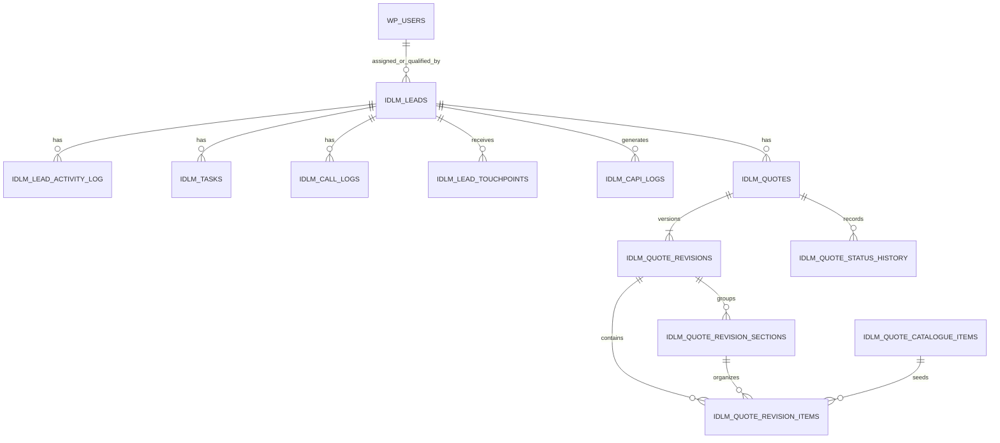

# Data Model

Tables use `$wpdb->prefix`; names below omit the site prefix. No database foreign keys are declared. IDs are application-enforced relationships and deletion must explicitly clean dependents.

## Core CRM tables

| Table | Important data and relationships | Created/migrated |
|---|---|---|
| `idlm_leads` | Canonical lead/profile, source/UTM/click IDs, commercial fields, pipeline/quality/call status, owner and qualification/handoff timestamps, duplicate linkage (`duplicate_of_id -> leads.id`) and response timings. `floor_plan_files` stores a bounded JSON URL list while `floor_plan_file` retains the first URL for compatibility. User-like IDs point to `wp_users.ID`. | `IDLM_DB::create_tables()` plus idempotent backfills in `IDLM_DB::init()` |
| `idlm_lead_activity_log` | Append-style activity: `lead_id -> leads.id`, `user_id -> wp_users.ID`, type, text details, time. Some structured details are JSON strings interpreted by UI code. | `IDLM_DB::create_tables()` |
| `idlm_tasks` | Lead tasks: lead/assignee/creator IDs, title, type, priority, `pending|completed`, due/completion timestamps. Qualification and Sales Follow-up types have lifecycle behavior. | `IDLM_DB::create_tables()` |
| `idlm_call_logs` | Provider-neutral call audit: lead/user, provider and unique provider event, direction/outcome, recording URL/hash, duration, JSON-like `metadata`. | `IDLM_DB::create_tables()` |
| `idlm_lead_touchpoints` | Acquisition history linked to canonical lead; platform/source/external ID, attribution fields, raw JSON payload and submission/receipt time. Unique `(platform, external_id)`. | `IDLM_DB::create_tables()`; duplicate touchpoint backfill in `IDLM_DB::init()` |
| `idlm_capi_logs` | Lead/platform/event payload, response and status audit. Payload/response are JSON text. | `IDLM_DB::create_tables()` |
| `idlm_audience_sync_logs` | Platform/audience/count plus JSON payload/response/status. | `IDLM_DB::create_tables()` |
| `idlm_telemetry_logs` | Error type/severity/message/file/line/trace/time. | `IDLM_DB::create_tables()` |
| `idlm_routing_state` | Atomic named round-robin counters with update timestamps. | `IDLM_Routing_State::install()` |

## Quotation tables

Created and upgraded by `IDLM_Quotation_Schema::install()` behind `IDLM_Quotations::install()` when `idlm_quotation_schema_version` differs from the aligned `IDLM_Quotation_Schema::VERSION` / `IDLM_Quotations::SCHEMA_VERSION`.

| Table | Important data and relationships |
|---|---|
| `idlm_quotes` | `lead_id -> leads.id`; quote number, title, owner/creator users, current/accepted revision IDs, status/timestamps and idempotent save key. |
| `idlm_quote_revisions` | `quote_id -> quotes.id`; revision number/status/source revision, immutable customer/project snapshot, internal/customer notes, currency and calculated totals, author/update IDs and save key. |
| `idlm_quote_revision_sections` | `revision_id -> revisions.id`; section name/description/order. |
| `idlm_quote_revision_items` | `revision_id`, optional `section_id` and `catalogue_item_id`; description, dimensions, quantity/rate, discounts, line totals, wood/optional flags and ordering. |
| `idlm_quote_payment_milestones` | Legacy-compatible revision milestones retained in schema but no longer edited or rendered. |
| `idlm_quote_status_history` | Quote/revision state transitions and actor/time. Retained although current UI largely suppresses workflow actions. |
| `idlm_number_sequences` | Atomic yearly numbering by `sequence_type`; unique type/year. |
| `idlm_quote_catalogue_items` | Reusable item code/name/category/unit/rate/wood flag and `active|inactive` state. |
| `idlm_quote_item_categories` | Normalized category names and active state. String category values remain on catalogue/items. |
| `idlm_quote_item_units` | Normalized unit names and active state. String unit values remain on catalogue/items. |

## State vocabularies

- Lead stage defaults use stable keys and persisted labels from `IDLM_State_Registry`; administrators may append custom labels while core workflow keys remain stable.
- Lead quality: empty/pending, `Qualified`, `Unqualified`.
- Handoff: `not_ready`, `awaiting_manager`, `manually_assigned`, `auto_assigned`, `exception`.
- Default call statuses: `Not Called`, `No Answer`, `Call Back Requested`, `Connected - Interested`, `Connected - Not Interested`, `Wrong Number`; configurable, with literal dependencies.
- Task state: `pending`, `completed`; domain task types include `Qualification`, `Sales Follow-up`, and `General`.
- Quote/revision legacy states include `Draft`, `Approved`, `Shared`, `Under Negotiation`, `Rejected`, `Expired`, `Superseded`. The present UI makes current revisions editable/printable and hides most state workflow.
- Catalogue/category/unit state: `active`, `inactive`.

## WordPress data

- `wp_users`/roles/capabilities provide identity and access. User IDs appear throughout lead, task, call, activity, and quote tables.
- User meta: `idlm_phone`; `idlm_whatsapp_read_activity_ids` (per-user bounded list); fallback read of `billing_phone`. Standard first/last name and email are updated by My Account.
- Attachments: lead floor-plan/file uploads use the WordPress Media Library (`wp_posts` attachment records); lead rows store URLs, not attachment IDs. Floor plans support up to 20 URLs in `floor_plan_files`; `floor_plan_file` mirrors the first URL for compatibility.
- No custom post types, taxonomies, post meta, or comments are registered.

## Options and transients

Options fall into these groups: schema/migration markers (`idlm_schema_version`, quotation/backfill markers); release/roles; CRM vocabularies and targets; visibility/routing pools/capacity/working hours; field mappings; audience rules/queue; platform credentials and event mappings; retention; telemetry; and `idlm_quote_settings`. Scoped integration credentials use encrypted `idlm_webhook_api_key`, `idlm_mcp_api_key`, and `idlm_google_gadm_password` envelopes unless their environment constants are defined. `idlm_retention_policy` groups touchpoint, integration-log, and telemetry retention days. `IDLM_Settings` reads the grouped `idlm_routing_settings` snapshot while mirroring established standalone routing keys during the compatibility migration; the complete schema is documented in [SETTINGS.md](SETTINGS.md).

Dynamic option families include `idlm_field_mappings_{platform}`. Round-robin indexes live in `idlm_routing_state`, and assignment overlap uses a database advisory lock. Important transients include throttled routing exceptions, per-IP REST fixed-window counters (`idlm_rl_*`), and per-user/per-revision quotation autosaves (`idlm_quote_autosave_*`, seven days).

Schema rules: increment the independent core or quotation schema version, update the matching installer, make backfills idempotent, and never assume physical foreign-key cascades.
