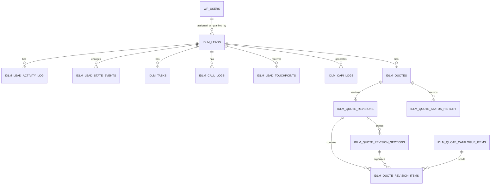

# Data Model

Tables use `$wpdb->prefix`; names below omit the site prefix. No database foreign keys are declared. IDs are application-enforced relationships and deletion must explicitly clean dependents.

## Core CRM tables

| Table | Important data and relationships | Created/migrated |
|---|---|---|
| `idlm_leads` | Canonical lead/profile, source/UTM/click IDs, commercial fields, pipeline/quality/call status, owner and qualification/handoff timestamps, duplicate linkage (`duplicate_of_id -> leads.id`) and response timings. `floor_plan_files` stores a bounded JSON URL list while `floor_plan_file` retains the first URL for compatibility. User-like IDs point to `wp_users.ID`. | `IDLM_DB::create_tables()` plus idempotent backfills in `IDLM_DB::init()` |
| `idlm_lead_activity_log` | Append-style activity: `lead_id -> leads.id`, `user_id -> wp_users.ID`, type, text details, time. Some structured details are JSON strings interpreted by UI code. | `IDLM_DB::create_tables()` |
| `idlm_lead_state_events` | Immutable reporting events for stage changes and owner assignments: prior/new state, origin, terminal-loss reason, actor, occurrence time, and the recorded Won/Lost amount when applicable. Event reporting begins on installation of schema `1.3.2`; the recorded amount column is reconciled by schema `1.3.3`. Historic current-state rows are never fabricated as events. | `IDLM_DB::create_tables()` |
| `idlm_tasks` | Lead tasks: lead/assignee/creator IDs, title, type, priority, `pending|completed|cancelled`, due/completion timestamps. Qualification and Sales Follow-up types have lifecycle behavior. | `IDLM_DB::create_tables()` |
| `idlm_call_logs` | Provider-neutral call audit: lead/user, provider and unique provider event, direction/outcome, recording URL/hash, duration, JSON-like `metadata`. | `IDLM_DB::create_tables()` |
| `idlm_lead_touchpoints` | Acquisition history linked to canonical lead; platform/source/external ID, attribution fields, raw JSON payload and submission/receipt time. Unique `(platform, external_id)`. | `IDLM_DB::create_tables()`; duplicate touchpoint backfill in `IDLM_DB::init()` |
| `idlm_inbound_submission_reviews` | Conflicting inbound email/phone matches retained for administrator review, including candidate IDs and redacted payload. These rows are not leads and never enter routing, task, conversion, or reporting workflows. | `IDLM_DB::create_tables()` |
| `idlm_capi_logs` | Lead/platform/event payload, response and status audit. Payload is redacted PHP serialized text; response is redacted text. New payloads include local `_idlm_delivery` identity/attempt metadata. | `IDLM_DB::create_tables()` |
| `idlm_audience_sync_logs` | Platform/audience/count plus JSON payload/response/status. | `IDLM_DB::create_tables()` |
| `idlm_telemetry_logs` | Error type/severity/message/file/line/trace/time. | `IDLM_DB::create_tables()` |
| `idlm_routing_state` | Atomic named round-robin counters with update timestamps. | `IDLM_Routing_State::install()` |

## Quotation tables

Created and upgraded by `IDLM_Quotation_Schema::install()` behind `IDLM_Quotations::install()` when `idlm_quotation_schema_version` differs from the aligned `IDLM_Quotation_Schema::VERSION` / `IDLM_Quotations::SCHEMA_VERSION`.

| Table | Important data and relationships |
|---|---|
| `idlm_quotes` | `lead_id -> leads.id`; one canonical quotation is created per lead through the application workflow, with further changes represented by revisions. Quote number, title, owner/creator users, current/accepted revision IDs, status/timestamps and idempotent save key are retained. |
| `idlm_quote_revisions` | `quote_id -> quotes.id`; revision number/status/source revision, immutable customer/project snapshot, internal/customer notes, currency and calculated totals, author/update IDs and save key. |
| `idlm_quote_revision_sections` | `revision_id -> revisions.id`; section name/description/order. |
| `idlm_quote_revision_items` | `revision_id`, optional `section_id` and `catalogue_item_id`; description, dimensions, quantity/rate, discounts, line totals, wood/optional flags, classification provenance and ordering. |
| `idlm_quote_payment_milestones` | Legacy-compatible revision milestones retained in schema but no longer edited or rendered. |
| `idlm_quote_status_history` | Quote/revision state transitions and actor/time. Retained although current UI largely suppresses workflow actions. |
| `idlm_number_sequences` | Atomic yearly numbering by `sequence_type`; unique type/year. |
| `idlm_quote_catalogue_items` | Reusable item code/name/category/unit/rate/wood flag and `active|inactive` state. |
| `idlm_quote_item_categories` | Normalized category names and active state. String category values remain on catalogue/items. |
| `idlm_quote_item_units` | Normalized unit names and active state. String unit values remain on catalogue/items. |

## State vocabularies

- Lead stage defaults use stable keys and persisted labels from `IDLM_State_Registry`; administrators may append custom labels while core workflow keys remain stable.
- Lead quality: empty/pending, `Qualified`, `Unqualified`.
- Handoff: `not_ready`, `awaiting_manager`, `manually_assigned`, `auto_assigned`, `exception`.
- Default call statuses: `Not Called`, `No Answer`, `Call Back Requested`, `Connected - Interested`, `Connected - Not Interested`, `Wrong Number`; configurable, with literal dependencies.
- Task state: `pending`, `completed`, `cancelled`; system task types are `Qualification` and `Sales Follow-up`; manual task types are `General`, `Call`, `Email`, `Site Visit`, `Design Mockup`, and `Quote Revision`. The shared registry owns the full vocabulary and manual subset.
- Current quote/revision writers use `Draft` for the current editable revision and `Superseded` for its prior source. Legacy commercial states/pointers/dates are preserved exactly and remain read-only; see [QUO-010 policy](AUDIT-REMEDIATION-QUOTATION-HISTORY-SLICE.md).
- Catalogue/category/unit state: `active`, `inactive`.

Disqualification keys include structured early-close reasons plus `unable_to_contact` (completed outreach) and `legacy_unqualified` (historical repair). Early-close UI/validation uses its contextual registry subset. The registry is not an allowed-edge state machine; see [current state and reversal policy](STATE-POLICY.md).

## WordPress data

- `wp_users`/roles/capabilities provide identity and access. User IDs appear throughout lead, task, call, activity, and quote tables.
- User meta: `idlm_phone`; `idlm_whatsapp_read_activity_ids` (per-user bounded list); fallback read of `billing_phone`. Standard first/last name and email are updated by My Account.
- Attachments: lead rows retain URL fields and WordPress attachment IDs remain stable; new URLs use authenticated `idlm_download_lead_file` retrieval. Generic private `wp_posts` attachment records associate with `idlm_private_files` (lead/purpose/filename/MIME/size/hash/state/archive) and `idlm_private_file_chunks` (file/variant/part/base64 bytes). Floor plans support up to 20 URLs in `floor_plan_files`; `floor_plan_file` mirrors the first URL for compatibility.
- No custom post types, taxonomies, post meta, or comments are registered.

## Options and transients

Options fall into these groups: schema/migration markers (`idlm_schema_version`, quotation/backfill markers); release/roles; CRM vocabularies and targets; visibility/routing pools/capacity/working hours; field mappings; audience rules/queue; platform credentials and event mappings; retention; telemetry; and `idlm_quote_settings`. Scoped integration credentials use encrypted `idlm_webhook_api_key`, `idlm_mcp_api_key`, and `idlm_google_gadm_password` envelopes unless their environment constants are defined. `idlm_retention_policy` groups touchpoint, integration-log, and telemetry retention days; diagnostic activity rows use a seven-day cutoff, while CAPI/audience audit logs use configured integration retention. Bounded progress and failure state live in `idlm_retention_progress`; the obsolete diagnostic cleanup marker is not the current worker policy. `IDLM_Settings` reads the grouped `idlm_routing_settings` snapshot while mirroring established standalone routing keys during the compatibility migration; the complete schema is documented in [SETTINGS.md](SETTINGS.md).

Dynamic option families include `idlm_field_mappings_{platform}`. Round-robin indexes live in `idlm_routing_state`, and assignment overlap uses a database advisory lock. Important transients include throttled routing exceptions, per-IP REST fixed-window counters (`idlm_rl_*`), and per-user/per-revision quotation autosaves (`idlm_quote_autosave_*`, seven days).

Schema rules: increment the independent core or quotation schema version, update the matching installer, make backfills idempotent, and never assume physical foreign-key cascades.

Private-file schema: core version `1.3.5`, independently verified marker `1`; unique attachment ID and chunk composite primary key, InnoDB required. States `uploaded`/`active`, `pending`/`pending_upload` migration journals, and `erasing` cleanup journal preserve verified bytes across filesystem failures. Plugin JSON backups exclude both private tables and WordPress attachment identities; full database recovery is required. Builder: Shashi. See [fifth slice policy](AUDIT-REMEDIATION-PRIVATE-FILE-SLICE.md).

### CRM JSON recovery (1.102.48)

Shashi: complete version-1 exports add optional schema/assigned-user identity manifests and use one InnoDB snapshot. Same-site full aggregates are validated and staged before atomic table/settings replacement. Protected credentials/migration/access markers and runtime counters are excluded; quotation sequence highwater cannot decrease. Private WordPress file tables are excluded and block partial JSON restore. [Policy and verification](AUDIT-REMEDIATION-RESTORE-SLICE.md).

## Checked core migrations — CORE-007

Shashi: core schema `1.3.6` and routing `1.0.1` retain additive declarations while requiring verified physical columns/defaults/indexes and InnoDB. Core/routing installers use `IDLM_Schema_Migration` session locks and checked durable markers. Seven legacy backfill markers advance to `1.0.1` only after success; `idlm_duplicate_touchpoint_backfill_cursor_v2` checkpoints bounded attribution batches. Migration markers/reporting-start/cursor are protected from backup import. Complete `1.3.5` manifests remain compatible only with identical current column manifests. [Operator/retry policy and limitations](AUDIT-REMEDIATION-SCHEMA-SLICE.md). Quotation migrations remain separate.

## Core 1.3.7 delivery intent

Shashi: additive InnoDB `idlm_lead_outbox` contains `id`, `lead_id`, `generation`, whitelisted `hook`, typed JSON `arguments`, `attempts`, `available_at`, and `created_at`. Indexes cover `(available_at,id)` and `lead_id`. Required lifecycle writes include intent in their checked transaction; delivery/cache handoff occurs after commit. Old-lead arguments may contain protected CRM data, with no configured credentials. Pending work is retained for replay, fenced by current recovery epoch/live lead, and removed by lead deletion/reset/restore. Delivery state is excluded from plugin JSON backups. [Contracts, retention and compatibility limits](AUDIT-REMEDIATION-LIFECYCLE-SLICE.md).

## Stable qualification cycles — 2026-10-07

Shashi: core schema **1.3.8** adds nullable `idlm_tasks.qualification_cycle` and unique `(lead_id, qualification_cycle)`. Qualification plans use 1–6; unrelated tasks retain NULL. Distinct legacy day/cycle labels adopt under the locked lifecycle transaction; ambiguous history is preserved and blocks that plan's repair. Complete earlier 1.3.5–1.3.7 backup inventories normalize to NULL before staging, while current snapshots retain identity. [Repair/upgrade policy](AUDIT-REMEDIATION-TASK-PLAN-SLICE.md).

## Derived active-workload capacity — CORE-010

Shashi: there is no new capacity table/counter. Active workload derives from non-duplicate lead rows outside Won/Lost and Unqualified, including Qualified. Each positive admission locks the target WordPress account plus current capacity configuration, then reads the live count under the existing lead transaction. A rollback/dead connection releases its locks and row change. Standalone configuration retains precedence over grouped fallback/default 30; zero disables the cap. Historical data is preserved even if already above a newly reduced limit. [Policy and verification](AUDIT-REMEDIATION-CAPACITY-SLICE.md).

## Identity reviews — core schema 1.3.9

Shashi: `idlm_inbound_submission_reviews` adds nullable `submission_data`, `external_id`, `resolved_lead_id`, `resolved_by`, `resolved_at`, `resolution_note`, unique `(platform,external_id)` and resolved-lead index. States: pending → matched/separate/rejected, terminal. Submission fields are sanitized/allowlisted; legacy missing values remain unknown. Resolved targets are live references at restore validation; legacy candidate JSON remains historical evidence. Complete prior inventories normalize null additions. Whole-row erasure follows candidate/resolved/contact association; reset and receipt-based touchpoint retention include every status. [Policy and evidence](AUDIT-REMEDIATION-IDENTITY-REVIEW-SLICE.md).

## Bounded retention and reads (`1.102.55`)

Shashi: retention runs one checked 100-row batch with transactional `idlm_retention_progress`, recovery/session fencing, fair target rotation, continuation hook `idlm_continue_sensitive_retention`, and operational failure status. Task responses use 50-card signed keysets and scoped totals (`counts_only` skips cards); queue qualification history reads 100 dates at a time. WhatsApp filters/counts stay in SQL; compatibility ID helpers page 100 by `after`. Lead CSV stages 100-row reads, capped at 10,000 rows/32 MiB/20 seconds of application work, before headers. Core/routing/quotation schemas unchanged. [Policy, verification, API details and remaining production gates](AUDIT-REMEDIATION-BOUNDED-WORK-SLICE.md).

## Quotation migration receipts (2.5.1)

Shashi: the ten quotation tables now have an explicit InnoDB declaration manifest and verified physical metadata before migration completion. No columns were added. `idlm_quotation_migration_status` is pending from before DDL until final completion; it is a protected runtime receipt excluded from backups. Schema version and ready status commit together after independently checked legacy/snapshot/lifecycle phases. Boot reads committed marker values directly. Complete quotation 2.5.0 backups remain accepted only with the complete compatible column manifest. Migration checks do not resolve old classification provenance (QUO-005) or historical commercial-state mapping (QUO-010). [Details](AUDIT-REMEDIATION-QUOTATION-MIGRATION-SLICE.md).

## Item classification provenance (2.5.2)

Shashi: `quote_revision_items.classification_source` distinguishes `legacy_unverified`, `submitted` and `default_nonwood`. Additive DDL conservatively marks legacy/missing classifications; every installer preserves stored 0/1 flags and amounts without reading current catalogue classifications. Missing original bits remain unreconstructable, and compatibility default 0 is not verified nonwood. Copies retain provenance, new saves derive it, and complete 2.5.0/2.5.1 backup manifests normalize before strict preflight. [Policy, schema/recovery limits and evidence](AUDIT-REMEDIATION-QUOTATION-CLASSIFICATION-SLICE.md). Historical commercial-state mapping remains QUO-010.

## Commercial history preservation (2.5.3)

Shashi: lifecycle receipt `1.1.0` verifies current/accepted/source bindings without changing original states, pointers, dates or totals. Read-only evidence includes current finalization, accepted pointer, commercial dates/history and non-Draft/Superseded revisions; failed evidence reads deny editing. Known Shared lead imports retain Shared with unknown dates null. Complete 2.5.2 backups are compatible. Previously erased fields require independent recovery evidence. [Policy and verification](AUDIT-REMEDIATION-QUOTATION-HISTORY-SLICE.md).

## Runtime engine requirement (1.102.60)

Shashi: Physical schemas remain core 1.3.9/routing 1.0.1/quotation 2.5.3. Every quotation save requires all ten quotation tables plus leads/activity/options to be InnoDB; working-copy, import and number scopes validate their relevant subsets on every transaction. Zero-row locking reads retain metadata pins until completion; no automatic conversion or marker rewrite occurs on drift. [Scope, executed checks and limits](AUDIT-REMEDIATION-QUOTATION-ENGINE-SLICE.md).

## Quotation numeric domain without schema migration

Candidate 1.102.61 keeps quantity DECIMAL(12,3), rate/quotation amounts DECIMAL(14,2) and lead quote_value DECIMAL(12,2). Two-decimal normalized measures cap at 999,999,999.99; money caps at the narrower lead ceiling 9,999,999,999.99. Checked intermediate/final totals prevent SQL truncation. Existing historical rows are unchanged; current submission policy applies to new revisions/working copies. [Numeric policy and qualification](AUDIT-REMEDIATION-QUOTATION-NUMERIC-SLICE.md).

## Revision document terms (1.102.62)

Shashi: quotation schema 2.5.4 adds nullable `document_terms LONGTEXT DEFAULT NULL` to revisions. Versioned JSON stores cover/closing flags and HTML, footer text and ordered payment name/percentage/amount snapshots. Existing `currency_code` retains original quotation currency across revisions. NULL means unknown historical terms, never current settings. No monetary/classification rewrite or milestone-table backfill. Exact prior 2.5.0–2.5.3 backups add NULL before strict restore validation; invalid nonempty snapshots fail preflight. [Contract and bounds](AUDIT-REMEDIATION-QUOTATION-DOCUMENT-SLICE.md).

## CAPI retry receipts (INT-005, Shashi)

Nonautoload `idlm_capi_retry_<sha256>` options contain the root log ID, recovery generation, status, bounded actual attempt count, attempt ID/time and result log ID. They contain no contact payload or credential. New local log metadata snapshots stage/event, platform/lead, destination, original event ID/time, value/currency and retryability/uncertainty; it is added after HTTP and never sent in provider JSON. Retry receipts are excluded from backups/imports and erased on successful restore/reset. No physical schema changes. Retention of minimal receipts remains unqualified. [Policy](AUDIT-REMEDIATION-CAPI-RETRY-SLICE.md).

## WhatsApp message receipts (INT-006, Shashi)

Nonautoload `idlm_whatsapp_receipt_<sha256(provider|message-id)>` options hold version, keyed fingerprint, activity ID and received time. `wp_options` uniqueness and a provider-ID advisory lock serialize cooperating requests; receipt and `whatsapp_reply` activity commit through the existing lead transaction owner with verified InnoDB options. Receipts contain no raw message ID/phone/text or credential, are independent of activity retention and remain as tombstones after deletion/reset. Backup export/import excludes them; same-site restore preserves existing receipts instead of rewinding acknowledgements. A database loss/foreign restore cannot reconstruct receipts from a backup. No schema changes. [Policy and privacy/retention limits](AUDIT-REMEDIATION-WHATSAPP-INBOUND-SLICE.md).

## Retention-independent CAPI receipts (`1.102.69`)

Builder: Shashi. Nonautoload `idlm_capi_delivery_<lead-id>_<sha256(platform|event)>` options hold version, lead/platform/event, current processing/sent/failed/uncertain status, an independent historical-success boolean, attempt ID and update time. They contain no request, response, contact identifiers, credentials or commercial payload. `IDLM_CAPI_Delivery` verifies primary state and InnoDB options/CAPI tables; the existing platform/lead lock serializes claims. Claims commit before HTTP; logs and acknowledgements commit together afterwards. Surviving expired legacy successes become receipts in the same 100-row retention transaction as their log deletion. Configured integration-log retention remains authoritative. Receipts persist for the lead's CRM lifetime, survive same-site restore and recovery generation changes, and are erased by explicit lead deletion/reset. They are excluded from backup export/import; database loss or erasure followed by restore cannot recover evidence already pruned from logs. [Policy and evidence](AUDIT-REMEDIATION-CAPI-RETENTION-SLICE.md).

## Minimal audience work — INT-009

Shashi: nonautoload `idlm_audience_work_<lead_id>` holds version/generation/lead ID, manual rule fingerprints and status/attempt/cooldown/UTC-day/destination hashes; no contacts, credentials or payload. `idlm_audience_sync_queue` retains selected IDs and `idlm_audience_scan` stores per-rule UTC-day keyset progress. Processing precedes HTTP; audit/ack are atomic. Diagnostic retention does not remove this work. Explicit lead erasure removes its record/queue ID; restore/reset clear runtime state and continuations. JSON export/import excludes these options. [Lifetime and limits](AUDIT-REMEDIATION-AUDIENCE-RETRY-SLICE.md).

## Local unreleased connector storage

Builder: Shashi. No schema change. Encrypted `idlm_connector_job_*` pending intake and `idlm_connector_attribution_{lead_id}` acquisition context use non-autoloaded options. Minimal `idlm_connector_receipt_*` HMAC fingerprints and `idlm_connector_erased_*` identity tombstones fence replay and stale intake. Runtime options are excluded from portable backups; reset/restore fence old jobs and deletion/reset erase associated acquisition context. [Retention and recovery limits](META-LEAD-CONNECTOR.md).

## Hosted Facebook connector state (local unreleased)

Builder: Shashi. No CRM schema migration. `idlm_meta_lead_connector` additionally stores hosted mode, connection ID and selected Page/form names/IDs. Pending `idlm_facebook_pending_<user>` secret-store entries contain encrypted session claims and expiry and are excluded from portable backups. The separate service has private SQLite installation, consent-session, connection, identifier-event, replay-nonce and deletion-receipt tables. Tokens and installation secrets use Sodium encryption; lead answers are transient proxy responses. Service pruning bounds consent to 15 minutes, event metadata to seven days and deletion receipts to 30 days. See its README for backup/key and pruning obligations.

## Meta form mappings — 1.102.94

Builder: Shashi. Nonautoload `idlm_meta_form_mapping_{sha256(app_id|page_id|form_id)}` options contain allowlisted CRM destination keys and exact provider question-key strings. Empty destinations are explicit omissions. They are source-scoped configuration, contain no token/respondent values and are included in portable settings backups. Existing global connector mappings remain fallback-only. No table/schema migration. Encrypted per-lead Meta acquisition snapshots retain all returned answers independently of mapping choices.
