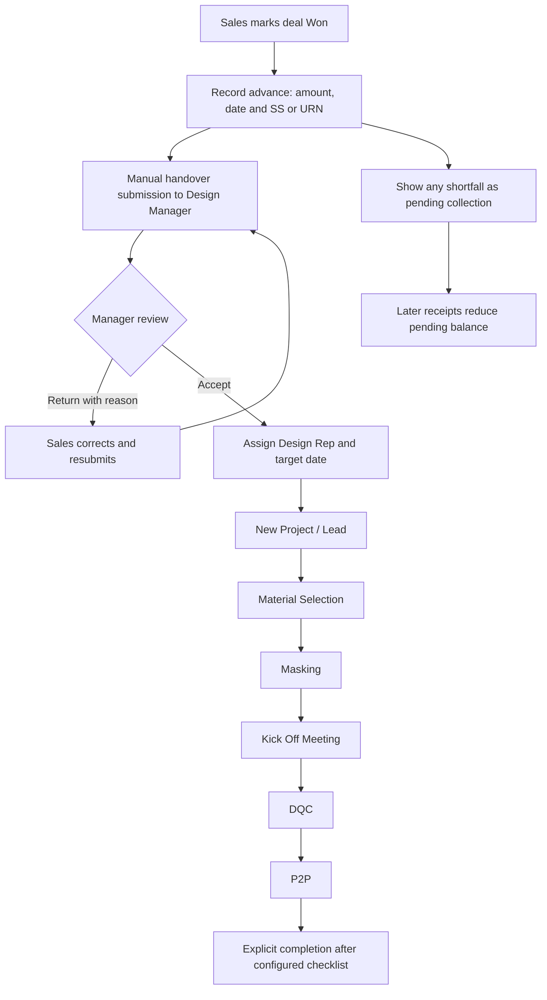

# Design Projects — Implementation Blueprint

Author: Shashi  
Date: 2026-11-05

Status: Implementation authorized by Shashi on 2026-11-05, one slice at a time. Section 0 of [the first-release requirements](DESIGN-PROJECTS-RELEASE-1-PLAN.md) overrides this blueprint where they conflict, including table count, stage configuration and build order. No deployment is authorized.

This is the implementation detail for [the first-release requirements](DESIGN-PROJECTS-RELEASE-1-PLAN.md). Confirmed business requirements take precedence over the proposed technical names and defaults below. Table names omit the installation-specific WordPress prefix.

## 1. Confirmed behaviour and remaining defaults

- Sales closes the lead as Won, records an actual positive advance with date, amount and screenshot (SS) or URN/transaction reference, then manually submits to a Design Manager. Both evidence types may be supplied. Apply the same evidence rule to subsequent collections.
- Short payments allow handover without a tolerance threshold or manager approval. Save the actual amount; show and carry forward the pending balance. Payment entry and Won do not automatically create actionable design work.
- The manager accepts or returns the handover and assigns a Design Rep. Sales ownership, Won amount and conversion history remain intact.
- Design uses a Kanban board by default with a List toggle: New Project / Lead → Material Selection → Masking → Kick Off Meeting → DQC → P2P, with the specified documents and payments. Stages remain configurable and versioned.
- Design Reps add/edit item names, descriptions and details through design revisions. Preserve the sales baseline, one quotation number and continuous revision numbering. Only authorized managers/admins change discounts, with a reason.
- Proposed defaults needing confirmation: phase checklists gate leaving/completing the phase; P2P remains Active until explicit completion; design users see collection summaries but do not record/correct receipts without a separate grant; item details use existing quote items. These defaults are proposals, not new confirmed business decisions.

## 2. End-to-end flow

Receipt recording is independent of submission: a paid lead can remain with sales. Create the unique project/intake identity on first submission; pending/returned projects do not count as active design work. Resubmissions append handover versions under that same identity. Accepted-but-unassigned projects enter the manager allocation queue. Accepted projects enter New Project / Lead, the first Kanban column, including accepted-but-unassigned projects in the manager’s scope. Pending/returned handovers remain outside the active board in intake queues. Actual design start is recorded when assigned work begins, independently of acceptance time; entering New Project / Lead alone does not start work.

Acceptance fixes the exact source sales revision and receipt/schedule snapshot. A later receipt updates live collections without rewriting what the manager accepted. Returning, reassigning, holding, cancelling and reopening each require explicit operations and preserve history. Sales-stage reversal or payment revocation flags a review exception; it does not delete a project.

## 3. Field and form plan

### Sales payment and handover form

| Group | Fields | Rule |
|---|---|---|
| Linked deal | Lead/customer, sales owner, Won amount | Read-only from lead; existing Won amount unchanged |
| Quotation | Quote ID, exact revision ID/reference, currency, grand total | Saved agreed revision required; no editable amount copy |
| Expected timeline | Ordered milestone name, percentage, expected amount; advance mapping | Snapshot from saved revision terms; missing terms require authorized resolution |
| Actual receipt | Amount, received date, method, URN/reference, screenshot file, note | Positive amount/date/method and SS or URN required; both accepted |
| Collection summary | Expected advance, advance received, advance pending, total received, total outstanding, unallocated credit | Calculated on server; shortfall informational for handover |
| Handover destination | Design Manager, studio/team | Eligible manager in authorized scope required |
| Scope | Included work/rooms, exclusions, commitments, brief/preferences, readiness/measurement summary | Scope required; explicit None/Unknown where supported |
| Coordination | Site/address confirmation, decision-maker/contact notes, requested and committed dates | Linked lead identity stays read-only |
| Open points | Pending information, risks, next action/responsible person | Explicit None or actionable detail |
| Sales remarks to Design | Dedicated long-text `sales_remarks_to_design`, displayed alongside payment details | Mandatory; reject empty/whitespace-only values; capture sales actor/time in each submission snapshot |
| Submission | Summary, expected record version, request key | Required; receipt and document references validated on server |

Sales remarks carry handoff context, customer commitments, special requests and pending points to the design team. Show them in manager review and the assigned rep’s handover summary. Sales may edit them before submission or when returned; resubmission preserves earlier remarks in immutable handover versions. After acceptance, updates require the audited amendment flow. Payment evidence cannot substitute for these remarks.

Keep a receipt's received date distinct from its system-recorded timestamp. Do not infer bank verification from a screenshot or URN. Do not derive received amounts from the payment schedule.

### Project and assignment fields

| Group | Persisted fields |
|---|---|
| Identity | ID, project number, editable title, lead ID, team type, created-by/at |
| Intake | Handover state, latest submitted version, accepted version, source sales owner and baseline revision |
| Assignment | Current manager, rep, team/studio, assigned-at, reason/history |
| Workflow | Workflow/version, current stage, stage-entry time, priority, optimistic concurrency version |
| Dates | Expected start, original/current target completion, actual start, completed/cancelled time |
| Brief | Requirements, preferences, measurement summary, site constraints, scope notes |
| Hold | Held flag, reason/responsible party, started-at, expected resume |
| Quotation context | Sales baseline revision, current design working revision, commercially accepted revision kept distinct |
| Audit | Created/updated actors/times, event identities; historic owner/stage labels snapshotted |

Calculated payment balances are read projections, not freely editable project fields. Extra project fields use stable definitions and typed validation; no arbitrary system-field replacement.

### Editable design items

Reuse quotation section/item rows: item name, description, category/unit, dimensions, quantity, material/specification details supported by the calculator, and notes. Capture item details in each revision. Validate supported fields against the current item schema before adding columns; custom material fields require an explicit additive snapshot design. Do not introduce a parallel item table for the same priced items. Project-only non-priced items remain a scope decision.

Rates inherit the source snapshot. Proposed safe default: reps cannot override rates until that authority is decided. Discount settings remain inherited and server-protected across save, autosave, copy and import. Manager discount changes require before/after audit and a meaningful reason.

## 4. Stage checklist model

Proposed timing: allow work inside a phase and require its checklist before leaving/completing it. This avoids requiring the final render before Masking work can begin. Publication stores explicit gate timing; do not implement both entry and exit gates implicitly. Initial acceptance/assignment does not require future phase documents.

| Stable stage key | Checklist/evidence | Payment handling |
|---|---|---|
| `new_project` | Accepted handover with payment details and Sales remarks to Design; eligible rep assigned before design work begins | Actual advance already recorded at handover; shortfall remains pending and does not block handover |
| `material_selection` | Receipt with date/amount and SS or URN | Expected 10% milestone shown; show actual and pending separately |
| `masking` | Final render PDF; masking DWG | No additional payment specified |
| `kick_off` | Tentative quote at exact revision; masking-changes DWG | Mandatory recorded payment with date/amount and SS or URN; amount/milestone mapping pending |
| `dqc` | Tentative quote; DQC DWG; MOM; approval-mail screenshot | No additional payment specified |
| `p2p` | Final quote; P2P DWG; receipt evidence | Expected milestone/amount pending; actual date/amount and SS or URN required |

A payment record/evidence requirement and full milestone coverage are separate rules. Proposed consistent default: recorded positive payment satisfies a payment-presence gate and shortfall stays visible; never turn the confirmed handover policy into an amount threshold elsewhere without a separate business decision. The 10% amount remains the expected target. Define its exact revision basis and whether an earlier receipt also satisfies a later stage explicitly; do not invent a second receipt or count it twice.

Quote evidence references the canonical revision and, where an uploaded quote is required, its private document version. Final render is PDF; drawing slots are DWG; screenshots are supported images. Quote/MOM file types remain to be finalized. An approval-mail screenshot is its own mandatory document and cannot be replaced by a payment URN.

Each gate stores exact evidence version/receipt-version/revision references. Replacing or archiving evidence triggers validation and a review flag for historical gates; historic transition snapshots remain intact. No silent undo of completed work. Used stages/categories are archived, and workflow migration requires explicit mappings.

## 5. Database design

### Conventions and ownership

Use InnoDB custom tables, unsigned bigint identities, existing canonical datetime conventions, `date` for received dates/targets, `decimal(14,2)` money and `decimal(5,2)` percentages. Calculate using existing integer minor-unit rules; never binary floats. Use bounded validated JSON only for snapshots/configuration/event details. No foreign-key cascade assumption; services enforce relationships and retention.

Core lead-owned payment tables are declared through `IDLM_DB::create_tables()` and its checked migration owner. Proposed `IDLM_Project_Schema` supplies project declarations through that same coordinated core installer. Quotation additions stay in `IDLM_Quotation_Schema::install()` behind the quotation facade. Allocate independent schema markers at implementation; physically verify indexes/columns before marking ready. Existing `idlm_quote_payment_milestones` is legacy-retained, not the new receipt source of truth.

### Lead-owned payment records — exist before any design project

| Proposed table | Main columns | Keys and purpose |
|---|---|---|
| `idlm_lead_payment_schedules` | id, lead_id, quote_id, revision_id, version_no, currency, basis_total, state, source_terms_snapshot, supersedes_id, created_by/at, amendment_reason | Unique lead/version; lead/state and revision indexes; immutable published schedule versions |
| `idlm_lead_payment_milestones` | id, schedule_id, stable_key, source_position, label, percentage, expected_amount, purpose, sort_order, optional due_date | Unique schedule/key and schedule/order; `advance` mapping explicit; no inferred due dates |
| `idlm_lead_payment_confirmations` | id, lead_id, current_version_id, receipt_identity, request_key, created_by/at, lock_version | One identity per received payment; unique lead/request key; lead/id index |
| `idlm_lead_payment_confirmation_versions` | id, confirmation_id, version_no, amount, currency, received_date, method, reference, normalized_reference, private_file_id, status, supersedes_id, correction_reason, actor_id, recorded_at | Unique confirmation/version; date and confirmation indexes; append-only correction/revocation history |
| `idlm_lead_payment_allocations` | id, receipt_version_id, milestone_id, amount, allocation_set_id, actor_id/at | Receipt-version and milestone indexes; unique allocation-set/receipt-version/milestone; allocation sets preserved on amendments |
| `idlm_lead_payment_events` | id, lead_id, event_key, event_type, receipt/schedule IDs, payload, actor_id, occurred_at | Unique event key; lead/id and type/time indexes; history before project creation |

A correction produces a complete new receipt version and replacement allocation set atomically; old allocations are historical. A schedule amendment produces a new schedule and a complete allocation set against it, preserving earlier versions. Read totals use only current non-revoked receipt versions and the selected current allocation set. Reject mixed leads/currencies, negative allocations, allocation sums exceeding the receipt and allocations to inactive schedule versions. Required evidence is enforced for each confirmed version.

Request keys prevent retry duplicates. Normalized URN/reference matches warn about possible duplicates within the same lead/method and require review rather than globally rejecting legitimate reused references. The same receipt identity can be cited by multiple stage snapshots without adding its amount again. Concurrent allocations lock the receipt and schedule before sum validation.

### Project-owned records

| Proposed table | Main columns / responsibility | Essential indexes |
|---|---|---|
| `idlm_projects` | Identity, current handover/assignments/workflow/stage, dates, hold, brief, baseline/design pointers, lock_version | Unique lead/team and project number; manager/state/id, rep/state/id, stage/entered-at, studio/target-date |
| `idlm_project_handovers` | project_id, version_no, state, quote/revision, payment schedule and receipt-version snapshot, required `sales_remarks_to_design` text snapshot, other submission fields, submitted/returned/accepted actors/times, reason, request_key | Unique project/version and project/request key; manager/state/submitted-at |
| `idlm_project_workflows` | workflow key, version, publication state, start stage, configuration snapshot, publisher/time | Unique workflow-key/version |
| `idlm_project_stages` | workflow_version_id, stable key, label/description/colour/order, category/purpose, target duration, archived flag | Unique workflow-version/stage-key; version/order |
| `idlm_project_transitions` | workflow_version_id, from/to stage, actor grants, gate timing, bounded requirements | Unique version/from/to; workflow/from |
| `idlm_project_events` | event key/type/version, project/lead, actor/time, before/after snapshots, event-time ownership, request key | Unique event key; project/id, type/time, event-time manager/time |
| `idlm_project_documents` | project_id, evidence/category key, title, description/area, current_version_id, state, lock_version | project/category/state/id |
| `idlm_project_document_versions` | document_id, version_no, private_file_id, previous_version_id, quote_revision_id, uploader/time, metadata snapshot | Unique document/version; private file and revision indexes |
| `idlm_project_field_definitions` | workflow/version, stable key, type, bounded choices/validation, read/edit grants, active state | Unique workflow-version/key |
| `idlm_project_field_values` | project_id, field_definition_id, typed value, updated actor/time | Unique project/definition |
| `idlm_project_gate_evidence` | transition_event_id, requirement key, exact document-version/receipt-version/quote-revision reference | Event/requirement index; referenced-object indexes for archive/revocation checks |
| `idlm_project_delivery_intents` | event_id, subscriber/hook key, recovery generation, attempts, available_at, claim/lease state, last error | Unique event/subscriber; available-at/id and project lookup |

Table/column names are proposals. Store immutable assignment, stage, hold and target-date events sufficient to reconstruct intervals; current project fields alone cannot support historical metrics. Add dedicated reporting projections only if measured query requirements justify them. Workflow field definitions can be deferred if fixed first-release fields meet scope.

### Quotation and private-file changes

Add revision phase (`sales`/`design`), project linkage, designer ID/name snapshot and persisted display designation; reuse existing source revision and actual author fields where semantically equivalent. Keep the original sales-current context explicit while design working pointers live on the project. Under the existing quote lock reserve the next global revision; test every existing sales reader/writer against mixed phase history.

Extend private-file purpose/reference validation for payment evidence and project documents. Current `IDLM_Private_Files::allowed()` checks lead scope and writes, and `referenced_or_temporary()` checks lead file fields: neither grants design document access today. Add explicit authorized project/receipt references without weakening old lead rules or exposing public attachment URLs. Keep 10 MB/file initially; DWG needs an explicit validated allowlist and safe download disposition. Preserve staged-file expiry, chunk/reference integrity, erasure and recovery behaviour.

## 6. Balance calculations and collection behaviour

Compute against a selected immutable schedule and confirmed receipt versions:

- Total received = sum of distinct current, non-revoked receipt amounts in the schedule currency, once per receipt identity.
- Advance received = current allocations to the mapped advance milestones; advance pending = max(0, expected advance minus advance received).
- Milestone pending = max(0, expected milestone amount minus current allocations). Overpayments are explicit unallocated credit until intentionally allocated.
- Total outstanding = max(0, schedule basis total minus total received); excess credit = max(0, total received minus basis total). Show unallocated credit separately, including receipts exceeding a milestone but below the overall quote total.
- Next collection display may combine prior pending and the next milestone. It is a presentation total, never another payable row added to overall outstanding.

Example: quote ₹10,00,000; advance 10% = ₹1,00,000; received ₹99,000 → handover allowed, advance pending ₹1,000, total outstanding ₹9,01,000. If the next milestone is ₹4,00,000, show ₹4,01,000 to collect including prior pending. Receipt of ₹4,01,000 clears the ₹1,000 first and allocates ₹4,00,000 to that milestone under the proposed oldest-pending allocation rule. Total received becomes ₹5,00,000 and total outstanding ₹5,00,000. Allocation order remains explicit and auditable.

An incomplete percentage schedule shows its unscheduled remainder; no fabricated milestone or due date. Changing the design quote does not silently change the schedule. Show the current design total separately until an authorized commercial schedule amendment is published.

## 7. Services, requests and capabilities

Follow existing static facade/repository/policy/controller/rendering conventions. Proposed responsibilities:

| Component | Responsibility |
|---|---|
| `IDLM_Projects` | Public internal facade and operation orchestration |
| `IDLM_Project_Repository` / `IDLM_Project_Policy` | Scoped persistence/read models; live actor and object access |
| `IDLM_Project_Workflow` | Versioned transitions and checklist evaluation |
| `IDLM_Lead_Payments` | Schedule snapshots, receipt versions, allocations and calculated balances |
| Project/payment controllers | Authenticated request parsing, nonce/capability validation, structured responses |
| Project renderer/templates/assets | Workspace lists/detail/checklists using existing design tokens/components |
| Project event/delivery owner | Atomic business event + delivery intent and bounded after-commit replay |

Operation contracts accept actor, object IDs, expected version and idempotency key: record/correct/revoke receipt; publish/amend payment schedule; submit/resubmit/accept/return handover; assign/reassign; update brief/target/items; transition; hold/resume; complete/reopen/cancel; add/archive document version; create design revision. Return typed `WP_Error` failures for validation, denied scope, stale version, missing evidence or unavailable migration. Short payment is an informational result, never a handover validation error.

Proposed authenticated actions use `idlm_project_*` and `idlm_payment_*` prefixes with operation-specific nonces; reads are bounded and scope-checked, downloads use authenticated admin-post routes. No public REST/webhook creation is needed for release one. Reuse request conventions; final route names become compatibility contracts when implemented.

Proposed capabilities: `idlm_view_design_projects`, `idlm_submit_design_handover`, `idlm_accept_design_handover`, `idlm_assign_design_projects`, `idlm_edit_design_projects`, `idlm_transition_design_projects`, `idlm_manage_design_workflows`, `idlm_record_lead_payments`, `idlm_correct_lead_payments`, and `idlm_change_design_discounts`. Grants always combine with current project/lead scope. Quote/export/file permissions require a narrow design-project access adapter; do not grant broad sales lead mutation or global quote management to make design work.

Sales records payments within owned leads; manager/admin correction authority is separate. Design Rep views assigned projects and edits authorized design work; manager operates scoped team queues; administrator configures/accesses organization-wide views. Proposed collection-entry grants after acceptance remain explicit. Suspension and reassignment revoke live access, including autosave and file URLs.

## 8. Transaction and event contracts

No nested transaction across existing quotation and lead owners: `IDLM_Lead_Transaction` explicitly refuses a quotation/third-party transaction. Lead-owned payment writes use a checked compatible lead operation; project mutations use an explicit owner with recovery fencing, rollback and required event/intent writes. Design revision creation needs a quotation-owned transaction adapter that atomically persists required project/revision linkage and event intent on the same connection; do not call one owning transaction inside another or permit a saved revision without its required linkage.

Before implementation, define one lock order for each operation and all competing paths: shared lead/project/schedule rows before quote reservation/content where applicable; receipt rows in ascending ID for allocation work. Verify compatibility with the quotation owner's existing order before changing it. Stale source revision, assignment or expected version fails without partial writes. Payment edits and handover snapshotting serialize on the same lead/payment context.

Use after-commit hooks with one versioned event envelope. Project events include event ID/schema version, event type, project/lead IDs, actor, occurred/recorded timestamps, workflow version, relevant before/after identities and event-time manager/rep/studio. Payment events before intake have a nullable project ID. Keep receipt identifiers in payloads; raw screenshots, URNs and customer details do not belong in broadly dispatched events.

| Proposed hook | Trigger |
|---|---|
| `idlm_lead_payment_recorded` | New confirmed receipt |
| `idlm_lead_payment_corrected` / `idlm_lead_payment_revoked` | New correction/revocation version |
| `idlm_lead_payment_schedule_published` | Initial or explicit amended schedule |
| `idlm_project_created` | Unique intake project created |
| `idlm_project_handover_submitted` / `idlm_project_handover_accepted` / `idlm_project_handover_returned` | Versioned handover decision |
| `idlm_project_assignment_changed` | Manager/rep reassignment |
| `idlm_project_stage_changed` / `idlm_project_hold_changed` | Committed workflow update |
| `idlm_project_document_version_added` / `idlm_project_document_archived` | Evidence lifecycle |
| `idlm_project_quote_revision_created` | Persisted design successor revision |
| `idlm_project_discount_changed` | Authorized revision-linked discount change |
| `idlm_project_target_changed` | Original/current deadline history |
| `idlm_project_completed` / `idlm_project_reopened` / `idlm_project_cancelled` | Explicit lifecycle event |

Durable delivery is at least once; consumers deduplicate by event/subscriber. Payment events also need lead-owned durable intent support: extend its allowlist/transaction recording explicitly rather than assuming the existing outbox accepts them. Email failure does not roll back committed handover; retries are bounded and visible. Pre-write extension filters may add validation but never bypass mandatory evidence, scope or history rules.

## 9. Design team workspace

Add a capability-matched Design Projects section to `[idlm_workspace]`; reuse shared navigation, components, colours and responsive patterns. Maintain any supported direct admin/shortcode compatibility through the existing routing/renderer approach.

### Representative view

Default My Projects Kanban with New Project / Lead as the first column, followed by Material Selection, Masking, Kick Off Meeting, DQC and P2P. Cards show project/customer, assigned designer, target date, priority, next required action, missing documents and pending collection amount. Provide a List toggle for comparing and searching projects. Filters: stage, target, hold, priority; search within scope. Both views use the same scope checks and server-validated transition operation. Moving a card with missing requirements opens the checklist and leaves the card in its original stage.

Project detail:

| Area | Contents/actions |
|---|---|
| Header | Project/customer, manager/rep, stage, target, hold and pending collection summary |
| Overview | Brief, read-only customer/site details, linked floor plans, original handover summary including Sales remarks to Design |
| Phase checklist | Required slots, current evidence, upload/version controls, payment references and transition action |
| Design quotation/items | Sales baseline read-only; current design revision; add/edit items, autosave, save revision, remarks, value delta |
| Documents | Lead documents read-only; private versioned design files grouped by evidence/category |
| Payments | Expected timeline, actual receipt history, pending by milestone, total outstanding; gated collection/correction actions |
| Activity | Assignment, stage, quote, document, payment, hold and target history |

Desktop uses existing table/detail conventions; mobile uses readable cards, a single-column checklist and accessible upload/actions without horizontal form overflow. Unsaved quote edits prompt before navigation. Stale edits show conflict/reload choices instead of overwriting another designer's work. Keep the removed quotation document-content review panel absent.

### Manager, administrator and sales views

Manager: Pending Handovers, Returned, Accepted Unassigned, My Team Active, Overdue, Due Soon, Missing Evidence, On Hold and Pending Collection. Review shows the exact sales quote, receipt evidence, expected/received/pending, Sales remarks to Design, scope and missing information; Accept + Assign can be one audited action. Shortfall never disables acceptance. Assign/reassign captures target and reason.

Administrator: organization sales-to-design intake queues and manager/studio comparisons, turnaround, stage aging, workload, value changes, discount activity, pending collections and operational delivery/migration failures. Scope totals and drill-downs consistently. Pending collections are receipt-confirmation balances, not bank-reconciled revenue or accounting receivables.

Sales: owned Won leads show Record Advance and Submit to Design, payment history and pending collection. After submission show manager decision/return reason; after acceptance show design status and permitted collection actions. No post-handover sales quote mutation through this view.

## 10. Delivery slices and acceptance

| Slice | Deliverable | Required evidence |
|---|---|---|
| 1. Payment foundation | Versioned schedule/receipts/allocations, proof access, sales form and pending summary | Snapshot/rounding, SS-only/URN-only/both, missing fields, partial/excess/duplicate/corrected receipts, permissions and concurrency |
| 2. Handover and access | Intake project, submit/return/resubmit/accept/assign, scoped roles | No automatic intake, short advance allowed, repeat requests, source preservation, mandatory remarks validation, remarks visibility and immutable resubmission/amendment history, reassignment/suspension and return history |
| 3. Workflow and documents | New Project / Lead intake column plus five design phases, configurable gates, DWG/private versioning, holds/targets | Allowed/denied transitions, versioned evidence, archive/revocation effects, MIME/size/download checks, workflow migrations |
| 4. Design revisions/items | Same quote number, protected source successor path, designer attribution | Concurrent numbering, immutable commercial history, item edits, all discount writer restrictions, sales reader/export regressions |
| 5. Workspace/reporting | Rep/manager/admin views and scoped queues, mobile parity | Default Kanban and List parity, New Project / Lead placement for accepted projects, pending/returned exclusion, assignment scope, counts/drill-downs, target/hold history, currency separation, pending balances without double count |
| 6. Release integration | Durable delivery, migrations, recovery/deletion/retention and release artifact | Interrupted upgrade/retry, physical verification, rollback, outbox retry/deduplication, private bytes recovery contract |

Each slice must preserve existing sales flows. Run targeted fast tests and PHP syntax checks, real WordPress/MySQL integration tests for transactions/migrations/concurrency and file access, then the broader shared regression suite for lifecycle/quote changes. Exercise relevant frontend/compatibility views on desktop and mobile. Release only after required repository artifact checks and aligned version/changelog updates; this blueprint itself requires no version bump.

## 11. Decisions to lock before the affected slice

1. Advance and later payment milestone mappings; 10% reference revision; receipt verification meaning and who can record/correct after design acceptance. Short-payment handover policy is already settled.
2. Phase completion versus entry gating (completion recommended), whether shortfall affects later phase transitions (payment presence recommended), Kick Off/P2P expected amounts and whether P2P is terminal.
3. Manager team/studio boundaries, internal document visibility to sales, quote/MOM formats and DWG validation policy.
4. Designer rate authority, material detail fields/project-only items, and final `DES` designation on outputs.
5. Target durations/timezone, receipt allocation/amendment authority, optional custom fields/tasks and notification recipients.

## 12. Architecture evidence and knowledge graph

Focused graph query: which existing components own quotation snapshots, private-file references and checked transaction/event delivery? The graph points to `IDLM_Quotation_Document`, `IDLM_Private_Files`, `IDLM_Lead_Transaction`, `IDLM_Lead_Outbox` and `IDLM_Quotation_Policy`. Its snapshot predates this plan and is a navigation aid only.

Verified against current source: quotation terms persist milestone amounts; money columns use decimal conventions; private files currently authorize through lead ownership/references; the lead transaction refuses foreign owners; lead outbox hook types are allowlisted. Relevant sources: `includes/class-quotation-document.php`, `class-quotation-schema.php`, `class-private-files.php`, `class-lead-transaction.php`, `class-lead-outbox.php`; current contracts in [ARCHITECTURE.md](ARCHITECTURE.md), [FEATURE-MAP.md](FEATURE-MAP.md), [DATA-MODEL.md](DATA-MODEL.md) and [INTERFACES.md](INTERFACES.md). No proposed project service, table, capability or hook in this document is claimed to exist today.
