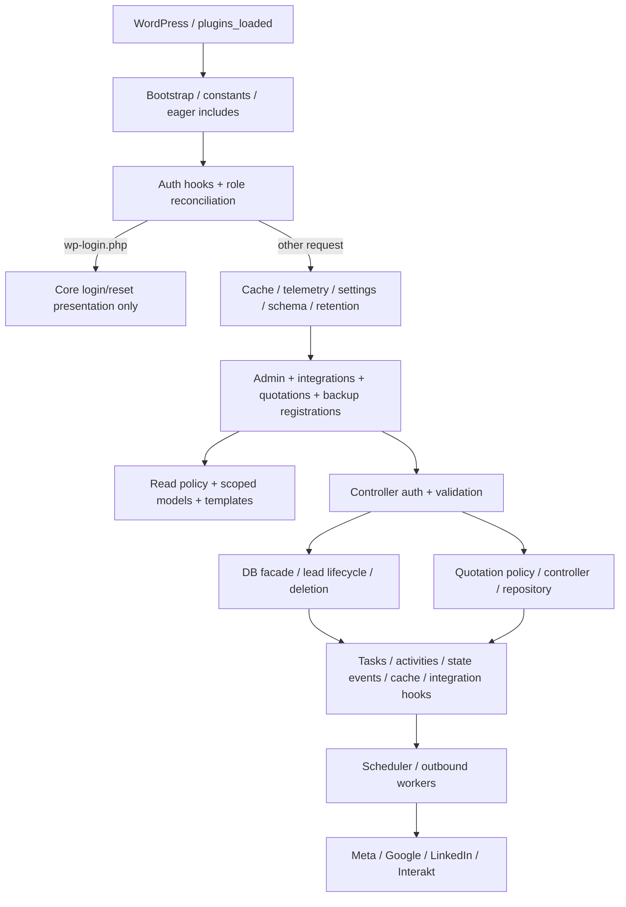
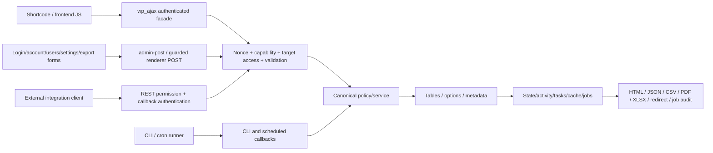

# Reviewed architecture and complete file inventory

Author / Builder: **Shashi**. Candidate **1.102.42**, core schema **1.3.4**, base revision `ff148ba62ec710a622d9b1af7e8f511b7e0b7385`. This map describes the reviewed dirty working tree, including the untracked quotation exporter and bundled PDF dependency. It consolidates existing review evidence; it does not add probes or change behavior.

## Inventory identity and navigation

The exact per-file inventory is [source-manifest.json](evidence/source-manifest.json): **513 files**, each with path, size and SHA-256. The snapshot contains 53 first-party include files, 24 templates, 22 assets, 31 test/tooling files and 325 dependency files, plus documentation/design/root/configuration files. Audit documentation and fixtures created after that snapshot are review outputs, not silently added runtime dependencies. The installed candidate identity is independently recorded in the [ZIP manifest](evidence/candidate/interior-design-lead-manager-1.102.42.manifest.json) and [checksum](evidence/candidate/interior-design-lead-manager-1.102.42.sha256). Working-tree and artifact inventories must not be conflated: `.distignore` excludes tests/docs/design/hosting/graph/development files from distribution.

For exact callback signatures and source locations, use [CONTRACTS.md](CONTRACTS.md), [registrations.csv](evidence/registrations.csv), [emissions.csv](evidence/emissions.csv), [persistence-keys.csv](evidence/persistence-keys.csv) and [runtime-contracts.json](evidence/runtime-contracts.json). The source registration scan records 122 declarations; the initialized WordPress doubles record 104 callable hook entries (95 actions, four filters, five shortcodes), including 46 authenticated AJAX and 24 admin-post entries; REST is expanded to 11 method variants, and the current menu inventory has one utility menu. These are different inventories with different scopes, not conflicting totals. The doubles register callbacks but do not dispatch every handler or establish its authorization.

Detailed responsibility/input/auth/storage/hooks/error/test contracts are in [CORE-REVIEW.md](CORE-REVIEW.md), [CORE-SOURCE-CONTRACTS.md](CORE-SOURCE-CONTRACTS.md), [INTEGRATION-SECURITY-REVIEW.md](INTEGRATION-SECURITY-REVIEW.md) and [QUOTATION-REVIEW.md](QUOTATION-REVIEW.md). This architecture map links their findings rather than repeating independent source inspection.

Graphify was used first for focused cross-module navigation. The core query found lifecycle/access/deletion ownership; the integration query mainly found admin/settings/test nodes and did not establish queue/restore causal links. Its generated snapshot has not been demonstrated to index every dirty/untracked runtime change, cannot prove dynamically constructed registrations, and cannot establish transaction/authentication behavior. Current PHP, initialized registrations and reviewer evidence take precedence. A final graph refresh can index the completed documentation, but is not release verification.

The later [actual WordPress inventory](evidence/native-runtime-contracts.json) records 107 first-party hook callbacks, five shortcodes and 11 REST method variants against the installed ZIP. Its callback-source filtering includes both REST namespaces and excludes WordPress's generated namespace index. It includes boot/schema/cache/settings/telemetry registrations absent from the earlier doubles. The double's one repeated Interakt batch callback is caused by its discovery harness; actual WordPress has one registration. These inventories record callback callability and metadata, not complete authorization or workflow execution.

## Boot and lifecycle ownership

`interior-design-lead-manager.php:18–76` defines constants and eagerly requires all 53 include files. There is no first-party Composer/npm/autoloader/build runtime; static `IDLM_*` classes and procedural WordPress boot are the compatibility architecture. Dompdf has its own bundled third-party autoloader, loaded only for PDF generation. The order permits facades to delegate to classes defined later once WordPress dispatches hooks.

Activation (`:79–97`) calls core schema, routing schema and quotation install, advances the core schema option, sets up recurring scheduling, reconciles capabilities and records activation time. Ordinary `plugins_loaded` (`:224–265`) registers auth and reconciles roles first; `wp-login.php` requests return before DB/integration/admin runtime initialization. Other requests initialize read cache, telemetry, settings, DB/routing schema, retention, integrations, CAPI, Interakt, scheduler, admin, backup and quotations in that order. This ordinary boot can migrate data, encrypt credentials and prune logs; it is not read-only startup.

Deactivation (`:216–220`) clears recurring audience/assignment and retention jobs, preserving tables/users/options/media. It does not unschedule all asynchronous CAPI/Interakt jobs. No uninstall implementation is present in the runtime inventory. Schema versions are independent of release version, but marker advancement and successful migration are not consistently coupled (CORE-007, QUO-004/005/010). Network-wide multisite installation has no per-blog migration orchestration demonstrated by this boot.

## All first-party runtime PHP files

Paths in this table are under `includes/` unless stated otherwise. **Core**, **Integration**, and **Quotation** point to the detailed reviews linked above. Every one of the 53 include files is named; public signatures live in the contract catalogue.

| File | Canonical responsibility and principal dependency | Detailed owner |
|---|---|---|
| `interior-design-lead-manager.php` | Constants, ordered loading, activation/update/boot/deactivation and CRM role/capability reconciliation. | Core |
| `mcp-server.php` | CLI-only WordPress bootstrap and line-oriented JSON-RPC stdio; host process is authority. | Integration |
| `class-db.php` | Core schema/log/task helpers and compatibility facade for canonical lead writes. | Core |
| `class-lead-lifecycle-service.php` | Identity upsert/insert/update, coupled workflow timestamps/state/events/tasks/hooks. | Core |
| `class-lead-deletion-service.php` | Transactional dependent deletion/reset and orphan auditing. | Core |
| `class-task-queue-service.php` | Task reschedule and administrator stale-cleanup operations; dispatcher supplies nonce. | Core |
| `class-state-registry.php` | Persisted workflow labels and stable keys; enumeration, not transition graph. | Core |
| `class-lead-access-policy.php` | CRM access, role scope, current-owner mutation versus broader reads, SQL scoping and routing roles. | Core |
| `class-routing-state.php` | Atomic keyed rotation counters/advisory-lock helpers with option fallback. | Core |
| `class-cursor-pagination.php` | User/filter/scope-bound signed navigation cursor; never replaces authorization. | Core |
| `class-read-model-cache.php` | Generation/context-partitioned cache, short fresh/stale windows and invalidation. | Core |
| `class-dashboard-read-model.php` | Full scoped cache context and dashboard entry point. | Core |
| `class-dashboard.php` | Current/historical/cohort metrics, date windows, role-filtered payload and investigation records. | Core |
| `class-admin.php` | Stable public callbacks/registrations; compatibility policy/render/controller delegates; utility menu/legacy redirects. | Core |
| `class-admin-ajax.php` | Authenticated CRM operations/lists/import/export/tasks plus administrator integration/diagnostic dispatch. | Core + Integration |
| `class-admin-lead-reads.php` | Authorized lazy drawer/details/WhatsApp/read-state responses. | Core |
| `class-admin-lead-notifications.php` | WhatsApp per-user read/unread metadata and reminder/pending/stale predicates. | Core |
| `class-admin-presenter.php` | Read-only labels/dates/activity markup/legacy attachment URL normalization. | Core |
| `class-admin-leads-renderer.php` | Authorized list context/common overlays and guarded lead templates. | Core |
| `class-admin-kanban-renderer.php` | Non-pre-sales pipeline context and guarded Kanban template. | Core |
| `class-admin-dashboard-renderer.php` | Authorized dashboard context and template orchestration. | Core |
| `class-admin-logs-renderer.php` | Administrator CAPI/audience audit lists and nonce-protected lazy payload detail. | Integration |
| `class-admin-assets.php` | Shared frontend asset registration/context enqueue and nonsecret AJAX localization. | Shell below |
| `class-admin-shortcodes.php` | Published workspace discovery and capability-aware module/sidebar orchestration. | Shell below |
| `class-view.php` | Guarded template name/realpath renderer, context passing and buffered HTML. | Shell below |
| `class-auth.php` | Anonymous email login/password recovery delegating cookies/keys/passwords to WordPress. | Integration |
| `class-admin-account-controller.php` | Own authenticated profile/phone/password/reset-mail changes and account template. | Integration |
| `class-admin-users-controller.php` | Administrator CRM account/role/suspension and per-role lead-scope management. | Integration |
| `class-settings.php` | Nonsecret grouped routing mirrors, validated branding/token/asset defaults. | Integration |
| `class-admin-settings-controller.php` | Administrator settings sanitization/persistence, routing coupling and scoped credential rotation. | Integration |
| `class-admin-settings-renderer.php` | Administrator settings/credentials/operational context and guarded settings shell. | Integration |
| `class-secret-store.php` | AES-GCM/environment-backed scoped webhook/MCP/feed credential storage. | Integration |
| `class-production-security.php` | MCP environment/grants/budgets, trusted proxies, upload policy and aggregate audit. | Integration |
| `class-mcp-core.php` | Shared JSON-RPC protocol/tool schemas, granted aggregate/PII reads and restricted custom-query engine. | Integration |
| `class-integrations.php` | Inbound/auth/feeds/MCP transport, attribution mapping, routing/handoff/fallback/mail. | Integration + Core routing |
| `class-capi.php` | Conversion hooks, per-platform eligibility/mapping, queue/dispatch/retry and Google conversion CSV. | Integration |
| `class-audiences.php` | Rule/manual audience selection, provider uploads, Google pull CSV and audit. | Integration |
| `class-interakt.php` | Ordinary WhatsApp automation queue/send and signed Interakt/Meta inbound replies. | Integration |
| `class-interakt-batch.php` | Separate capped administrative backfill, opaque job claims/lock/retries. | Integration |
| `class-scheduler.php` | AS/WP-Cron recurring audience/assignment consumers and schedule cleanup. | Integration |
| `class-data-retention.php` | Sensitive-key redaction, log/touchpoint/review pruning and bounded audience-summary migration. | Integration + Core |
| `class-backup.php` | Administrator custom-table/options JSON export/transactional replacement and outbound cancellation. | Integration |
| `class-integrity-command.php` | `idlm integrity [--repair]` WP-CLI wrapper around deletion-service orphan rules. | Integration + Core |
| `class-telemetry.php` | Plugin-origin PHP error/exception capture, diagnostic records/cap/prune. | Integration |
| `class-horizontal-readiness.php` | Aggregate shared infrastructure declarations and deployment preflight. | Integration |
| `class-operational-health.php` | Aggregate database/schema/job/secret/storage/cache/recent-fault observability. | Integration |
| `class-quotations.php` | Compatibility registration/install/asset/shortcode facade and protected common seams. | Quotation |
| `class-quotation-policy.php` | Quote capabilities/pre-sales/suspension and lead visibility predicate. | Quotation |
| `class-quotation-lead-read-model.php` | Scoped lead existence/search/editor selection. | Quotation |
| `class-quotation-calculator.php` | Server money/area/discount/tax/rounding and item/section normalization. | Quotation |
| `class-quotation-controller.php` | Save/revision/autosave/search/list/settings/catalogue request coordination. | Quotation |
| `class-quotation-repository.php` | Number reservation, aggregate persistence/snapshots/history/catalogue/query/deletion. | Quotation |
| `class-quotation-schema.php` | Quote/catalogue schemas, legacy/status/snapshot migrations and numbering schema. | Quotation |
| `class-quotation-renderer.php` | Workspace/editor/list/catalogue/customer print HTML from revision bundle. | Quotation |
| `class-quotation-exporter.php` | Revision-authorized PDF/CSV/XLSX; Dompdf/ZipArchive and controlled branding artwork. | Quotation |

Persistence is custom tables, WordPress options/transients/usermeta, and WordPress Media Library attachments. No custom post type supplies lead/quote persistence. Relationships are application enforced; service transactions/locks differ by operation, so a repository call alone does not preserve all invariants. The data model/state map is in the core and quotation reviews, and the exact option/meta keys are indexed in the persistence evidence.

## Frontend shell, authentication, templates and assets

The current UI is frontend-workspace-first. `class-admin.php:290–302` registers only administrator `idlm_utilities`; `:303–345` safely redirects known former wp-admin CRM routes to matching frontend views after capability/pre-sales checks. `class-quotations.php:59` intentionally has no menu. This is a compatibility shift, not a missing callback. The utility page guides creation of a published `[idlm_workspace]` page; discovery scans up to 100 matching published posts and selects the first real shortcode (`class-admin-shortcodes.php:14–38`).

The four CRM shortcodes call shared access policy before rendering; pre-sales cannot use Kanban. Composite workspace includes dashboard/leads, conditional pipeline/quotations, administrator logs/settings/users, and own account (`class-admin-shortcodes.php:77–126`). It sanitizes `idlm_view` and selects from the allowed section map; the template invokes an authorized callback rather than trusting a submitted class/function name. `[idlm_quotations]` remains a separate capability-gated compatibility shortcode.

`class-view.php:8–31` permits only plugin-owned lowercase/hyphen `.php` names and a realpath inside templates. It buffers output and passes a context array without extracting arbitrary keys. Templates own context-specific HTML escaping; this helper is neither authorization nor automatic escaping. Authentication/account forms use WordPress action nonces, local redirects and core user/session APIs, detailed in the integration review. Login UI and profile validation JavaScript improve recovery feedback but do not replace server validation.

`class-admin-assets.php:32–80` registers fonts/styles/scripts and localizes AJAX URL, nonce, allowed call statuses and display labels. It does not localize platform secrets. The `idlm-google-fonts` handle actually loads bundled Inter fonts through local `fonts.css`. Frontend discovery at `:91–128` enqueues relevant modules if the post contains a CRM shortcode; direct shortcode execution also forces its needed assets at `:131–164`. The old wp-admin enqueue method at `:86` is intentionally empty. Dashboard/kanban/workspace sets share base app/dialog CSS/JS; quotation facade separately loads quote assets/nonces. Asset enqueue may happen before access-restricted rendering and is not authorization. Workspace script loads in the head to apply saved collapsed state before paint; several assets use modification timestamps while others use plugin version.

| Complete template inventory (24 files) | Controller/context owner |
|---|---|
| `templates/access-restricted.php`, `templates/my-account.php`, `templates/workspace.php` | Auth/access presentation, own-account controller, shortcode composition. |
| `templates/admin/leads.php`, `dashboard.php`, `kanban.php`, `common-overlays.php` | Dedicated page renderers and shared lead/routing/modal contexts. |
| `templates/admin/users.php` | Administrator users controller. |
| `templates/admin/logs/capi.php`, `audience.php`, `payload-dialog.php` | Administrator logs renderer with lazy payload retrieval. |
| `templates/admin/settings/shell.php`, `general.php`, `white-label.php`, `routing.php`, `capi.php`, `webhooks.php`, `mcp.php`, `sync-reminders.php`, `backup.php`, `danger-zone.php`, `health.php`, `help.php`, `token-editor.php` | Settings renderer/controller; shared shell, protected admin controls and health/service/help disclosures. |

| Complete asset inventory (22 files) | Responsibility and dependency |
|---|---|
| `assets/js/admin-app.js` | Shared jQuery AJAX, lead list/filter/drawer/task/upload operations and client state. Server facade/contracts remain authoritative. |
| `assets/js/dashboard.js`, `kanban.js` | Reporting/Chart.js context, pipeline interactions and AJAX filters. |
| `assets/js/settings.js`, `users-logs.js` | Settings controls, token/rules/branding UI; account administration and lazy integration log dialogs. |
| `assets/js/quotations.js` | Catalogue/quote searches, item/section editing, independent browser totals, autosave/revision/save controls. |
| `assets/js/workspace.js`, `access-account.js`, `dialog.js` | Sidebar/localStorage/responsive navigation; password visibility/match/submission feedback; shared dialog focus/keyboard handling. |
| `assets/js/chart.js` | Bundled Chart.js, header identifies **4.5.1**, MIT; registered handle version **4.4.1** at assets class line 36 is stale metadata. |
| `assets/css/admin-style.css`, `dashboard.css`, `kanban.css`, `workspace.css`, `quotations.css`, `login.css`, `fonts.css` | Shared tokens/component CSS, module/responsive/print styles, core-password branding and local font faces. |
| `assets/fonts/inter-latin-300.woff2`, `inter-latin-400.woff2`, `inter-latin-500.woff2`, `inter-latin-600.woff2`, `inter-latin-700.woff2` | Five bundled font weights; parent dependency/licensing review governs notices/distribution compliance. |

No fresh browser/mobile/accessibility test is implied by this source map. The separate artifact/UI evidence records exactly which views/roles were exercised.

## Public surfaces and canonical request flow

| Surface | Registration and business-rule owner |
|---|---|
| CRM AJAX (40) | Admin facade registers current callbacks; AJAX/lead-read/log renderer delegates enforce their own nonce/capability/object checks. Multiplexed task `operation` values reach task-queue service; inventory must include these hidden operations. |
| Quote AJAX (six) | Quotation facade registers search/filter/autosave/discard; controller → quote policy/read model/calculator/repository. |
| Admin-post (24) | Three anonymous auth forms, own account, credential rotation, three users/scope actions, backup export/restore, quotation/catalogue/settings/print/download operations. Dynamic PDF/CSV/XLSX closures call exporter. |
| Five registered shortcodes | Four CRM shortcode facade delegates and quotation shortcode. Internal payment-structure shortcode expansion is a print-template token, not a globally registered shortcode. |
| 11 REST method variants | Lead webhook, two conversion feed forms, two audience feed forms, MCP GET/POST/DELETE; Interakt POST and Meta GET/POST. Integration permissions own scoped keys/feed auth; WhatsApp callbacks validate HMAC/token themselves. |
| Menu/legacy frontend routes | One administrator utility menu; recognized previous menus redirect to allowed workspace view. Query view/action/quote/revision selectors are input to guarded renderers, not separate registered REST routes. |
| Lifecycle hooks | Canonical lead stage/attribution/no-answer/generic automation signals feed CAPI/Interakt; import also emits conversion hook. State/activity/cache writes precede side effects with different transaction guarantees. |
| Scheduled jobs | Daily audience/telemetry and hourly routing/task rollover AS/WP-Cron pairs; sensitive-data prune; CAPI, ordinary Interakt and administrative backfill jobs. Hook registry ownership is scheduler/integration classes; queue workers are trusted server callers. |
| CLI/MCP | WP-CLI `idlm integrity [--repair]`; CLI stdio MCP and HTTP MCP share enabled/tool-grant/SQL core. HTTP credential authority is global integration scope, not a current CRM user's lead scope. |
| Upload/export/destructive operations | Lead uploads use admin AJAX → production upload policy → WordPress media; lead/catalogue exports stream CSV; quote downloads require explicit revision authorization; backup JSON restore differs from import; deletion/reset/retention use separate core services. |

Use `IDLM_DB::insert_lead`, `upsert_inbound_lead`, and `update_lead` instead of direct lead CRUD to preserve lifecycle normalization/hooks; the audit still found incomplete failure atomicity in these canonical paths. Apply read versus mutation policy separately. Quote repository public methods are trusted internal APIs, so controllers must bind quote/revision/lead IDs, validate state and coordinate locks/transactions. Notifications/logging/read caches are downstream effects, not sources of authority.

## Dependencies, tooling and non-runtime material

| Inventory group | Files/API dependencies and boundary |
|---|---|
| WordPress platform | Hook/REST/AJAX/shortcode/menu APIs; core users/cookies/nonces/password resets/mail; WPDB/dbDelta, options/transients/object cache, cron, Media Library/filesystem, HTTP, timezone/escaping. No first-party dependency manager. |
| Optional job backend | Action Scheduler global functions detected at runtime; not bundled in this manifest. WP-Cron retained, with ordinary Interakt synchronous fallback. MySQL transactions/advisory locks and persistent cache topology are deployment dependencies. |
| PDF bundle (325 files) | `vendor/README.md` plus 324 under `vendor/dompdf/`: root autoload/version/authors/license/readme; generated Composer autoload metadata; Dompdf and packaged font/SVG dependencies, Masterminds HTML5 parser, Sabberworm CSS parser. Exact files/versions/licenses/advisories are in source/dependency evidence and parent release review. Dompdf 3.1.6 only loads from quotation exporter. |
| XLSX/PDF/secret extensions | XLSX uses PHP `ZipArchive` and handcrafted OOXML, no separate spreadsheet package. Scoped credentials use OpenSSL AES-GCM. WordPress native tests use mysqli. PDF uses bundled renderer/extensions; the quotation/release review assesses missing-extension behavior. |
| External APIs | Meta Graph conversions/custom audience; Google Measurement Protocol and Data Manager pull CSV; LinkedIn conversions/contact segments; Interakt track and WhatsApp inbound. WordPress email is a delivery dependency. Real delivery/ad acceptance was not tested by reading declarations. |
| Fast/runtime contract tooling | `tests/run.php`, `bootstrap.php`, `admin-refactor-contracts.php`, `dashboard-contracts.php`, `high-priority-contracts.php`, `inbound-task-integrity-contracts.php`, `interakt-action-scheduler-contracts.php`, `release-contracts.php`, `ui-regression-contracts.php`, `tests/support/wp/wp-admin/includes/upgrade.php`, `tests/README.md`. Doubles and source assertions have explicit limits. |
| Native tooling | `tests/integration/bootstrap.php`, `run.php`, `worker.php`, `performance-bootstrap.php`, `high-priority-contracts.php`; requires disposable WordPress/MySQL database. |
| Performance tooling | `tests/performance/README.md`, `class-dataset-generator.php`, `class-qualification-result.php`, `seed-dataset.php`, `capture-baseline.php`, `capture-query-plans.php`, `run-load-qualification.php`, `qualification-matrix.php`, `qualification-scenarios.php`, `query-plan-scenarios.php`, `scenarios.php`. Synthetic qualification/load/plan tools; presence does not mean load matrix was run. |
| Release tooling | `tests/release/class-release-artifact.php`, `class-release-candidate.php`, `build-release.php`, `verify-candidate.php`, `.distignore`, `.github/workflows/tests.yml`. CI declares PHP 7.4/8.1/8.4 × WordPress 6.6/latest, MySQL 8.0; only recorded execution establishes PASS. Release job awaits matrix and builds/checks candidate evidence, not a public update service. |
| Audit-only additions | `tests/audit-contract-inventory.php`, `audit-integration-security.php`, `audit-quotation-probes.php`, core synthetic/native probes and all current audit documents/evidence. Excluded from packaged runtime. |
| Documentation/design/configuration | `AGENTS.md`, `CHANGELOG.md`, `readme.txt`, project docs, `design.md`, `data-point-labels.csv`; eight `design-system/interior-design-lead-manager/` guidance files (`MASTER.md`, seven `pages/` maps). `.gitignore`, `.hosting/qoak-hostarmada-ssh-config`, `.DS_Store` are checkout/deployment material, excluded as appropriate. No secrets from host configuration were read for this map. |

## Readability, coupling and focused maintenance risks

- **Large mixed owners.** `class-admin-ajax.php` spans more than 3,200 lines and combines CRM requests, lists/HTML, uploads, destructive operations and provider/diagnostic controls. `class-integrations.php` spans 1,871 lines covering authentication, transport, attribution, routing and email. Keep facade callbacks stable; extract one tested business boundary at a time rather than copying rules into new controllers. Their source signatures/owners are fully indexed in CONTRACTS and detailed reviews.
- **Authorization predicates have different meanings.** Core current-owner mutation policy differs from read-all visibility; quotations reuse visibility for some writes, list ownership uses historical metadata, and MCP grants are global. These differences are material findings (CORE-001/011, QUO-001/002/003, INT-001/002), not names to normalize cosmetically. Document rule owners and add cross-entry regression coverage before refactoring.
- **Queues share names but not guarantees.** Ordinary Interakt versus backfill (`class-interakt.php:111–135`, `class-interakt-batch.php:28–83`), CAPI worker versus manual retry (`class-capi.php:269–307`, `:661–704`), and daily audience versus pull resolver (`class-audiences.php:59–64`, `class-integrations.php:537–558`) implement different enable/state/idempotency behavior. A common durable delivery contract should precede code deduplication.
- **Inherited facades obscure side effects.** Lifecycle service extends DB, and quotation controller/repository/renderer share protected facade seams; direct methods are callable after boot but require trusted caller invariants. Quote value projection intentionally bypasses lead lifecycle conversion hooks. The reviewed failure/restore/state risks must be resolved before claiming one universal transaction boundary.
- **State enumeration and display labels are not a transition policy.** Registry, custom vocabulary settings, qualification/task rules and quotation normalization differ. Historical migrations can rewrite commercial states/classification; event text parsing and current setting lookups can affect prior exports. State-map and migration evidence in the detailed reviews are authoritative.
- **Presentation duplication and independent calculations.** The large base CSS and appended quotation print overrides require controlled cascade review; browser quotation totals in `assets/js/quotations.js` independently duplicate server calculator rules. Dompdf transforms browser grid into table-compatible layout in exporter. Preserve API/UI parity with meaningful persisted-revision/export checks, not matching source-string assertions.
- **Misleading names/stale documentation.** `idlm-google-fonts` is local font loading; chart registration reports 4.4.1 while vendored header says 4.5.1. Legacy no-op menu/admin asset methods preserve compatibility and should be documented as such. Old project docs say no CLI, Local MCP fallback, no binary PDF and WP-Cron ordinary Interakt fallback; current source contradicts those statements. The new audit documents distinguish reviewed behavior from intended behavior.
- **Operational declarations are not correctness checks.** Schema markers, health presence checks, shared infrastructure constants and successful queue acceptance cannot prove migrations, concurrency, current provider authentication or recovery. Preserve raw execution/status evidence and list unresolved limitations before public release.

This map establishes where to extend or investigate each feature. It does not supersede the findings, executed scenario matrix, installed-artifact evidence or release verdict; those documents explicitly identify unresolved security/data-integrity blockers and checks that remain unrun.
