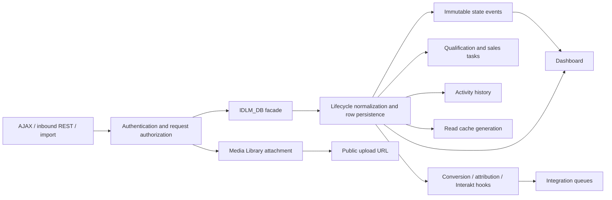
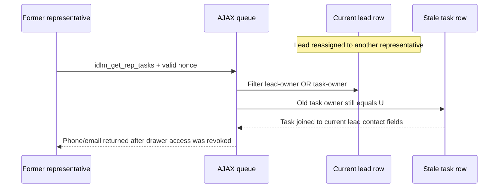

# Core lead engineering audit

Author: **Shashi**. Reviewed 2026-10-06. Base commit `ff148ba62ec710a622d9b1af7e8f511b7e0b7385`; working-tree plugin version `1.102.42`, core schema `1.3.4`. This is a review of the dirty checkout, including the changed drawer/WhatsApp reads and facade registrations. No production behavior was changed. Audit-only fixtures and evidence live beside this report.

**Core verdict: NOT READY.** Confirmed privacy, export and persistence failures remain. This review does not approve the ZIP; the parent audit owns final-artifact verification and the integrated verdict.

## Navigation, scope, and evidence

Read workspace/plugin AGENTS and targeted project/data/flow/security documentation. Graphify query `lead lifecycle assignment deletion attachment access --budget 1200` identified `IDLM_Lead_Lifecycle_Service`, `IDLM_Lead_Access_Policy`, and `IDLM_Lead_Deletion_Service` as distinct owners with extracted method links. Source was then verified directly; the existing graph is a navigation snapshot, not proof of the current dirty changes.

Reviewed first-party core modules: bootstrap, DB, lifecycle, state registry, access policy, routing state and assignment functions in integrations, task queue, deletion, retention, read cache, cursors, dashboard/read model, admin facade/AJAX/lead reads, reminder/read-state helper, presenter, lead/kanban/dashboard renderers. Integration credentials, backup implementation, quotations, authentication/accounts, scheduler implementation, frontend assets and bundled dependencies have separate reviewers; their boundaries are referenced where flows cross them. The complete method/registration signature appendix is [CORE-SOURCE-CONTRACTS.md](CORE-SOURCE-CONTRACTS.md).

Execution evidence:

- [core-synthetic-probes.php](core-synthetic-probes.php), [results](core-synthetic-results.json): **7 PASS, 9 FAIL**, PHP 8.4.14 dependency-free doubles. These failures are safety expectations, not a failure of the fixture process. WPDB doubles always grant advisory locks and do not model database isolation or unique constraints.
- [core-native-probes.php](core-native-probes.php), [results](core-native-results.json): **2 PASS, 5 FAIL**, native WordPress 7.1.2/PHP 8.4.14/MySQL on the explicitly disposable audit server. A new `idlm_test_core_native_20261006` database and isolated temporary content/uploads were created and removed. Email was intercepted before WordPress installation; external HTTP was blocked; cron spawning was disabled. No configured site database was loaded.
- Actual lead export handler executed with mocked SELECT result and synthetic `=1+1` first name: [core-csv-synthetic.csv](core-csv-synthetic.csv). Formula is retained. PHP 8.4 emitted `fputcsv` implicit escape deprecations at lines 836 and 839; clean evidence was captured with display_errors disabled while retaining stderr diagnostics.
- Both new PHP fixtures passed `php -l`. Parent reports existing checkout native suite **17 PASS / 0 FAIL**; do not count that as these new negative probes or as all-artifact/browser coverage. Parent owns the fast suite, installed-artifact/native suite, Plugin Check, and UI results.

Initial native AJAX fixture attempts exited through WordPress's non-AJAX `die` path; those partial attempts are not counted as full runs. The final fixture defines `DOING_AJAX` and captures the die handler. Both exact disposable databases left by those preliminary exits were explicitly removed; the parent's UI database was preserved.

## Module contracts and ownership

All paths below are relative to the plugin. Public static signatures, line numbers, registrations and emissions are in the companion source-contract appendix. A facade signature is a compatibility entry, not a separate domain rule.

| Module | Contract, persistence, authorization and side effects | Recovery/test limits |
|---|---|---|
| `interior-design-lead-manager.php` | Eagerly includes static classes, including untracked exporter. Activation calls DB/routing/quotation installers, advances core schema option, schedules jobs, reconciles roles, records activation time. `plugins_loaded` boots auth, role updates and runtime; wp-login stops before DB/runtime initialization. Deactivation clears schedules/retention; no uninstall callback/file was found in this boundary. Recognized role slugs/display names grant CRM/quotation capabilities. | No installer-success return checked before core/routing markers; roles removed by operators may be re-added on version reconciliation. Multisite network install/activation is not implemented with per-blog iteration. Native fresh boot exercised; failure/upgrade/multisite matrix incomplete. |
| `class-db.php` | Canonical compatibility facade delegates insert/upsert/update to lifecycle service. Owns nine custom schemas (leads, activity, immutable state events, CAPI, audience logs, telemetry, tasks, calls, touchpoints) plus inbound-review table; no physical foreign keys. Lead monetary values are DECIMAL; state-event amounts snapshot terminal transitions. Owns workflow normalization, budget parser, six-cycle compliance, task planning/roll-forward, backfills and log/event insert helpers. Direct methods have no request authorization; trusted callers must enforce it. Options record independent migrations. | dbDelta/post-DDL checks are incomplete; event/task/log helpers' failure returns are frequently ignored. Parent native install/repeated schema checks passed; injected event failure fails new native probe. |
| `class-lead-lifecycle-service.php` | Extends DB for shared protected invariants/error channel. `upsert_inbound_lead` sanitizes platform, locks sorted normalized phone/email/platform external keys, matches one canonical or retains ambiguous review, fills blank attributes and updates latest source, records touchpoint; repeat does not reassign owner. `insert_lead` applies workflow, duplicate policy, timestamps, creation/state activity; `update_lead` reads old row, validates, writes row then state events/tasks/activity/hooks/cache. Returns ID/result array/bool and DB's last validation string. | No encompassing lifecycle transaction. Mutation authorization belongs to handlers. Inbound failure swallowing and missing state-event failure handling verified. General update uses no row lock/version token; stale concurrent reads remain NOT RUN. |
| `class-state-registry.php` | Stable persisted stage/call/quality/task/handoff labels and key/label translations; `values`, `stages`, `stage_key`, `label` are read-only APIs. Built-in stage union with configured custom stages is allowed by DB. | Registry is an enumeration, not a permitted-edge FSM. Manual task types and some disqualification reason lists live elsewhere. Tests mostly inspect labels/normalization; callers can disagree unless DB validates domain. |
| `class-lead-access-policy.php` | `has_rep_access` checks login/disabled meta/manager or recognized role, not access capability. `restriction_user_id` applies assigned/all per-role scope, mixed-role assigned precedence via users controller, manager unrestricted, pre-sales assigned, legacy rep see-all default1. `scope_sql` generates owner/history SQL. `can_access(id,false)` permits manager or current owner; view=true can include global role scope and historical pre-sales owner/qualifier. Drawer commercial restrictions and role-based assignable users are here. | Read-all does not grant cross-owner mutation. Removed capability is ineffective for recognized-role access; assignability fails to exclude disabled users. Synthetic access/disabled probes executed. |
| `class-routing-state.php` | dbDelta keyed rotation table, atomic `LAST_INSERT_ID` counter; bounded-modulus `next_index`, GET_LOCK/RELEASE_LOCK wrappers. Option fallback when table update fails. | Fallback option counter is not atomic; install marker unconditional. Real unsupported advisory-lock behavior and counter fallback contention NOT RUN. |
| Assignment portion of `class-integrations.php` | Intake modes manual/pre_sales/round_robin/source/studio; pools, working time/capacity, studio strategy and per-key rotation. `assign_lead_atomically` CAS checks expected owner and optionally qualified/nonterminal/duplicate status; changes row then activity/event/cache/tasks and optional email. `run_assignment_fallback` guards overlap with advisory lock, updates start/completion/status options. Recovery drains unassigned 200-row batches; qualified fallback examines up to 200 rows, preserving configured sales owners and handling mismatch/exception. | CAS protects owner race for router only. Task/event/email work is outside a transaction; failure reporting incomplete. Unassigned pool stale across whole backlog violates cap (native verified); disabled-user pools not filtered. Parent integration reviewer covers upstream REST/mapping/working-time APIs. |
| `class-task-queue-service.php` | Called by `ajax_get_rep_tasks(operation=reschedule/cleanup_stale)` after facade nonce. Reschedule requires CRM, exact future local due time, pending nonqualification task and current lead ownership. Cleanup is manage_options-only and archives pending Lost/deleted-user tasks through DB. | Nonce belongs to dispatcher; standalone service methods must not be independently registered. Reschedule compares epoch with site-local `current_time('timestamp')`; timezone boundary validation remains NOT RUN. Cleanup counts normalize DB failures to0. |
| `class-lead-deletion-service.php` | Administrator handlers call delete/delete_many; trusted internal service has no capability guard. Normal deletion refuses canonical deletion with outside linked duplicate; transactional deletes activity/events/CAPI/tasks/touchpoints/calls, quote records, lead. Reset verifies count, all runtime table engines and transactional options, deletes manifest, clears audience/Interakt runtime options, cancels async lead hooks, invalidates cache. Orphan auditing/repair enumerates core/quote relationships. | Delete-many lacks reset's engine validation, missing checks on duplicate lookup errors, no attachment cleanup, no targeted queue removal. Reset leaves identity-review table. Orphan audit excludes inbound-review JSON references/media/user-meta/queues. Native reset omission confirmed. |
| `class-data-retention.php` | Daily `idlm_prune_sensitive_data` WP-Cron, recursive field-key redaction and bounded audience-payload compaction. Policy prunes touchpoints/reviews, CAPI/audience/telemetry; diagnostics purge selected activity types and CAPI older than7 days irrespective of integration policy. Stores retention/compaction version markers. | Most deletes unbounded, no resumable cursor/overlap lock or inspected DB result. Installation initialization can synchronously purge. CAPI idempotency/audit reliance crosses integration reviewer. Does not expire leads/uploads or supply WP personal-data eraser/exporter registration in this module. |
| `class-read-model-cache.php` | Generation option partitions logical caches. Context-hashed object-cache or transient value with60s fresh/180s stale, 30s lock; first fill computes even if lock storage fails. Option/retention hooks invalidate; lifecycle explicitly invalidates. Public `remember`, `invalidate`, `generation` and option handlers. | Caller must supply full authorization/query context. Transient-option locks have expiry cleanup but no ownership token, so very slow builder lock stealing remains NOT RUN. TTL stale response is designed. |
| `class-cursor-pagination.php` | HMAC with nonce salt over JSON user/family/filter/sort/scope/position/expiry;2h default and2048-byte max. Recursive associative sorting stabilizes scope hashes. Returns position or WP_Error, never authorization. | Positive and cross-user rejection executed. Expiry/tamper/filter/role revocation mostly existing tests; full matrix does not inherit PASS from implementation. |
| `class-dashboard.php` | `access_context` derives sales/marketing/pre-sales/manager payload visibility. `get_stats` uses scoped read model then filters fields. `calculate_stats` mixes current live pipeline, creation cohorts, timestamped current closes and immutable Won/Lost/assignment occurrences with legacy fallbacks. `get_records` bounded25-row+1 investigations uses same current-owner scope. `get_date_ranges` uses site timezone and period/custom ranges. Queries are allowlisted/prepared. | Events are not durable under lifecycle failures. Historical results deliberately join surviving lead/current-owner visibility: deleting lead removes report history; owner change moves historical visibility. Public `calculate_stats` is internal/trusted and bypasses field filtering if called directly. Native reporting/date/large-data assertions are parent suite/source-only where unspecified. |
| `class-dashboard-read-model.php` | Public get_stats/cache_context; namespace includes roles, access, owner/global scope, settings/schema/filter/ranges, minute-rounded now. No secrets in cache context. | Changed scope produces different key even though role scopes are not in cache option invalidation allowlist. Cache isolation was inspected; live artifact cache flush/ownership/browser concurrency NOT RUN here. |
| `class-admin.php` | Stable callbacks delegate controller/policy/render/service classes. Registers admin menus, redirects, frontend enqueues,4 shortcodes, account/user/credential admin-post handlers,40 authenticated AJAX callbacks. The appendix records each exact registration. `get_rep_tasks` multiplexes two hidden operations. | No anonymous CRM AJAX. Missing AJAX callbacks not found in this facade; all current public delegates exist. Nested module auth must remain intact. Changed WhatsApp registration delegates to lead-read service. |
| `class-admin-ajax.php` | Shared `idlm_admin_nonce`; CRM role gate plus view/current ownership per object. Quick edit allowlists stage/call/owner/quality/commercial logic; pre-sales decisions/touch recording impose evidence and role rules. Comments manage actor ownership and15s duplicate check. Task CRUD protects lifecycle task type. Admin-only import/export/deletion/reset/routing/diagnostic/integration commands. Lists bound page sizes25/50/100; default sales order keyset cursor, other sorts/pre-sales OFFSET; kanban per-stage limits. Drawer omits submitted controls safely, binds tagged files by lead, preserves structured quote summary authority. | CSV raw cells/all rows in memory; unbounded task queue; stale task ownership PII. Mutation calls usually report explicit DB primary failure but dependent failures lost. Native task-leak verified. Media source-only; quote/diagnostic/integration handlers separately audited. |
| `class-admin-lead-reads.php` | Details/WhatsApp/read marker require nonce+CRM+lead view. Drawer loads current record and bounded history/100 recent comments; activity and WhatsApp tabs are lazy in current dirty tree. WA history bounded100 and render escaped. Mark-read resolves latest authorized lead reply then per-user helper. | Historical pre-sales read intentionally permits complete drawer under policy. Upload URLs rendered directly; no private download boundary. Parent UI reviewer must exercise newly lazy tabs/error/stale drawer sequencing. |
| `class-admin-lead-notifications.php` | Reminder definitions legacy+array, overdue business predicates, pending calls and WhatsApp read/unread counts. Read markers in usermeta bounded1000 leads. Unread snapshot caches user/restriction/max activity/read IDs for15s. Received lead IDs used as an intersection with list permission query. | Cache has no ownership generation in key: with external cache, owner-change without new activity may briefly leave stale badge/filter IDs; material direct access remains rechecked. Broad WA ID/activity queries and task/count larger-data performance NOT RUN. |
| `class-admin-presenter.php` | URL-list normalization (legacy URL+JSON/newline/comma compatible), qualification labels, site-timezone datetime formatting, business-day age, escaped/linkified activity HTML and allowlisted stage-total mappings. Read-only; compatibility facade delegates. | No file privacy checks or request authorization by design. Business-time/date DST tests and malformed legacy arrays not independently executed. |
| `class-admin-leads-renderer.php`, `class-admin-kanban-renderer.php`, `class-admin-dashboard-renderer.php` | Server permission guards then context-building/templates; pre-sales kanban denied; common overlays and managers' routing context shared across frontend/admin. Dashboard template context filters role display separately from data authorization. | Browser/mobile/accessibility/asset checks owned by UI reviewer. Source review alone is not browser verification. |

## Canonical data model and transitions

Lead PK `id` is referenced logically by tasks/activity/state-events/calls/touchpoints/CAPI and quotation root. Email/phone indexes are nonunique. Touchpoint `(platform,external_id)` unique key enforces replay dedup where external ID exists; submissions without external ID are independent touches. Pending identity reviews hold email, phone, candidate IDs JSON, redacted payload and status with no FK. Routing state holds monotonic counter, not lead ownership.

`insert_lead → update_lead/upsert` is the intended lifecycle owner. Authorization occurs before it in request handlers. Callers must not use raw `$wpdb` lead writes unless implementing narrowly documented assignment CAS/backfill/quotation projection and explicitly preserving timestamps/tasks/activity/events/hooks/cache. Lifecycle does not perform its own permissions or arbitrary-column allowlist; treat these APIs as trusted internals.

| Input/transition | Actual business rule and consequence |
|---|---|
| New insert | Defaults New/Not Called; stamps created/updated, owner-assigned clock; rejects new Unqualified. Qualified requires6 project fields and budget≥₹4L. Legacy raw insert duplicate scan can create Lost/Unqualified duplicate row; canonical inbound upsert normally reconciles/reviews first. Emits initial New conversion for nonduplicate. |
| Quality Qualified / stage Qualified | Forces consistent Qualified stage/quality, requires6 fields/budget; explicit quality decision without plan requires handoff remark. Stamps qualification actor/time; pre-sales owner→awaiting_manager, sales owner→manually_assigned, ownerless→awaiting_manager. Completes Qualification tasks. |
| Downstream sales stage | Does not automatically qualify; Visited Studio/Negotiation/Won are not globally forbidden for quality blank. This is current deliberate normalizer behavior, not a strict linear FSM. Validate-quality early return means blank-quality sales transitions avoid qualification checks. |
| Unqualified | Six complete outreach cycles plus closure evidence unless structured early_close; moves Lost and records reasons/time/actor; completes qualification then cancels pending remaining tasks. Early-close request layer validates reasons, evidence, minimum remark and exceptional administrator use. |
| Lost / reverse Lost | Requires lost reason; entry cancels pending tasks. Reverse clears reason but does not automatically recreate cancelled tasks. If old quality remains Unqualified, normalizer forces Lost unless quality is changed too. |
| Quote Shared | Requires confirmation and positive structured/legacy quote total. Quote save itself does not move stage. |
| Won / reverse Won | Requires positive deal and0–100 discount; stamps current Won conversion_time, records event amount. Leaving Won clears current conversion_time; immutable event remains if insert succeeds. `time_to_won` retains first measured duration; CAPI behavior belongs to integration consumer. |
| Call Back Requested | Dedicated quick-edit path validates callback; drawer has independent datetime input sanitization. Other call statuses clear callback. First Connected sets working elapsed duration, not every reconnect. |
| Qualified owner change | Current owner timestamp/handoff fields, pending task transfer or qualification-completion policy plus Sales Follow-up creation. Manual update side effects and router CAS are different paths. |
| Other owner change | Lead owner changes; pending manual task owner can remain old owner. This is a confirmed access-revocation defect in queue. |

## Request contracts

Facade's authenticated `wp_ajax_idlm_*` registration resolves to `IDLM_Admin::ajax_* → IDLM_Admin_Ajax` or read/log class. Most use `idlm_admin_nonce`; diagnostic download verifies a GET nonce explicitly. Google conversion export checks manage_options but its handler and CAPI stream method contain no nonce check (read-only download, no cross-origin read demonstrated). None is an anonymous AJAX callback. Lead mutations require CRM recognized role plus current owner or assignment manager; read-all applies only to views. Administrator export/import/delete/reset uses `manage_options`. Every successful write should report completion only after required primary+dependent persistence; that invariant currently fails.

Representative request example: `wp_ajax_idlm_save_lead_details → check_ajax_referer → has_rep_access → parse scalar form/ID → can_access → tagged-file cross-lead rejection → validate commercial/pre-sales fields → merge omitted controls → canonical update → tasks/events/activity/hooks/cache → JSON success/error`. Quote summary fields are removed when structured quotations exist. Legacy untagged URLs remain accepted; this is compatibility, not private media authorization.

Task queue hidden mutations: `wp_ajax_idlm_get_rep_tasks` checks nonce before dispatch. `operation=reschedule` validates exact future date/pending/manual task/current lead ownership, updates task and logs; `cleanup_stale` requires manage_options. Plain list scopes with task-owner OR lead-owner and returns PII; this is where revocation fails.

CSV request: nonce→manage_options→normalized filters/prepared query→all matching rows loaded→raw fputcsv→headers/output/exit. Spreadsheet quoting does not neutralize formula syntax.

## Cross-module flows 1–6, 9 and 12

1. Inbound REST mapping→canonical upsert→sorted identity locks→canonical/review/new insertion. New route invokes assignment CAS; pre_sales route creates6 tasks, outreach evidence advances6 cycles, quality gate completes tasks and awaits manager/OOO sales assignment. Qualified handoff creates Sales Follow-up. Full external/browser E2E NOT RUN by this reviewer; individual source contracts and selected native failure paths executed.
2. Repeat inbound→external-ID or normalized identity match→blank-fill and source promotion→owner retained→touchpoint. Attribution merge emits hook before verifying write success; repeat external-ID unique insertion failure is ignored. Ownership preservation synthetic PASS. No second routing/task plan for repeat.
3. Multiple contact matches→pending inbound-review row and candidate duplicate_review activity; no actionable lead. Matching one email with contradictory/new phone still merges; exact touchpoint/external ID outranks contradictory contact. There is no application review queue/resolution handler in current source: reviews appear in schema/backup/diagnostics/retention only. Documentation saying every conflicting supplied identity blocks merge overstates policy.
4. Lead update reads old row→normalize/qualify→primary UPDATE→events/tasks/activity/hooks→cache. Native injected state-event failure still commits stage/returns success. No outbox/transaction recovery for dependent failures.
5. Won/Lost/reversal uses current timestamps plus immutable event amounts. Dashboard shows both live cohort/current-close facts and recorded transitions, so a second Won can be a second recorded transition by design. Deletion removes events; missing event inserts invalidate historical completeness. CAPI retry/idempotency beyond hook is separate review. Concurrent stale browser updates/repeated stage-hook delivery NOT RUN here.
6. Ownership changes are immediately rechecked in drawer/comment/upload/quotation policy. Current-quality Qualified updates reconcile tasks; New/unqualified ownership does not. Native former owner cannot open drawer yet task endpoint still returns PII from old task. Notifications are optional automatic-handoff email only in this path. Attachment public URL remains valid independently of ownership.
9. Upload nonce+CRM+lead owner→purpose/MIME/extension/10MB security validation→WordPress media_handle_upload→binding/creator/purpose/time meta→public attachment URL→drawer URL binding. Ownership change revokes AJAX but cannot revoke file URL. Lead deletion/reset never removes attachment/postmeta/files. Actual browser HTTP/private-storage controls are NOT RUN; source establishes no plugin-controlled download guard.
12. Delete-many transaction→dependent/quote rows→lead→cache, without attachment/inbound review/job cleanup. Reset validates InnoDB, count, deletes runtime manifest/options, commit→unschedules lead jobs→cache. Native reset succeeds while inbound review PII survives. Retention prunes logs/touches/reviews, not leads or uploads; orphan audit cannot recover deleted history. Backup/restore and running-worker recovery are separate review.

## Findings register

Each ID is stable within the integrated audit. P1=high, P2=medium, P3=low. Recommendations are proposals only; no production fixes applied. Tests mentioned as missing were not found to assert the defect; source-string matches do not demonstrate behavior.

### CORE-001 — P1 High: broad default CRM visibility and ineffective capability revocation

Sources: bootstrap:128,188; access-policy:13,64. Trigger: activate/update on a typical WordPress site with author/contributor/editor accounts, or remove their `idlm_access_leads` capability. Expected: explicit CRM enrollment and least-privilege scope; removed capability denies access. Actual: recognized built-in roles are automatically granted broad quote/CRM caps; role membership alone passes access, legacy see-all default1 returns global scope. Impact: unrelated content staff can read CRM/contact/budget/activity data; capability controls do not revoke CRM. Synthetic S01/S02 FAIL; S03 own-lead mutation separation and S04 subscriber denied PASS. Existing matrix checks subscriber/representative but not built-in least-privilege or removed cap. Remediate opt-in role grants, cap-based access, assigned default plus controlled migration for existing deployments; test all ordinary/mixed/disabled/removed-cap roles across request paths. **Confirmed, high confidence**, compatibility migration must be deliberate.

### CORE-002 — P1 High: confidential uploads use public static URLs and survive deletion

Sources: admin-ajax:2674–2694,2556; lead-deletion-service:6,21,157. Trigger: upload floor plan/quote, copy file URL, reassign/delete/reset lead. Expected: private authorized retrieval and defined deletion/retention. Actual: core public upload URL returned/stored, no authenticated file-serving handler or storage isolation in plugin; only failed-URL upload cleanup invokes wp_delete_attachment. Impact: revocation cannot revoke copied links; files/customer plans remain after CRM delete/reset. Existing upload guards cover intake/object binding, not anonymous HTTP retrieval/erase. Implement private storage/authenticated download with current lead policy; migrate legacy URLs; explicit attachment lifecycle manifest/transaction-safe filesystem recovery; native anonymous/cross-owner/deletion tests. **Confirmed source architecture, high confidence**; direct HTTP accessibility can be altered by host controls, not verified here.

### CORE-003 — P1 High: lead CSV formula injection

Sources: admin-ajax:839–883. Trigger: inbound/manual/imported value starts `=`, `+`, `-`, `@` or spreadsheet control-prefix; administrator exports/open CSV. Expected: neutralize untrusted spreadsheet cells. Actual: raw lead cells passed to fputcsv; synthetic endpoint output `1,=1+1,...`. Impact: spreadsheet formula execution/link/data manipulation on recipient workstation according to spreadsheet settings. Quotations' independent sanitizer does not protect this exporter. Existing release/high-priority tests do not execute formula export. Apply shared formula-cell normalization while preserving numeric intended types; test all prefixes, tabs/CR, Unicode and quotes with actual endpoint. **Confirmed executed, high confidence**.

### CORE-004 — P1 High: canonical upsert acknowledges failed persistence and emits false side effects

Sources: lifecycle:25–43,253–273. Trigger: canonical lead UPDATE or touchpoint INSERT fails (size/DB error/transient issue; duplicate external IDs are intentional insert failures requiring separate handling). Expected: transactional/checked result, no attribution event before durable success; distinguish benign replay from persistence failure. Actual: ignores UPDATE and touchpoint return, logs merge/emits attribution hook/returns success. Impact: lost attribution/history, replay mapping loss, incorrect CAPI re-fire and false webhook acknowledgments. S05/S06/S07 FAIL. Tests cover success/matching, not injected write failure. Add checked transaction or durable reconciliation/outbox, explicit duplicate-key replay handling; native triggers for UPDATE/INSERT and retry behavior. **Confirmed doubles/source, high confidence**; native specific upsert fault not executed.

### CORE-005 — P1 High: lead row and immutable reporting events/tasks are not atomic

Sources: lifecycle:725–755,758–823; DB:1178–1203; integrations:1188–1234. Trigger: required state-event/activity/task insertion fails after lead/assignment UPDATE. Expected: rollback complete lifecycle or durable pending recovery without success claim. Actual: ignores return; update_lead true and changed stage while state event absent. Impact: reports omit transitions, mandatory tasks/handoff work may be missing, external side effects can be emitted without reliable history. S08/S09 FAIL; **native N03/N04 FAIL** using MySQL trigger. Existing lifecycle/native success tests miss this injected dependent-write failure. Introduce checked atomic persistence for row/history/tasks with after-commit side effects, durable retry for nontransactional effects; native triggers on each dependency and concurrent owner/stage updates. **Confirmed native, high confidence**.

### CORE-006 — P2 Medium: partial six-task plan cannot self-repair

Sources: DB:864–907. Trigger: one of6 inserts fails, later inserts succeed; call create_presales_followup_tasks again. Expected: six distinct stable cycles, retry fills missing. Actual: first existing Qualification task causes immediate return; no per-cycle uniqueness/fill and no return failure. Impact: missing mandatory follow-up tasks and false creation activity. S10 FAIL yields5 after retry. Existing task tests check normal plan, not partial write/retry/concurrent creation. Use stable cycle identity/unique key and idempotent upsert/fill within checked lifecycle transaction; verify every failure position and concurrent plan creation. **Confirmed doubles/source, high confidence**.

### CORE-007 — P1 High: schema migration markers advance without successful schema verification

Sources: bootstrap:82–87; DB:28–31,359–684; routing-state:6–17. Trigger: dbDelta fails/partial schema/no DDL permission. Expected: validate required table/column/index state before advancing migration option; next request retries. Actual: core/routing installer markers set unconditionally; multiple one-time backfill markers similarly disregard results. Impact: broken install/upgrade presented as current, runtime errors and lost writes until manual repair. Existing native schema/repeated migration tests pass normal DDL only. Add installer WP_Error/result and verified schema assertions, checked migration advancement; test restricted DDL and partial upgrades on disposable DB. **Confirmed source, high confidence**; failure injection native NOT RUN.

### CORE-008 — P2 Medium: CRM reset leaves pending identity-review PII and there is no resolution interface

Sources: deletion-service:21–39; DB:667–684; lifecycle:276–290; repository-wide review references only schema/lifecycle/backup/retention/diagnostics. Trigger: conflict review exists then administrator resets CRM; or genuine ambiguous lead needs follow-up. Expected: reset's complete runtime erasure includes reviews; documented review workflow offers inspect/resolve/reject. Actual: manifest omits table and successful reset retains synthetic email/phone/candidate IDs; no handler/list/resolver found. Impact: PII survives reset, references deleted leads, valid prospects stranded until retained row expires. **Native N05 PASS reset / N06 FAIL erasure**. Existing reset test iterates manifest itself, so cannot catch omitted tables. Add explicit review lifecycle/reset manifest and independent schema inventory assertion; access-controlled review UI/actions with auditable safe resolution. **Confirmed native+source, high confidence**. Normal deletion JSON candidate-reference policy also undefined.

### CORE-009 — P2 Medium: disabled users remain assignable

Sources: access-policy:50–62; integrations:996–1057. Trigger: disable CRM user but leave role/configured routing pool. Expected: future ownership only targets active CRM user. Actual: role-based manual validator/get_users/active pool ignore disabled meta (sales pool only checks user existence); disabled user cannot enter CRM but receives leads. Impact: inaccessible backlog, bad routing metrics and handoff recipients. S15 denied-access PASS / S16 assignability FAIL. Existing disabled-account tests do not assert automatic/manual owner exclusion. Centralize assignable user policy including role/cap/disabled and apply every routing/manual pool; test disabled/mixed-role/user deletion/role change. **Confirmed doubles/source, high confidence**.

### CORE-010 — P2 Medium: unassigned recovery exceeds configured rep capacity

Sources: integrations:1378,1390–1434; capacity definition:1062–1085. Trigger: backlog≥2, one eligible rep, cap1. Expected: one assigned, remaining queue retained. Actual: pool capacity evaluated once then reused through all rows/batches. **Native N07 FAIL:3 assigned at cap1.** Impact: workload cap violated, escalation and task volume incorrect. Qualified fallback recomputes pool per lead; recovery differs. Existing capacity tests do not drain backlog under near-cap conditions. Refresh capacity after every assignment; make capacity reservation atomic across simultaneous intake/fallback/manual operations. Verify cap0, near-cap, studio/general pools,200+ backlog and concurrent writers. **Confirmed native, high confidence**; simultaneous cap race additionally NOT RUN.

### CORE-011 — P1 High: task queue leaks reassigned lead PII to former owner

Sources: lifecycle:793–823 (transfer only old Qualified); admin-ajax:3240,3262–3270. Trigger: assigned-only rep owns pending General task on New lead; manager reassigns lead, former rep calls idlm_get_rep_tasks. Expected: task visibility respects current lead access. Actual: OR task owner condition exposes joined first/last/phone/email/source although lead drawer policy denies access. **Native N01 deny PASS / N02 queue privacy FAIL**, returns1 foreign-owned lead task. Impact: customer PII access persists after revocation for pending/completed task history. Existing owner mutation tests do not test stale task owner queue. Scope returned lead PII by current lead visibility, intentionally transfer/archive stale tasks for all ownership transitions; test historical pre-sales and completed-task policy explicitly. **Confirmed native, high confidence**.

### CORE-012 — P2 Medium: retention and heavy reads remain unbounded/weakly recoverable

Sources: data-retention:67–86,116–133; admin-ajax:3262–3270,824; notifications:80–111. Trigger: large historical logs/tasks or all-lead admin export. Expected: bounded/resumable jobs and predictable paged reads. Actual: DELETE purges without batch limit/cursor/lock/result checks; task queue fetches all and groups in PHP; CSV fetches all rows; WhatsApp unread scans all activities in scope. Impact: request timeout/DB lock pressure/memory exhaustion and silent failed retention. Audience compaction is bounded100 but does not fix other targets. Existing large-data performance runs do not establish all these peak/failure cases. Add bounded cursor batches/continuations, query limits and error audit; run representative-size EXPLAIN/memory/time and overlap/failure matrix. **Confirmed source scalability risk**, no load failure demonstrated; severity depends on dataset/hosting.

### CORE-013 — P3 Low: documentation and state registries overstate consistency

Sources: docs/FLOWS.md follow-up section states4 working-day tasks and print section says no binary server PDF; DB:886 creates6; current exporter changes add Dompdf. FLOWS conflict language vs high-priority-contracts:101–110/inbound-task-integrity-contracts:56–69 deliberately accepts single email with conflicting phone; normalizer DB:283 defines only Qualified as quality-coupled while later validator calls broader stages. State registry task_types omits manual types; early-close reasons include values not in registry. Expected: one explicit owner/policy and accurate guide. Actual: competing descriptions/enumerations; business logic not a single FSM. Impact: developer changes can bypass/misinterpret constraints and operator expects resolution UI that does not exist. Update focused docs and shared domain enumerations after intended policies are decided; contract tests should assert behaviors, not only strings. **Confirmed source/doc discrepancy, high confidence**.

## Coverage matrix and limitations

| Family | Executed here | Status / remaining cases |
|---|---|---|
| Built-in role/no cap/default visibility | Contributor recognized and global scope; subscriber denied; foreign mutation denied |2 FAIL,2 PASS in doubles. Anonymous/editor/author/custom-name/mixed roles/changed-cap browser matrix NOT RUN here; parent existing suites separate. |
| Disabled CRM user | Access deny / assignability |1 PASS,1 FAIL in doubles. Automatic pool native NOT RUN. |
| Inbound retry/failure/identity | Owner preservation; single conflicting phone; UPDATE failure/hook; touchpoint failure |2 PASS,3 FAIL doubles. Lock timeout/native race/country-formatted phone query/replay retention expiry/oversized payload NOT RUN. |
| Required dependent persistence | State event failure/no rollback; partial task recovery |3 FAIL doubles;2 FAIL native. Activity/task/commit failure permutations/concurrent updates NOT RUN. |
| Ownership revocation | Drawer deny versus stale queue PII |1 PASS,1 FAIL native. Quote and media private access separately reviewed; stale task completion/history also needs matrix. |
| Assignment capacity | One rep cap1 backlog3 |1 FAIL native. Multi-rep/studio/pre-sales≥200/concurrent intake/manual NOT RUN. |
| Reset completeness | Reset success / review-table residual |1 PASS,1 FAIL native. Media/historical queues not included in executed reset fixture. Parent rollback/reset-native suite independent. |
| CSV | Actual endpoint retains `=1+1` from mocked synthetic SELECT |FAIL formula; no spreadsheet application opened. Larger export memory and remaining prefixes NOT RUN. PHP8.4 warning observed. |
| Cursors | Valid token and cross-user substitution |2 PASS doubles. Expired/tampered/filter/ownership scope/mutable sort pagination matrix NOT RUN here. |
| Dashboard/date/cache | Source traced multiple report bases, owner scope, signed pagination and cache key |Source-only; no PASS assigned. Native reporting tests parent owns. Custom malformed AJAX dates guarded; direct trusted service date exceptions and DST/month end/leap year/full denial matrix NOT RUN. |
| Install/upgrade/deactivate/multisite | Native disposable fresh install used as fixture |Setup successful, not whole release compatibility evidence. Parent existing17 native PASS. DDL failure, oldest-supported upgrades, network activation, uninstall expectations NOT RUN. |
| Actual UI/uploads/privacy HTTP | Source contract only |NOT RUN by core reviewer; parent UI evidence must explicitly cover role/nonce/lazy tabs/media. |

## Developer extension and remediation order

1. Fix privacy boundaries together: opt-in/cap access, current-lead task visibility and private media retrieval/erasure. Test role/ownership changes before introducing broader cache optimizations.
2. Make lifecycle row/state-events/tasks durable together and release hooks after commit; check upsert/touchpoint errors and repair incomplete task plans. Keep routing CAS but integrate event/task checks. Add failure tests before changing schema/queues.
3. Add schema-success verification, review lifecycle/reset completeness, disabled-rep policy and capacity reservation. Validate retention/replay and deletion/async worker behavior after lifecycle persistence is reliable.
4. Neutralize CSV, bound export/task/retention work, align documentation and registries with chosen business rules.
5. Rebuild/reidentify artifact; run targeted negative native probes plus existing fast/native suites, install/upgrade/rollback and required runtime/UI/Plugin Check/distribution matrix on that exact artifact. Failed checks here must become PASS or receive explicitly accepted low-risk limitations; material privacy/data-integrity failures cannot be waived as public release READY.

Future callers should compose existing authorization→canonical facade→checked persistence rather than registering direct mutation on service methods. A new field must be allowed/sanitized at each exposing request boundary, validated by domain owner, escaped at output, represented in export/backup/privacy contracts and covered by relevant failure/ownership tests. A new lifecycle rule must update both manual update and routing/import/repository projection paths where they intentionally differ.

Final release evidence required for this boundary: replayable fixed negative tests on the packaged ZIP, anonymous/private-media retrieval and owner-change HTTP proof, independent complete reset data inventory, checked migration-failure/retry proof, lifecycle rollback/outbox side-effect evidence, task-history authorization matrix, CSV prefix matrix, capacity race/backlog proof, disabled-user routing tests, and representative-data retention/read measurements. Unknowns and checks NOT RUN above are not passing evidence.
