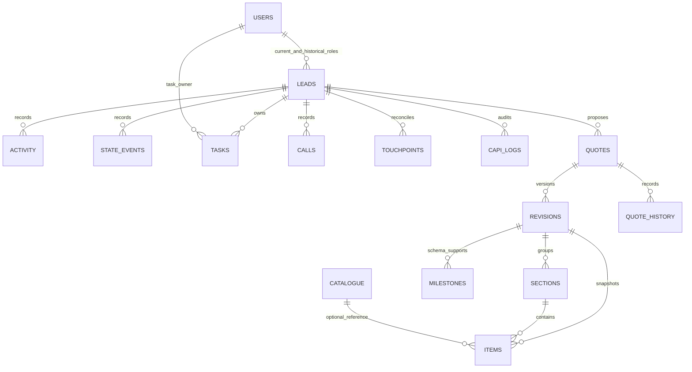
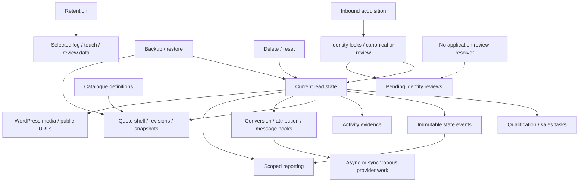

# Data model, business states and cross-module flows

Author: **Shashi**. Reviewed candidate `1.102.42`, base `ff148ba62ec710a622d9b1af7e8f511b7e0b7385`, including the dirty working tree, on 2026-10-06. This document describes implemented contracts and confirmed gaps; it does not approve release. The parent audit owns the final source/artifact identity and scenario counts.

Read with [core review](CORE-REVIEW.md), [integration/security review](INTEGRATION-SECURITY-REVIEW.md), [quotation review](QUOTATION-REVIEW.md), and [endpoint contracts](CONTRACTS.md). Source signatures and hooks are in [core source contracts](CORE-SOURCE-CONTRACTS.md); machine-readable column/index declarations are in [custom-schema.json](evidence/custom-schema.json). The declaration appendix below captures all21 plugin custom tables; WordPress core tables and optional Action Scheduler tables are dependencies, not first-party IDLM schema.

## Canonical ownership and relational contract

`IDLM_DB::create_tables()` owns10 lead/log/task/acquisition tables (`includes/class-db.php:359`). `IDLM_Routing_State::install()` owns1 routing-counter table (`class-routing-state.php:6`). `IDLM_Quotation_Schema::install()` owns10 quotation/catalogue tables, entered through `IDLM_Quotations::install()` (`class-quotation-schema.php:23`). Core schema `1.3.4`, routing schema `1.0.0`, quotation schema `2.5.0` have independent option markers. SQL uses `$wpdb->prefix`, so names below are suffixes.

The installers declare no physical foreign keys or explicit table engine. Logical relationships and cleanup must be maintained by services; typed bigint references do not validate that a parent exists. Reset/restore require InnoDB; ordinary lead deletion and quotation aggregate transactions assume transactional engines. Installer markers can advance after failures (CORE-007, QUO-004); version options alone are not schema verification.

| Table suffix | Canonical meaning, parent/reference and persistence contract |
|---|---|
| `idlm_leads` | Canonical contact/project/commercial/current stage/quality/call/ownership/handoff state. PK id; email/phone ordinary indexes, no unique normalized identity key. `duplicate_of_id` self-reference is logical; WordPress owner/qualifier IDs are historical references. `deal_value`/`quote_value` DECIMAL(12,2), discount DECIMAL(5,2). Canonical writes through DB facade→lifecycle service; assignment CAS, backfills and quote projection are explicit exceptions. |
| `idlm_lead_activity_log` | lead_id→lead; user_id→WordPress user. Append-oriented activity/evidence/freeform details; comments can edit/delete. Lifecycle, tasks, integrations and quotations write it. Activity timing helps compliance/legacy reporting but freeform content is not an enforceable state record. |
| `idlm_lead_state_events` | lead_id→lead, actor→WordPress user. Stage/assignment occurrence history with from/to/origin/reason/time and terminal amount snapshot DECIMAL(14,2). Immutable through normal lifecycle, deleted by lead delete/reset. Primary lead write can succeed without event write (CORE-005). |
| `idlm_tasks` | lead_id→lead; assigned_rep_id/created_by→WordPress user. Separate task-owner metadata may differ from live lead owner. Types include six lifecycle Qualification tasks, Sales Follow-up and manual types. No unique cycle key. Pending/completed/cancelled are application labels. |
| `idlm_call_logs` | lead_id/user_id logical references, provider/outcome/duration/recording URL/hash/metadata. Provider-event unique pair supports nullable manual records. Represents call audit, not the outbound messaging engine. |
| `idlm_lead_touchpoints` | lead_id→canonical lead; per-channel acquisition/attribution/submission history. Unique `(platform,external_id)` where ID exists; NULL external IDs allow distinct touches. Payload key-redacted; top-level tracking IDs and landing URLs persist. Pruning removes replay-map history. |
| `idlm_inbound_submission_reviews` | Pending conflict holding area, not actionable lead. Email/phone and candidate-lead IDs JSON, redacted payload, received/submitted time and pending status. No normalized child/FK relation or application resolution endpoint. Reset omits it (CORE-008). |
| `idlm_capi_logs` | lead_id→lead; provider/event/payload/response/status/time for outbound conversion audit and prior-success logic. No event-id/send-claim unique key. Retention affects idempotency evidence (INT-008). |
| `idlm_audience_sync_logs` | Provider/audience/count/payload summary/response/status/time; aggregate row has no lead relation. Does not provide per-customer removal/retry history. |
| `idlm_telemetry_logs` | Global runtime diagnostics with type/severity/message/file/line/trace/time. May contain PII/secret freeform text despite being diagnostics. No direct lead relation. |
| `idlm_routing_state` | state_key PK and monotonic state_value/updated_at. Atomic database round-robin counter; advisory locks protect distinct operations outside this table. No lead relation; option fallback is separate and non-atomic. |
| `idlm_quotes` | lead_id→lead; quote number/save key unique, owner/creator→WordPress user, current_revision_id→revision. One quote per lead is workflow/advisory-lock policy, not a unique lead index. Legacy acceptance/shared columns remain in schema but current workflow normalizes to Draft. |
| `idlm_quote_revisions` | quote_id→quote; source_revision_id→prior revision. Unique `(quote_id,revision_number)` and save key. Captures customer/project/currency/item totals and author/time/reason. Current Draft, older Superseded; decimal amounts14,2, no independent commercial approval transitions. |
| `idlm_quote_revision_sections` | revision_id→revision; named section and order. Section ownership must match item revision in application. |
| `idlm_quote_revision_items` | revision_id→revision, section_id→section, optional catalogue_item_id→catalogue. Stored description/code/name/unit/category/wood/rate/quantity/dimensions/totals/optional flag are snapshots. Dimension/quantity DECIMAL(12,3); money14,2. Installer currently rewrites wood flags from catalogue (QUO-005). |
| `idlm_quote_payment_milestones` | revision_id→revision; ordered name/type/value/calculated amount/due trigger. Persisted schema/cleanup supports it, but current editor/save/print payment behavior uses global payment_structure rather than immutable per-revision milestones. |
| `idlm_quote_status_history` | quote_id→quote, revision_id→optional revision; from/to/note/actor/time. Existing revision save records Draft→Draft history while prior row becomes Superseded. |
| `idlm_number_sequences` | Unique `(sequence_type,sequence_year)`, last_number/time. Quotation number reservation separately commits; gaps are possible on failed aggregate saves. Reset deletes it, so later numbering can reuse identifiers (unresolved business policy). |
| `idlm_quote_catalogue_items` | Reusable active/inactive item definition, unique item_code; category/unit strings refer logically to term names. Rate14,2. No FK; historical quote snapshot must survive catalogue archive/delete. |
| `idlm_quote_item_categories` | Unique category_name, active status/creator/times. Repository deletion checks catalogue usage; renaming semantics require caller policy. |
| `idlm_quote_item_units` | Unique unit_name, active status/creator/times. Names copied into catalogue/quote snapshots. Nos seeded. |



This diagram describes logical cardinalities, not enforced FKs. Reviews hold candidate IDs JSON; global logs, routing and number sequences do not have lead FK relations. Quotes' current/accepted pointers and revision source pointers are additional logical edges. User rows are core WordPress data, excluded from plugin backup.

## Options, metadata, caches and jobs

| Store | Contract |
|---|---|
| Core schema/migration options | `idlm_schema_version`, `idlm_routing_schema_version`, reporting start, handoff/duplicate/workflow/assignment/touchpoint/conversion/task cleanup markers. These are migrations, not release versions. Quote schema/legacy/snapshot/lifecycle markers are independent. |
| Role/visibility/account state | Role capabilities in WordPress roles, `idlm_roles_version`; `idlm_role_lead_scopes` (`all`/`assigned`) and legacy `idlm_reps_see_all_leads` default1. User metadata `idlm_crm_access_disabled`, `idlm_phone`, per-user bounded1000-entry WhatsApp read map. |
| Settings and credentials | Routing legacy keys remain authoritative over grouped `idlm_routing_settings`; branding `idlm_white_label_settings`, quote settings, mapping/credentials/audience rule arrays. Scoped webhook/MCP/feed password use environment override/encrypted envelopes; other provider credentials retain option storage. Do not infer all settings are harmless export data. |
| Background work | Audience queue option stores lead IDs; `idlm_interakt_batch_<hash>` stores historical-backfill state. Ordinary Interakt AS arguments include snapshot/credential; CAPI args include lead/stage. Recurring AS/WP-Cron hook pairs and retention hook have independent cancellation paths. Detailed contracts: integration review. |
| Read models | `idlm_read_cache_generation`; owner/global/access/role/filter/schema-keyed caches fresh60s/stale180s; locks30s. Signed user/filter/sort/scope pagination cursor TTL2h. No authorization decision is delegated to a cursor. |
| Temporary quotation edits | `idlm_quote_autosave_<user/revision>` transient family, seven days. Temporary user copy is not customer document data. Lifecycle cleanup of these on full CRM reset/deletion must be independently established; core deletion source does not enumerate an autosave cleanup family. |
| Attachments | WordPress attachment posts/files plus `_idlm_attachment_purpose`, `_idlm_attachment_lead_id`, `_idlm_attachment_owner_id`, `_idlm_attachment_created_at`. Lead field stores legacy/new public URLs/JSON URL array, not an enforced private document relation. |

## State and business rule map

| Domain | Permitted labels and actual transition contract |
|---|---|
| Pipeline | New, Contacted, Qualified, Visited Studio, Quote Shared, Negotiation, Won, Lost, plus configured custom stages. Enumeration is not a linear FSM. DB normalizer couples only Qualified with quality; downstream sales states may retain blank quality. Won requires positive deal/0–100 discount; Quote Shared requires confirmation/positive quote; Lost requires reason. Source: DB:258–330. |
| Qualification | Blank, Qualified, Unqualified. Qualified requires six project details/budget≥₹4L; explicit quality decision without floor plan needs handoff remark. Unqualified requires6 outreach cycles+closure unless structured early-close request satisfies reason/evidence. New insert cannot start Unqualified. Source: DB:805–862,1038–1091; lifecycle:311–366; AJAX:268–472. |
| Handoff | not_ready, awaiting_manager, manually_assigned, auto_assigned, exception. Qualification stamps actor/time/intake owner; sales ownership or manager assignment completes handoff, OOO fallback after working-hour threshold chooses capacity/studio pool or exception. Leaving qualification clears relevant handoff fields. Source: lifecycle:590–669; integrations:1152–1589. |
| Call | Not Called, No Answer, Call Back Requested, Connected - Interested, Connected - Not Interested, Wrong Number. Non-callback status clears callback; first connected status records working-time interval. No Answer/mapped changes can emit Interakt hooks. Source: registry:26; lifecycle:687–720,857–885. |
| Task | pending/completed/cancelled; lifecycle Qualification cycles and Sales Follow-up; manual General/Call/Email/Site Visit/Design Mockup/Quote Revision. Reserved Qualification task cannot be manually created/toggled/deleted. Lost cancels pending; reverse Lost does not recreate. Owner transfer only old Qualified currently creates stale-owner queue risk. Source: DB:80–119,864–1024; AJAX:3020–3216. |
| Quote | New shell/current revision Draft R01; each successful explicit revision save makes R+1 Draft and prior Superseded. No implemented approval/share/accept/reject/cancel commercial transition actions in current candidate, despite legacy capabilities/columns. Shared pipeline is independent. Source: quotation review state section; schema:23–108, normalization below installer. |
| Integration status | Provider audit success/error and separate batch queued/processing/sent/failed/cancelled states are implementation-specific. Ordinary CAPI/Interakt do not share durable per-send claims or automatic retry guarantees; administrative Interakt batch has dedup key/lock/max3 attempts. Source: integration review. |

Events are recorded occurrences, while lead row is current state. A Won reversal clears current `conversion_time` but does not undo a successful historical Won state event. Dashboard includes creation cohorts/live snapshot/current closes and event occurrence reporting with legacy fallbacks; it is not a single financial ledger. Owner change changes scope of old events because queries join current lead owner, and lead deletion removes history. Source: dashboard:139–168,346–414,608–666,1009–1029,1216–1271.

## Twelve flow contracts

### 1. New inbound acquisition to sales handoff

REST permission authenticates scoped header before parsing; supported platform/payload mappings normalize data. `upsert_inbound_lead` locks sorted identity keys, finds none, normalizes/inserts lead, emits creation state/activity/New conversion and touchpoint; handler routes only created leads. Intake CAS creates6 working-day qualification tasks. Logged call/WhatsApp/closure evidence completes cycles; qualification checks detail/budget/plan remark, stamps actor/time, completes Qualification tasks and enters awaiting_manager. Manager/OOO handoff selects sales rep, reconciles tasks and creates Sales Follow-up, optional email. Source: integrations:578–658,1318–1368; lifecycle:14–85,311–535,541–892; DB:805–944. Failure gaps: CORE-004/005/006/009/010. Source-traced and selective native probes; no provider/browser whole-flow PASS.

### 2. Repeat inbound reconciliation

External touchpoint match takes precedence, then legacy external ID, then email/full normalized phone union. One canonical match fills empty details/identifiers, promotes generic source to Meta Ads for Meta case, updates latest source, retains owner and records touch. It does not route/create tasks again. Attribution hook can re-fire prior conversions. A unique external touchpoint provides replay association while retained; missing/failed/pruned touchpoint can change future resolution. Source: lifecycle:139–274; conversion contract: [INT review](INTEGRATION-SECURITY-REVIEW.md). Owner preservation probe PASS; persistence-failure probes FAIL; replay retention/overlap/provider effects remain incomplete.

### 3. Conflicting identities and resolution

Multiple candidate lead IDs→pending review record, candidate duplicate_review activity, lead_id0 response, no actionable lead/routing. A single email match with conflicting/new phone still merges; exact external ID also wins before contact conflict. No review list/resolution action was found; backup/retention/diagnostics retain the queue. Source: lifecycle:139–215,276–290; DB:667–684. CORE-008/013 establish limitation. Resolution behavior is currently absent, not a tested successful workflow.

### 4. Lead edit through tasks/reporting/integrations

Authenticated AJAX checks nonce→role→current owner/manager→field/domain/structured-quote restrictions→DB facade. Lifecycle reads old row, normalizes/validates, updates, then records state events/tasks/activity/hooks/cache. Reporting uses new row/events; CAPI/Interakt queue consumers observe emitted triggers. Source: AJAX:135–244,2531–2635; lifecycle:541–892. Native event INSERT fault showed committed stage/success with missing history (CORE-005). Concurrent stale reads and post-commit provider retries need dedicated checks.

### 5. Won/Lost/reversal

Won requires positive deal and valid discount; stamps close time and snapshot amount. Lost requires reason and cancels pending tasks; Unqualified forces Lost. Reverse Won clears current timestamp; reverse Lost clears reason but cancelled tasks stay cancelled. Historical events remain until lead deletion, so event counts can exceed current Won count after reopen/reclose. Source: DB:268–330; lifecycle:698–787; dashboard references above. CAPI current-state filtering/manual retries differ: INT-005. Historical financial/export and reversal scenario proof is incomplete beyond existing suite and new failure evidence.

### 6. Ownership/access change

Manager assignment or routing CAS changes current owner/time/handoff state; Qualified owner changes reconcile tasks/sales work, other owners can leave old task metadata. Lead drawer/comment/upload checks re-evaluate live owner, quotation detail/export check live lead scope, while quotation list uses original quote owner and queue accepts task owner OR lead owner. Public media URL ignores policy. Source: lifecycle:635–669,793–823; AJAX:3240–3270; [QUO-002/003](QUOTATION-REVIEW.md); CORE-002/011. Native drawer denial PASS versus PII queue FAIL; quotation reviewer supplies independent list evidence. Notification emails do not guarantee delivery.

### 7. Quotation creation, revision and outputs

Save capability/nonce/live-lead scope→per-lead advisory lock/existing quote check→independently committed number reservation→checked aggregate transaction for shell/revision/sections/items/history/lead projection→cache/activity/autosave cleanup→redirect. Autosave is per-user transient; explicit revision locks quote/rechecks current Draft/source before R+1. Preview/export checks explicit persisted revision and visibility; print/PDF use some live global template/payment/currency state. Source: [quotation flow/detail review](QUOTATION-REVIEW.md#cross-module-flows), controller:12–250, repository:32–336, exporter:12–337. QUO-001 new revision binding, QUO-003 read-scope mutation and QUO-006 snapshot/document inconsistencies remain material.

### 8. Catalogue to quotation snapshots

Catalogue capability/nonce→validated active term/rate/item definition→repository CRUD; importer uses≤5MB/2,000 rows and checked transaction, exporter formula-normalizes/chunks500. Picker copies active definition into new submitted item snapshot; existing snapshot should retain independent historical values after archive/delete/change. Installer rewrites is_wood from catalogue, violating that invariant. Source: quotation-schema:150–196,238; quotation-controller:catalogue handlers; [QUO-005 and detailed flow8](QUOTATION-REVIEW.md). Customer export tabular omission of optional/header rows differs intentionally from print.

### 9. Upload, binding and retrieval

Nonce+CRM+current lead owner→purpose/pre-sales restriction→extension/MIME/size validation→WordPress media upload→lead/creator/purpose/time metadata→public URL response→drawer rejects newly tagged cross-lead binding. Legacy untagged/external URLs accepted. Ownership change revokes AJAX access but URL survives; deletion/reset omit media. Source: AJAX:2556–2569,2642–2695; production-security upload policy; CORE-002. Anonymous HTTP/storage-host enforcement and actual Media Library/erase walkthrough not executed by core reviewer.

### 10. Queue, failure, retry and cancellation

Lifecycle conversion/attribution/no-answer/mapping hooks→CAPI/ordinary Interakt or admin historical batch. CAPI New sends synchronously; later stages queue delayed event and can cancel prior stage work; provider failure requires manual retry. Ordinary Interakt snapshots can retain old credentials/state; batch stores opaque key, reloads state, serializes worker and retries≤3. Audience all-match batches lack per-row retry/chunk/lock; manual queue clears even failure. Reset/restore cancel3 async hooks after commit; recurring deactivation cleanup does not cancel every async job. Source: [INT queue/retry findings](INTEGRATION-SECURITY-REVIEW.md), CAPI/init/worker, Interakt/batch, scheduler. Real provider acceptance/crash/duplication/failover remains NOT RUN; mocks do not establish delivery.

### 11. Backup, restore and reconciliation

Manage_options+action nonce→21table/filtered-option JSON export (users/media/jobs/credential keys excluded). Restore exact RESTORE confirmation/upload/envelope limits→table presence/InnoDB checks→transaction delete/reinsert tables/options→commit→partial option cache invalidation→cancel async hooks→retention prune/cache generation→redirect. Payload lacks full schema/relationships validation and export lacks consistent snapshot transaction. Missing table payload defaults empty after destructive clear; preserved WordPress user IDs may not resolve on another site. Source: backup:16–24,37–87,90–172; [INT-003 restore analysis](INTEGRATION-SECURITY-REVIEW.md); QUO migrations. Round-trip compatibility/concurrent export/restore/active-worker fencing are unknown; checksum is not integrity reconciliation.

### 12. Delete, reset, retention and recovery

Admin deletes→linked duplicate guard→transaction related lead tables+quotation cleanup+lead→commit/cache. Reset additionally checks all manifest engines/count, deletes quote/log/call/task/touch/lead/routing data and queued options, commits then cancels async hooks. Identity-review table omitted; media/WordPress usermeta persist. Retention daily clears selected log/acquisition rows with unbounded unchecked DELETE; fixed7-day CAPI policy overrides configurable integration interval. Source: deletion:6–204; retention:13–134; native reset probe confirms review residual. There is no uninstall erasure or guaranteed rollback for files/external audiences/messages. Backup recovery excludes files/users and can immediately prune restored history; restoration requires separate verified full-system backup/recovery policy.



## PII, ownership, retention and destructive-operation matrix

| Data family | Visibility/ownership | Retention | Single lead deletion | CRM reset | Backup/restore |
|---|---|---|---|---|---|
| Lead contact/project/deal/current attribution | Recognized role/global or assigned scope; current owner mutation; broad default risk CORE-001 | No automatic lead expiry | Lead removed; external duplicate guard | Removed, IDs not reset | All rows exported/reinserted; no users |
| Activity/comments/call evidence/recording URLs | Lead view policy; task ownership can expose lead context separately | Specific diagnostic types7days; ordinary evidence/call logs no scheduled expiry | Removed | Removed | Exported; recordings binary not included |
| Immutable state events | Reports join surviving lead/current-owner scope | No scheduled event expiry | Removed, past reporting changes | Removed | Exported/reinserted; primary-history completeness not validated |
| Tasks | Lead/task OR queue scope leaks former-owner PII; per-object mutations use current lead | Lost/deleted-user pending tasks archived; no scheduled history expiry | Removed | Removed | Exported; referenced users may be missing |
| Touchpoints | Canonical acquisition table/internal/API/report usage; includes identifiers and landing URL | Default90days | Removed | Removed | Exported; restore immediately prunes by current policy |
| Identity reviews | No application resolver; retained PII and JSON candidate IDs | Default touchpoint interval90days | Not included; dangling candidate IDs possible | **Not removed** (native FAIL) | Exported/reinserted and prune applies |
| CAPI request/response audit | Administrator diagnostics/integration engine; payload can carry customer data | Effective fixed7days despite configured180default | Removed | Removed | Exported; current retention re-prunes; replay guards may lose evidence |
| Audience aggregate logs/queue | Admin/provider jobs; summaries reduce payload, response can contain details | Logs integration default180days; no per-member removal lifecycle | No lead-linked aggregate purge/targeted queue erase in deletion service | Aggregate logs and queue option cleared | Logs and filtered queue options can restore; jobs not restored |
| Telemetry/diagnostic text | Administrator UI/download and MCP audit; freeform text may contain sensitive data | Default14days plus telemetry1000row cap behavior | Global logs remain | Removed | Exported; diagnostics no general text redaction guarantee |
| Quote/revisions/customer snapshots/history | Required quote cap plus live-lead scope for details/export; original quote-owner list leak QUO-002 | No automatic quote/customer expiry | Aggregate children/shell removed | Removed; catalogue retained | Exported/reinserted; legacy migration/current global settings can alter historical output |
| Catalogue/terms/number sequences | Catalogue manage cap; numbers internal | No schedule | Catalogue/terms/sequence remain | Catalogue/terms remain; sequences deleted | Exported/reinserted |
| WordPress attachment files/postmeta | Public URL persists; binding protects AJAX association only | No IDLM file expiry | **Remain** | **Remain** | Not backed up/restored |
| User profiles/roles/disabled/read markers | WordPress self/admin plus CRM policy | Core WP/user policy; WhatsApp marker bounded1000entries | Remain, old lead IDs can remain in marker map | Remain | Not backed up/restored |
| Autosave working copies | User/revision transient, not customer document | Seven days | Cleanup family not found in core deletion | Cleanup family not found in core reset | Not portable persisted revision data; option/transient export exclusions must be verified |
| Async payloads/Interakt batch state | Worker-held customer traits/lead IDs; ordinary AS args can contain credential snapshot | Batch terminal options not automatically pruned | No targeted scheduling cleanup in delete_many | Hooks/options cancelled/cleared after commit; running jobs cannot recalled | Jobs not exported, hook cancellation after commit; active-worker fencing absent |

## Explicit unknowns and evidence boundaries

No new tests were run for this document. It consolidates source and peer-review evidence; parent owns final totals. Declared DDL is not proof that every supported site's physical schema matches it. Missing DDL privileges/engine changes, oldest supported data migrations, foreign user references, full restore round-trip, real competing workers, multisite, proxy/cache failover, supplier acceptance, legal consent/retention policy and anonymous private-storage enforcement require independent evidence.

Known contradictions are retained honestly: docs promise review resolution without endpoint; broad CRM scope is compatibility behavior but unsafe default; snapshot tables coexist with mutable template/payment/classification dependencies; deletion is not full personal-data erasure; job cancellation does not recall a running remote send. The defect registers describe remediation and confidence. This map provides no financial/consent guarantee beyond implemented fields and rules.

## Exact declared column and index appendix

The following declarations are extracted from current installers. They record data type, null/default and uniqueness/index contracts; no claim of a deployed schema comparison is made. `AUTO_INCREMENT` PK is id in20tables; routing uses state_key. All21 schemas use WordPress charset/collation. No explicit FK/engine clause is declared.

### idlm_leads

Source: [includes/class-db.php:367](</Users/shashi_protecto/Local Sites/testing/app/public/wp-content/plugins/interior-design-lead-manager/includes/class-db.php:367>).

```sql
id bigint(20) unsigned NOT NULL AUTO_INCREMENT,
first_name varchar(100) DEFAULT '',
last_name varchar(100) DEFAULT '',
email varchar(100) DEFAULT '',
phone varchar(50) DEFAULT '',
project_name varchar(255) DEFAULT '',
budget varchar(100) DEFAULT '',
deal_value decimal(12,2) DEFAULT 0.00,
discount_percentage decimal(5,2) DEFAULT 0.00,
project_timeline varchar(100) DEFAULT '',
possession_date date DEFAULT NULL,
property_location varchar(255) DEFAULT '',
source varchar(50) DEFAULT '',
original_source varchar(50) DEFAULT '',
latest_source varchar(50) DEFAULT '',
referrer_details text DEFAULT NULL,
property_type varchar(50) DEFAULT '',
num_rooms varchar(50) DEFAULT '',
floor_plan_received tinyint(1) DEFAULT 0,
floor_plan_file varchar(255) DEFAULT '',
floor_plan_files longtext DEFAULT NULL,
quote_shared tinyint(1) DEFAULT 0,
quote_value decimal(12,2) DEFAULT 0.00,
quote_file varchar(255) DEFAULT '',
preferred_studio varchar(100) DEFAULT '',
stage varchar(50) DEFAULT '',
lost_reason varchar(100) DEFAULT '',
call_status varchar(50) DEFAULT '',
callback_datetime datetime DEFAULT NULL,
lead_quality varchar(50) DEFAULT '',
disqualification_reason varchar(50) DEFAULT '',
disqualification_method varchar(50) DEFAULT '',
disqualified_at datetime DEFAULT NULL,
disqualified_by_user_id bigint(20) unsigned DEFAULT 0,
assigned_rep_id bigint(20) unsigned DEFAULT 0,
assigned_at datetime DEFAULT NULL,
utm_source varchar(100) DEFAULT '',
utm_medium varchar(100) DEFAULT '',
utm_campaign varchar(100) DEFAULT '',
utm_adgroup varchar(100) DEFAULT '',
utm_term varchar(100) DEFAULT '',
utm_content varchar(100) DEFAULT '',
gclid varchar(255) DEFAULT '',
gbraid varchar(255) DEFAULT '',
wbraid varchar(255) DEFAULT '',
fbclid varchar(255) DEFAULT '',
li_fat_id varchar(255) DEFAULT '',
fb_lead_id varchar(100) DEFAULT NULL,
landing_page text DEFAULT NULL,
conversion_time datetime DEFAULT NULL,
qualified_at datetime DEFAULT NULL,
qualified_by_user_id bigint(20) unsigned DEFAULT 0,
intake_owner_id bigint(20) unsigned DEFAULT 0,
handoff_status varchar(30) DEFAULT 'not_ready',
handoff_at datetime DEFAULT NULL,
handoff_method varchar(50) DEFAULT '',
handoff_exception_reason varchar(255) DEFAULT '',
is_duplicate tinyint(1) DEFAULT 0,
duplicate_of_id bigint(20) unsigned DEFAULT 0,
created_at datetime DEFAULT NULL,
updated_at datetime DEFAULT NULL,
time_to_connected bigint(20) DEFAULT NULL,
time_to_won bigint(20) DEFAULT NULL,
PRIMARY KEY  (id),
KEY email (email),
KEY phone (phone),
KEY source (source),
KEY original_source (original_source),
KEY latest_source (latest_source),
KEY stage (stage),
KEY lost_reason (lost_reason),
KEY call_status (call_status),
KEY assigned_rep_id (assigned_rep_id),
KEY assigned_at (assigned_at),
KEY created_at (created_at),
KEY conversion_time (conversion_time),
KEY lead_quality (lead_quality),
KEY disqualification_reason (disqualification_reason),
KEY disqualified_at (disqualified_at),
KEY qualified_at (qualified_at),
KEY qualified_by_user_id (qualified_by_user_id),
KEY intake_owner_id (intake_owner_id),
KEY handoff_status (handoff_status),
KEY duplicate_of_id (duplicate_of_id)
```

### idlm_lead_activity_log

Source: [includes/class-db.php:468](</Users/shashi_protecto/Local Sites/testing/app/public/wp-content/plugins/interior-design-lead-manager/includes/class-db.php:468>).

```sql
id bigint(20) unsigned NOT NULL AUTO_INCREMENT,
lead_id bigint(20) unsigned NOT NULL,
user_id bigint(20) unsigned DEFAULT 0,
activity_type varchar(50) NOT NULL,
details text NOT NULL,
created_at datetime DEFAULT NULL,
PRIMARY KEY  (id),
KEY lead_id (lead_id),
KEY activity_lead_id (activity_type, lead_id, id),
KEY lead_activity_id (lead_id, activity_type, id),
KEY created_at (created_at)
```

### idlm_lead_state_events

Source: [includes/class-db.php:487](</Users/shashi_protecto/Local Sites/testing/app/public/wp-content/plugins/interior-design-lead-manager/includes/class-db.php:487>).

```sql
id bigint(20) unsigned NOT NULL AUTO_INCREMENT,
lead_id bigint(20) unsigned NOT NULL,
event_type varchar(50) NOT NULL,
event_origin varchar(50) DEFAULT '',
from_value varchar(191) DEFAULT '',
to_value varchar(191) DEFAULT '',
reason varchar(191) DEFAULT '',
amount decimal(14,2) DEFAULT NULL,
actor_user_id bigint(20) unsigned DEFAULT 0,
occurred_at datetime DEFAULT NULL,
PRIMARY KEY  (id),
KEY lead_event_time (lead_id, event_type, occurred_at),
KEY event_time (event_type, occurred_at),
KEY event_target_time (event_type, to_value, occurred_at)
```

### idlm_capi_logs

Source: [includes/class-db.php:530](</Users/shashi_protecto/Local Sites/testing/app/public/wp-content/plugins/interior-design-lead-manager/includes/class-db.php:530>).

```sql
id bigint(20) unsigned NOT NULL AUTO_INCREMENT,
lead_id bigint(20) unsigned NOT NULL,
platform varchar(50) NOT NULL,
event_name varchar(100) NOT NULL,
payload text NOT NULL,
response text NOT NULL,
status varchar(50) NOT NULL,
created_at datetime DEFAULT NULL,
PRIMARY KEY  (id),
KEY lead_id (lead_id),
KEY created_at (created_at)
```

### idlm_audience_sync_logs

Source: [includes/class-db.php:548](</Users/shashi_protecto/Local Sites/testing/app/public/wp-content/plugins/interior-design-lead-manager/includes/class-db.php:548>).

```sql
id bigint(20) unsigned NOT NULL AUTO_INCREMENT,
platform varchar(50) NOT NULL,
audience_id varchar(255) NOT NULL,
lead_count int(11) NOT NULL DEFAULT 0,
payload longtext NOT NULL,
response longtext NOT NULL,
status varchar(50) NOT NULL,
created_at datetime DEFAULT NULL,
PRIMARY KEY  (id),
KEY created_at (created_at)
```

### idlm_telemetry_logs

Source: [includes/class-db.php:565](</Users/shashi_protecto/Local Sites/testing/app/public/wp-content/plugins/interior-design-lead-manager/includes/class-db.php:565>).

```sql
id bigint(20) unsigned NOT NULL AUTO_INCREMENT,
log_type varchar(50) NOT NULL,
severity varchar(20) NOT NULL,
message text NOT NULL,
file varchar(255) DEFAULT '',
line int(11) DEFAULT NULL,
stack_trace text,
created_at datetime DEFAULT NULL,
PRIMARY KEY  (id),
KEY created_at (created_at)
```

### idlm_tasks

Source: [includes/class-db.php:582](</Users/shashi_protecto/Local Sites/testing/app/public/wp-content/plugins/interior-design-lead-manager/includes/class-db.php:582>).

```sql
id bigint(20) unsigned NOT NULL AUTO_INCREMENT,
lead_id bigint(20) unsigned NOT NULL,
assigned_rep_id bigint(20) unsigned DEFAULT 0,
title varchar(255) NOT NULL,
task_type varchar(50) DEFAULT 'General',
priority varchar(20) DEFAULT 'Medium',
status varchar(50) DEFAULT 'pending',
due_date datetime DEFAULT NULL,
created_by bigint(20) unsigned DEFAULT 0,
created_at datetime DEFAULT NULL,
completed_at datetime DEFAULT NULL,
updated_at datetime DEFAULT NULL,
PRIMARY KEY  (id),
KEY lead_id (lead_id),
KEY lead_status_due (lead_id, status, due_date),
KEY assigned_rep_id (assigned_rep_id),
KEY status (status),
KEY due_date (due_date)
```

### idlm_call_logs

Source: [includes/class-db.php:608](</Users/shashi_protecto/Local Sites/testing/app/public/wp-content/plugins/interior-design-lead-manager/includes/class-db.php:608>).

```sql
id bigint(20) unsigned NOT NULL AUTO_INCREMENT,
lead_id bigint(20) unsigned NOT NULL,
user_id bigint(20) unsigned DEFAULT 0,
provider varchar(50) DEFAULT 'manual',
provider_event_id varchar(191) DEFAULT NULL,
direction varchar(20) DEFAULT 'outbound',
outcome varchar(50) DEFAULT '',
started_at datetime DEFAULT NULL,
duration_seconds int(11) unsigned DEFAULT 0,
recording_url text DEFAULT NULL,
recording_hash varchar(128) DEFAULT '',
metadata longtext DEFAULT NULL,
created_at datetime DEFAULT NULL,
PRIMARY KEY  (id),
UNIQUE KEY provider_event (provider, provider_event_id),
KEY lead_id (lead_id),
KEY user_id (user_id),
KEY started_at (started_at)
```

### idlm_lead_touchpoints

Source: [includes/class-db.php:634](</Users/shashi_protecto/Local Sites/testing/app/public/wp-content/plugins/interior-design-lead-manager/includes/class-db.php:634>).

```sql
id bigint(20) unsigned NOT NULL AUTO_INCREMENT,
lead_id bigint(20) unsigned NOT NULL,
platform varchar(30) DEFAULT '',
source varchar(50) DEFAULT '',
external_id varchar(191) DEFAULT NULL,
utm_source varchar(100) DEFAULT '',
utm_medium varchar(100) DEFAULT '',
utm_campaign varchar(100) DEFAULT '',
utm_adgroup varchar(100) DEFAULT '',
utm_term varchar(100) DEFAULT '',
utm_content varchar(100) DEFAULT '',
gclid varchar(255) DEFAULT '',
gbraid varchar(255) DEFAULT '',
wbraid varchar(255) DEFAULT '',
fbclid varchar(255) DEFAULT '',
li_fat_id varchar(255) DEFAULT '',
landing_page text DEFAULT NULL,
payload longtext DEFAULT NULL,
submitted_at datetime DEFAULT NULL,
received_at datetime DEFAULT NULL,
PRIMARY KEY  (id),
UNIQUE KEY platform_external (platform, external_id),
KEY lead_id (lead_id),
KEY source (source),
KEY received_at (received_at)
```

### idlm_inbound_submission_reviews

Source: [includes/class-db.php:667](</Users/shashi_protecto/Local Sites/testing/app/public/wp-content/plugins/interior-design-lead-manager/includes/class-db.php:667>).

```sql
id bigint(20) unsigned NOT NULL AUTO_INCREMENT,
platform varchar(30) DEFAULT '',
source varchar(50) DEFAULT '',
email varchar(100) DEFAULT '',
phone varchar(50) DEFAULT '',
candidate_lead_ids longtext DEFAULT NULL,
payload longtext DEFAULT NULL,
submitted_at datetime DEFAULT NULL,
received_at datetime DEFAULT NULL,
status varchar(20) DEFAULT 'pending',
PRIMARY KEY  (id),
KEY status_received (status, received_at),
KEY received_at (received_at)
```

### idlm_routing_state

Source: [includes/class-routing-state.php:11](</Users/shashi_protecto/Local Sites/testing/app/public/wp-content/plugins/interior-design-lead-manager/includes/class-routing-state.php:11>).

```sql
state_key varchar(191) NOT NULL,
state_value bigint(20) unsigned NOT NULL DEFAULT 0,
updated_at datetime DEFAULT NULL,
PRIMARY KEY  (state_key)
```

### idlm_quotes

Source: [includes/class-quotation-schema.php:38](</Users/shashi_protecto/Local Sites/testing/app/public/wp-content/plugins/interior-design-lead-manager/includes/class-quotation-schema.php:38>).

```sql
id bigint(20) unsigned NOT NULL AUTO_INCREMENT,
lead_id bigint(20) unsigned NOT NULL,
quote_number varchar(50) NOT NULL,
title varchar(255) NOT NULL,
status varchar(30) NOT NULL DEFAULT 'Draft',
current_revision_id bigint(20) unsigned DEFAULT 0,
owner_user_id bigint(20) unsigned DEFAULT 0,
created_by bigint(20) unsigned NOT NULL,
accepted_revision_id bigint(20) unsigned DEFAULT 0,
shared_at datetime DEFAULT NULL,
accepted_at datetime DEFAULT NULL,
rejected_at datetime DEFAULT NULL,
save_request_key varchar(64) DEFAULT NULL,
created_at datetime NOT NULL,
updated_at datetime NOT NULL,
PRIMARY KEY (id),
UNIQUE KEY quote_number (quote_number),
KEY lead_status (lead_id, status),
KEY owner_status (owner_user_id, status),
KEY current_revision_id (current_revision_id),
UNIQUE KEY save_request_key (save_request_key)
```

### idlm_quote_revisions

Source: [includes/class-quotation-schema.php:62](</Users/shashi_protecto/Local Sites/testing/app/public/wp-content/plugins/interior-design-lead-manager/includes/class-quotation-schema.php:62>).

```sql
id bigint(20) unsigned NOT NULL AUTO_INCREMENT,
quote_id bigint(20) unsigned NOT NULL,
revision_number int(11) unsigned NOT NULL DEFAULT 1,
revision_name varchar(80) NOT NULL,
status varchar(30) NOT NULL DEFAULT 'Draft',
source_revision_id bigint(20) unsigned DEFAULT 0,
revision_reason varchar(500) DEFAULT '',
currency_code varchar(10) NOT NULL DEFAULT 'INR',
valid_until date DEFAULT NULL,
customer_intro text DEFAULT NULL,
customer_name varchar(255) DEFAULT '',
customer_phone varchar(50) DEFAULT '',
customer_email varchar(255) DEFAULT '',
project_name varchar(255) DEFAULT '',
property_location text DEFAULT NULL,
internal_notes longtext DEFAULT NULL,
subtotal decimal(14,2) NOT NULL DEFAULT 0.00,
wooden_subtotal decimal(14,2) NOT NULL DEFAULT 0.00,
wooden_discount_percent decimal(5,2) NOT NULL DEFAULT 0.00,
wooden_discount_amount decimal(14,2) NOT NULL DEFAULT 0.00,
subtotal_after_wooden_discount decimal(14,2) NOT NULL DEFAULT 0.00,
other_subtotal decimal(14,2) NOT NULL DEFAULT 0.00,
soft_close_enabled tinyint(1) NOT NULL DEFAULT 0,
soft_close_percent decimal(5,2) NOT NULL DEFAULT 0.00,
soft_close_amount decimal(14,2) NOT NULL DEFAULT 0.00,
design_fee_percent decimal(5,2) NOT NULL DEFAULT 0.00,
design_fee_amount decimal(14,2) NOT NULL DEFAULT 0.00,
total_before_additional_discount decimal(14,2) NOT NULL DEFAULT 0.00,
additional_discount_amount decimal(14,2) NOT NULL DEFAULT 0.00,
taxable_total decimal(14,2) NOT NULL DEFAULT 0.00,
cgst_total decimal(14,2) NOT NULL DEFAULT 0.00,
sgst_total decimal(14,2) NOT NULL DEFAULT 0.00,
igst_total decimal(14,2) NOT NULL DEFAULT 0.00,
round_off_amount decimal(14,2) NOT NULL DEFAULT 0.00,
grand_total decimal(14,2) NOT NULL DEFAULT 0.00,
created_by bigint(20) unsigned NOT NULL,
created_at datetime NOT NULL,
updated_by bigint(20) unsigned NOT NULL,
updated_at datetime NOT NULL,
finalized_at datetime DEFAULT NULL,
save_request_key varchar(64) DEFAULT NULL,
PRIMARY KEY (id),
UNIQUE KEY quote_revision (quote_id, revision_number),
KEY quote_status (quote_id, status),
KEY created_by (created_by),
UNIQUE KEY save_request_key (save_request_key)
```

### idlm_quote_revision_items

Source: [includes/class-quotation-schema.php:111](</Users/shashi_protecto/Local Sites/testing/app/public/wp-content/plugins/interior-design-lead-manager/includes/class-quotation-schema.php:111>).

```sql
id bigint(20) unsigned NOT NULL AUTO_INCREMENT,
revision_id bigint(20) unsigned NOT NULL,
section_id bigint(20) unsigned DEFAULT 0,
row_type varchar(20) NOT NULL DEFAULT 'item',
catalogue_item_id bigint(20) unsigned DEFAULT 0,
is_wood tinyint(1) NOT NULL DEFAULT 0,
category varchar(100) DEFAULT '',
room_area varchar(100) DEFAULT '',
item_code varchar(100) DEFAULT '',
item_name varchar(255) DEFAULT '',
description text NOT NULL,
specification text DEFAULT NULL,
length decimal(12,3) NOT NULL DEFAULT 0.000,
height decimal(12,3) NOT NULL DEFAULT 0.000,
quantity decimal(12,3) NOT NULL DEFAULT 1.000,
unit varchar(30) DEFAULT 'Nos',
unit_rate decimal(14,2) NOT NULL DEFAULT 0.00,
discount_type varchar(10) NOT NULL DEFAULT 'fixed',
discount_value decimal(14,2) NOT NULL DEFAULT 0.00,
discount_amount decimal(14,2) NOT NULL DEFAULT 0.00,
line_subtotal decimal(14,2) NOT NULL DEFAULT 0.00,
line_total decimal(14,2) NOT NULL DEFAULT 0.00,
is_optional tinyint(1) NOT NULL DEFAULT 0,
sort_order int(11) unsigned NOT NULL DEFAULT 0,
PRIMARY KEY (id),
KEY revision_order (revision_id, sort_order)
```

### idlm_quote_revision_sections

Source: [includes/class-quotation-schema.php:140](</Users/shashi_protecto/Local Sites/testing/app/public/wp-content/plugins/interior-design-lead-manager/includes/class-quotation-schema.php:140>).

```sql
id bigint(20) unsigned NOT NULL AUTO_INCREMENT,
revision_id bigint(20) unsigned NOT NULL,
section_name varchar(255) NOT NULL,
section_description text DEFAULT NULL,
sort_order int(11) unsigned NOT NULL DEFAULT 0,
PRIMARY KEY (id),
KEY revision_order (revision_id, sort_order)
```

### idlm_quote_catalogue_items

Source: [includes/class-quotation-schema.php:150](</Users/shashi_protecto/Local Sites/testing/app/public/wp-content/plugins/interior-design-lead-manager/includes/class-quotation-schema.php:150>).

```sql
id bigint(20) unsigned NOT NULL AUTO_INCREMENT,
item_code varchar(100) NOT NULL,
category varchar(100) DEFAULT '',
item_name varchar(255) NOT NULL,
description text DEFAULT NULL,
unit varchar(30) DEFAULT 'Nos',
is_wood tinyint(1) NOT NULL DEFAULT 0,
default_rate decimal(14,2) NOT NULL DEFAULT 0.00,
status varchar(10) NOT NULL DEFAULT 'active',
created_by bigint(20) unsigned NOT NULL DEFAULT 0,
created_at datetime NOT NULL,
updated_at datetime NOT NULL,
PRIMARY KEY (id),
UNIQUE KEY item_code (item_code),
KEY status_name (status, item_name),
KEY category (category)
```

### idlm_quote_item_categories

Source: [includes/class-quotation-schema.php:169](</Users/shashi_protecto/Local Sites/testing/app/public/wp-content/plugins/interior-design-lead-manager/includes/class-quotation-schema.php:169>).

```sql
id bigint(20) unsigned NOT NULL AUTO_INCREMENT,
category_name varchar(100) NOT NULL,
status varchar(10) NOT NULL DEFAULT 'active',
created_by bigint(20) unsigned NOT NULL DEFAULT 0,
created_at datetime NOT NULL,
updated_at datetime NOT NULL,
PRIMARY KEY (id),
UNIQUE KEY category_name (category_name),
KEY status_name (status, category_name)
```

### idlm_quote_item_units

Source: [includes/class-quotation-schema.php:181](</Users/shashi_protecto/Local Sites/testing/app/public/wp-content/plugins/interior-design-lead-manager/includes/class-quotation-schema.php:181>).

```sql
id bigint(20) unsigned NOT NULL AUTO_INCREMENT,
unit_name varchar(30) NOT NULL,
status varchar(10) NOT NULL DEFAULT 'active',
created_by bigint(20) unsigned NOT NULL DEFAULT 0,
created_at datetime NOT NULL,
updated_at datetime NOT NULL,
PRIMARY KEY (id),
UNIQUE KEY unit_name (unit_name),
KEY status_name (status, unit_name)
```

### idlm_quote_payment_milestones

Source: [includes/class-quotation-schema.php:198](</Users/shashi_protecto/Local Sites/testing/app/public/wp-content/plugins/interior-design-lead-manager/includes/class-quotation-schema.php:198>).

```sql
id bigint(20) unsigned NOT NULL AUTO_INCREMENT,
revision_id bigint(20) unsigned NOT NULL,
milestone_name varchar(255) NOT NULL,
amount_type varchar(10) NOT NULL DEFAULT 'percent',
amount_value decimal(14,2) NOT NULL DEFAULT 0.00,
calculated_amount decimal(14,2) NOT NULL DEFAULT 0.00,
due_trigger varchar(255) DEFAULT '',
sort_order int(11) unsigned NOT NULL DEFAULT 0,
PRIMARY KEY (id),
KEY revision_order (revision_id, sort_order)
```

### idlm_quote_status_history

Source: [includes/class-quotation-schema.php:211](</Users/shashi_protecto/Local Sites/testing/app/public/wp-content/plugins/interior-design-lead-manager/includes/class-quotation-schema.php:211>).

```sql
id bigint(20) unsigned NOT NULL AUTO_INCREMENT,
quote_id bigint(20) unsigned NOT NULL,
revision_id bigint(20) unsigned DEFAULT 0,
from_status varchar(30) DEFAULT '',
to_status varchar(30) NOT NULL,
note varchar(500) DEFAULT '',
changed_by bigint(20) unsigned NOT NULL,
changed_at datetime NOT NULL,
PRIMARY KEY (id),
KEY quote_history (quote_id, id),
KEY revision_id (revision_id)
```

### idlm_number_sequences

Source: [includes/class-quotation-schema.php:225](</Users/shashi_protecto/Local Sites/testing/app/public/wp-content/plugins/interior-design-lead-manager/includes/class-quotation-schema.php:225>).

```sql
id bigint(20) unsigned NOT NULL AUTO_INCREMENT,
sequence_type varchar(50) NOT NULL,
sequence_year int(11) unsigned NOT NULL,
last_number bigint(20) unsigned NOT NULL DEFAULT 0,
updated_at datetime NOT NULL,
PRIMARY KEY (id),
UNIQUE KEY sequence_year (sequence_type, sequence_year)
```
